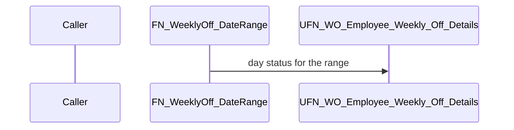
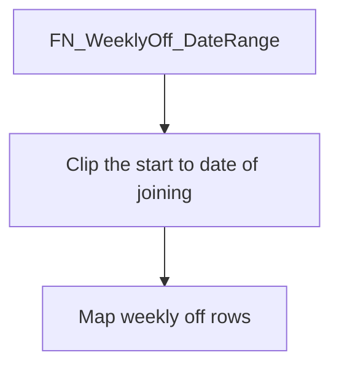

# FN_WeeklyOff_DateRange

## What it does

Returns one row per calendar day from the employee weekly-off function. The start date is moved forward to the date of joining when the requested start is earlier. Weekly off is marked, and half-day weekly off is stored as attendance 0.5.

## Parameters

| Name | Direction | What it is for |
|---|---|---|
| `@lYear` | in | Year text. The body uses the date range rather than this value |
| `@EmployeeID` | in | Employee |
| `@lv_Employerid` | in | Employer passed to the weekly-off function |
| `@FromDate` | in | Range start |
| `@ToDate` | in | Range end |

## Call sequence

## Callers

Procedures and functions that call this object.

| Object | Kind | Page |
|---|---|---|
| `FN_CM_GetEmployeeCalendarDetails_AttendanceCal_SP` | function | No page yet |
| `SP_DocumentGen_MailToEmp` | procedure | No page yet |
| `SP_InsertEmpDocGeneratedDetailsNew` | procedure | [SP_InsertEmpDocGeneratedDetailsNew](/docs/database/hrms/SP_InsertEmpDocGeneratedDetailsNew) |
| `SP_InsertTimlineEmpDocGeneratedDetails` | procedure | [SP_InsertTimlineEmpDocGeneratedDetails](/docs/database/hrms/SP_InsertTimlineEmpDocGeneratedDetails) |
| `SP_UpdateEmpDocGeneratedDetails` | procedure | [SP_UpdateEmpDocGeneratedDetails](/docs/database/hrms/SP_UpdateEmpDocGeneratedDetails) |

## Nested

| Object | Kind | When | Page |
|---|---|---|---|
| `UFN_WO_Employee_Weekly_Off_Details` | function | day status for the range | [UFN_WO_Employee_Weekly_Off_Details](/docs/database/hrms/UFN_WO_Employee_Weekly_Off_Details) |

## Steps

1. Read date of joining and raise `@FromDate` to that date when needed (`FN_WeeklyOff_DateRange.sql`).
2. Read `UFN_WO_Employee_Weekly_Off_Details` for the range.
3. Map weekly off and half-day weekly off onto attendance status and the weekly-off flag.

## Tables

| Table | Read or write |
|---|---|
| `dbo.TEmployeeInfo` | read |

## Flow

