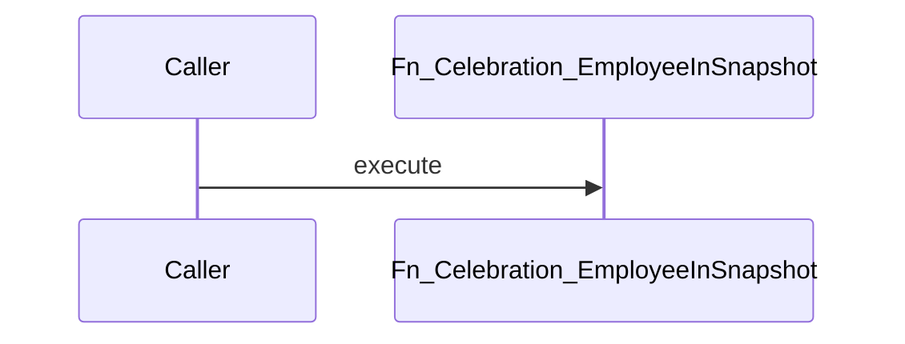
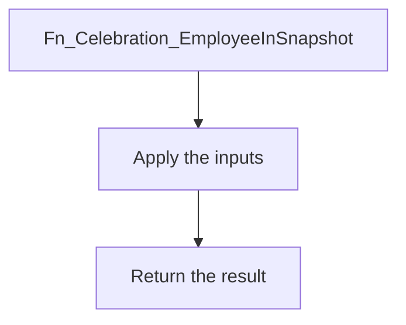

# Fn_Celebration_EmployeeInSnapshot

## What it does

Helper called by a Home dashboard procedure. It reads its inputs and returns that result to its caller.

## Parameters

| Name | Direction | What it is for |
|---|---|---|
| `@EmployeeIds` | in | Input used by this procedure (`VARBINARY(MAX)`) |
| `@EmployeeId` | in | Employee the Home screen is loading or acting for (`INT`) |

## Call sequence

## Callers

| Object | Kind | Page |
|---|---|---|
| `SP_Celebration_ActorInAudience` | procedure | No page yet |
| `SP_Celebration_BroadcastResolve` | procedure | No page yet |
| `SP_Celebration_DashboardTicker` | procedure | [SP_Celebration_DashboardTicker](/docs/database/hrms/SP_Celebration_DashboardTicker) |
| `SP_Celebration_FeedCategoryUnreadCounts` | procedure | No page yet |
| `SP_Celebration_FeedList` | procedure | [SP_Celebration_FeedList](/docs/database/hrms/SP_Celebration_FeedList) |
| `SP_Celebration_PublishedMilestoneLookup` | procedure | No page yet |
| `SP_GetHomeNewsAndEvents` | procedure | [SP_GetHomeNewsAndEvents](/docs/database/hrms/SP_GetHomeNewsAndEvents) |

## Nested

This object does not execute another procedure or user-defined function.

## Steps

In `HRMS-DATABASE/HRMS/FUNCTIONS/Fn_Celebration_EmployeeInSnapshot.sql`:

1. Return the result set to the caller.

## Tables

No permanent table is read or written. The result comes from parameters, functions, or table variables.

## Flow

