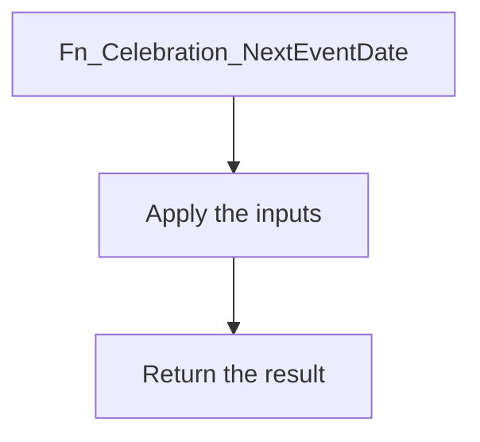

# Fn_Celebration_NextEventDate

## What it does

Table-valued helper that returns the next calendar occurrence of a source month/day on or after AsOfDate.

## Parameters

| Name | Direction | What it is for |
|---|---|---|
| `@SourceDate` | in | Input (`DATE,`) |
| `@AsOfDate` | in | Input (`DATE`) |

## Call sequence

Calls no other procedures or functions.

## Callers

| Object | Kind | Page |
|---|---|---|
| `SP_Celebration_EmployeeEventDate` | procedure | [SP_Celebration_EmployeeEventDate](/docs/database/hrms/SP_Celebration_EmployeeEventDate) |
| `SP_Celebration_GetEmailPayload` | procedure | No page yet |
| `SP_Celebration_ListAutoScheduleCandidates` | procedure | No page yet |
| `SP_Celebration_MilestoneList` | procedure | [SP_Celebration_MilestoneList](/docs/database/hrms/SP_Celebration_MilestoneList) |
| `SP_Celebration_PublishOrCancel` | procedure | No page yet |

## Nested

Calls no other procedures or functions.

## Steps

In `HRMS-DATABASE/HRMS/FUNCTIONS/Fn_Celebration_NextEventDate.sql`:

1. Table-valued helper that returns the next calendar occurrence of a source month/day on or after AsOfDate.

## Tables

No base tables referenced (expression-only or pass-through).

## Flow

