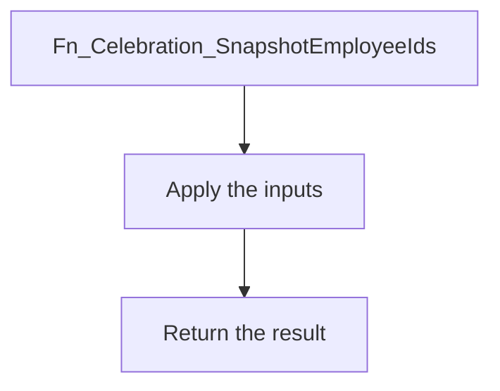

# Fn_Celebration_SnapshotEmployeeIds

## What it does

Table-valued helper that expands a snapshot EmployeeIds payload into employee id rows.

## Parameters

| Name | Direction | What it is for |
|---|---|---|
| `@EmployeeIds` | in | Input (`VARBINARY(MAX)`) |

## Call sequence

Calls no other procedures or functions.

## Callers

| Object | Kind | Page |
|---|---|---|
| `SP_Celebration_BroadcastGet` | procedure | [SP_Celebration_BroadcastGet](/docs/database/hrms/SP_Celebration_BroadcastGet) |
| `SP_Celebration_BroadcastList` | procedure | [SP_Celebration_BroadcastList](/docs/database/hrms/SP_Celebration_BroadcastList) |
| `SP_Celebration_ReadAudienceList` | procedure | [SP_Celebration_ReadAudienceList](/docs/database/hrms/SP_Celebration_ReadAudienceList) |
| `SP_Celebration_ResolveAudienceEmployees` | procedure | No page yet |

## Nested

Calls no other procedures or functions.

## Steps

In `HRMS-DATABASE/HRMS/FUNCTIONS/Fn_Celebration_SnapshotEmployeeIds.sql`:

1. Table-valued helper that expands a snapshot EmployeeIds payload into employee id rows.

## Tables

No base tables referenced (expression-only or pass-through).

## Flow

