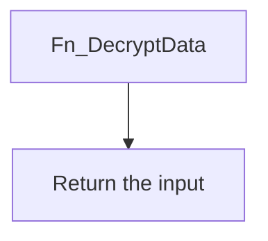

# Fn_DecryptData

## What it does

Returns the input string unchanged. A commented block below the live body would decrypt with `DecryptByKey` and `FN_ConvertBase64ToSTR`. That block is not part of the function.

## Parameters

| Name | Direction | What it is for |
|---|---|---|
| `@ValueToDecrypt` | in | `VARCHAR(MAX)` value the function returns as-is |

## Call sequence

Calls no other procedures or functions.

## Callers

| Object | Kind | Page |
|---|---|---|
| `FN_EmployeeFullName` | function | No page yet |
| `Fn_GetAllEmployeeNames_CommaSeparated` | function | No page yet |
| `Fn_GetAssetManagerNames_CommaSeparated` | function | No page yet |
| `Fn_GetEmployeeFirstName` | function | No page yet |
| `Get_RecruitmentCandidate_SalaryStructure` | procedure | No page yet |
| `Hrms_Sp_DailyAttendanceReport` | procedure | No page yet |
| `Hrms_Sp_DailyAttendanceReport_DP` | procedure | No page yet |
| `SP_AddMyDetailsChanges` | procedure | No page yet |
| `Sp_AdminEMP_CopyEmployee` | procedure | No page yet |
| `SP_AdminEMP_EmployeeSearch` | procedure | No page yet |
| `SP_AdminEMP_GetEmpListByOrg` | procedure | No page yet |
| `SP_AdminLM_GetEmpByLeaveType` | procedure | No page yet |
| `SP_AdminRM_GetEmployeeListByOrg` | procedure | No page yet |
| `SP_BGV_GetHomePageVerificationDet` | procedure | No page yet |
| `SP_BGV_GetVerificationDet` | procedure | No page yet |
| `SP_BGV_GetVerificationViewDet` | procedure | No page yet |
| `Sp_BGV_UpdateDocumentUploadInfo` | procedure | No page yet |
| `Sp_BGV_UpdateVerification` | procedure | No page yet |
| `SP_BulkProfile_AddMyDetailsChanges` | procedure | No page yet |
| `Sp_CM_DirectIndirectReports` | procedure | No page yet |
| `SP_CM_GetEmployeeFullInformation` | procedure | No page yet |
| `SP_CM_GetEmployeeListByOrganization` | procedure | No page yet |
| `SP_CM_GetEmployeeSummaryData` | procedure | No page yet |
| `sp_CopyEmployee` | procedure | No page yet |
| `Sp_DailyAttendanceReport_New` | procedure | No page yet |
| `Sp_DirectIndirectReports` | procedure | No page yet |
| `Sp_EC_SentBirthdayWorkAnnNotification` | procedure | No page yet |
| `SP_EC_UpdateEmployeePersonalInformation` | procedure | No page yet |
| `SP_EmployeeSearch` | procedure | No page yet |
| `SP_EmployeeSelfService_VoucherRequestStatus` | procedure | No page yet |
| `SP_EmployeeSelfService_VoucherRequestStatus_GlobalFilter` | procedure | No page yet |
| `SP_EmployeeWorkflowFilterSearch` | procedure | No page yet |
| `SP_EMPMD_AddEmpPassportDet` | procedure | No page yet |
| `Sp_EMPMD_GetEmpHistory` | procedure | No page yet |
| `SP_EMPMD_GetEmpPassportHistData` | procedure | No page yet |
| `SP_EMPMD_GetEmpPersonalInfoHistData` | procedure | No page yet |
| `SP_EMPMD_GetEmpSummaryData` | procedure | No page yet |
| `SP_EMPMD_GetPassportDet` | procedure | No page yet |
| `Sp_EMPMD_GetSpecificFutureEmpinfo` | procedure | No page yet |
| `SP_GET_TEmpSalary` | procedure | No page yet |
| `SP_GetActualOfficeWorkingTimeForAllEmployeeInDateRange` | procedure | No page yet |
| `SP_GetAllEmployeeListByOrganization` | procedure | No page yet |
| `SP_GetAllResignationByTemplateId` | procedure | No page yet |
| `SP_GetAttendanceNotificationForEmail` | procedure | No page yet |
| `SP_GetCheckinCheckoutTimeForAllEmployee` | procedure | No page yet |
| `SP_GetDuplicatePANInfo` | procedure | No page yet |
| `Sp_GetEmpActualWorkingHrs` | procedure | No page yet |
| `Sp_GetEmpAttendanceDetailsScheduler` | procedure | No page yet |
| `Sp_GetEmpBirthDayAnniversaryDetails_DP` | procedure | No page yet |
| `Sp_GetEmpBirthDayAnniversaryDetails_Mobile` | procedure | No page yet |
| `SP_GetEmployeeByLeaveType` | procedure | No page yet |
| `SP_GetEmployeeDetailsForCompensation` | procedure | No page yet |
| `SP_GetEmployeeFullInformation` | procedure | No page yet |
| `Sp_GetEmployeeHistory` | procedure | No page yet |
| `SP_GetEmployeeInformation` | procedure | No page yet |
| `SP_GetEmployeeLetterDetails` | procedure | No page yet |
| `SP_GetEmployeeList` | procedure | No page yet |
| `SP_GetEmployeeListByOrg` | procedure | No page yet |
| `SP_GetEmployeeListByOrganization` | procedure | No page yet |
| `SP_GetEmployeeListWithNoLeaveAssigned` | procedure | No page yet |
| `SP_GetEmployeePassportHistoryData` | procedure | No page yet |
| `SP_GetEmployeePersonalInfoHistoryData` | procedure | No page yet |
| `SP_GetEmployeePersonalInformation` | procedure | No page yet |
| `SP_GetEmployeeSalaryStructure` | procedure | No page yet |
| `SP_GetEmployeeSalaryStructure_History` | procedure | No page yet |
| `SP_GetEmployeeSalaryStructure_Pivot` | procedure | No page yet |
| `SP_GetEmployeeSummaryData` | procedure | No page yet |
| `Sp_GetEmpSummaryRpt` | procedure | No page yet |
| `SP_GetNotificationDetails` | procedure | No page yet |
| `SP_GetNotificationDetailsBKP03052025` | procedure | No page yet |
| `SP_GetPassportDetails` | procedure | No page yet |
| `SP_GetPayrollSubmitDetails` | procedure | No page yet |
| `SP_GETPoisePayrollHrEmployeeFullInfo` | procedure | No page yet |
| `Sp_GetSpecificFutureEmployeeinfo` | procedure | No page yet |
| `Sp_GetSupportcontactdetailsbyid` | procedure | No page yet |
| `SP_GetZenx_PayrollHrEmployeeFullInfo` | procedure | No page yet |
| `SP_LA_Validate_HourlyBasedLeave` | procedure | No page yet |
| `SP_LA_ValidateLeaveRequest` | procedure | No page yet |
| `SP_LA_ValidateLeaveRequest_dp` | procedure | No page yet |
| `SP_LA_ValidateLeaveRequest_New` | procedure | No page yet |
| `SP_Mob_AddTempLocationDetails` | procedure | No page yet |
| `SP_Mydetails_Enhanced_AddEmpPassportDet` | procedure | No page yet |
| `SP_Mydetails_Enhanced_UpdateEmployeePersonalInformation` | procedure | [SP_Mydetails_Enhanced_UpdateEmployeePersonalInformation](/docs/database/hrms/SP_Mydetails_Enhanced_UpdateEmployeePersonalInformation) |
| `SP_PMS_GetEmployeeAppraisalReport` | procedure | No page yet |
| `SP_RPT_AttendanceReport_ByDate` | procedure | No page yet |
| `SP_RPT_EmpCompetency` | procedure | No page yet |
| `SP_RPT_EmpSkillSummary` | procedure | No page yet |
| `SP_RPT_FPF_GetDisciplineRecords` | procedure | No page yet |
| `SP_RPT_GetActOffWorkingTimeForAllEmp` | procedure | No page yet |
| `SP_RPT_Leave_ByDate` | procedure | No page yet |
| `SP_Saralapi_GetUpdPageEmployeeDetails` | procedure | No page yet |
| `SP_SEP_GetAllResignationByTemplateId` | procedure | No page yet |
| `SP_SEP_GetAllSubmittedResignations` | procedure | No page yet |
| `Sp_SEP_GetAutoExitInterviewMappedEmployees` | procedure | No page yet |
| `Sp_UserAccessRights_Rpt` | procedure | No page yet |
| `sp_vw_AttendanceRegularizationSummaryReports` | procedure | No page yet |
| `SP_vw_EmplEstablishmentDetailsyeeFullInfoReports_TDG_PROD_BY_DP` | procedure | No page yet |
| `SP_vw_EmployeeFullInfoReports` | procedure | No page yet |
| `SP_vw_EmployeeFullInfoReports_dev` | procedure | No page yet |
| `SP_vw_LeaveLedgerReport` | procedure | No page yet |
| `SP_vw_LeaveSummaryReports` | procedure | No page yet |
| `SP_vw_WorkFromHomeSummaryReports` | procedure | No page yet |
| `USP_AttendanceOverTime_Report` | procedure | No page yet |
| `USP_ClaimCompOff_Report` | procedure | No page yet |
| `USP_ClaimLocum_Report` | procedure | No page yet |
| `USP_ClaimOT_Detail_Report` | procedure | No page yet |
| `USP_ClaimOT_Summary_Report` | procedure | No page yet |
| `USP_ClaimPH_Report` | procedure | No page yet |
| `USP_CM_GetEmployeeInformation` | procedure | No page yet |
| `USP_COB_ProcessTEmployeeInfo` | procedure | No page yet |
| `USP_DayWiseAttendance` | procedure | No page yet |
| `USP_EmployeeFullInfoReports` | procedure | No page yet |
| `USP_Get_AttendanceReportForIASYS` | procedure | No page yet |
| `USP_GetAttendanceForPayroll` | procedure | No page yet |
| `USP_GetCurrentYearJoinedEmployee` | procedure | No page yet |
| `USp_GetEmpAttendanceDetails_V2` | procedure | No page yet |
| `USP_GetEmpListByOrgBU` | procedure | No page yet |
| `USP_GetFPFEmailNotification` | procedure | No page yet |
| `USP_GetManagerList` | procedure | No page yet |
| `USP_HrmstoHive_GetUpdatedEmployeeDetails` | procedure | No page yet |
| `USP_LA_ValidateLeaveRequest` | procedure | No page yet |
| `USP_LA_ValidateLeaveRequest_Import` | procedure | No page yet |
| `USP_LE_Report` | procedure | No page yet |
| `USP_OT_OTRequest_OverTime_Report` | procedure | No page yet |
| `USP_OT_OTRequest_Preapproval_Report` | procedure | No page yet |
| `USP_OT_PreApproved_DayWise_Report` | procedure | No page yet |
| `USP_Report_EmployeeInfo_EducationCertification` | procedure | No page yet |
| `USP_Report_EmployeeInfo_PolicyDocuments` | procedure | No page yet |
| `USP_Report_Leave_LeaveEncashmment` | procedure | No page yet |
| `USP_Report_Leave_LeaveLedger` | procedure | No page yet |
| `USP_Report_Leave_LeaveRange` | procedure | No page yet |
| `USP_Report_Leave_LeaveReport` | procedure | No page yet |
| `USP_Report_Leave_LeaveSummary` | procedure | No page yet |
| `USP_Report_TimeAttendance_OptionalHoliday` | procedure | No page yet |
| `USP_Report_TimeAttendance_Overtime_DayWise` | procedure | No page yet |
| `USP_Report_TimeAttendance_OverTime_Detail` | procedure | No page yet |
| `USP_Report_TimeAttendance_Overtime_Planned` | procedure | No page yet |
| `USP_Report_TimeAttendance_OverTime_Summary` | procedure | No page yet |
| `USP_Report_TimeAttendance_WorkFromHomeSummary` | procedure | No page yet |
| `USP_RPT_GetDraftPayrollOrganization` | procedure | No page yet |
| `USP_Saralapi_GetUpdPageEmployeeDetails` | procedure | No page yet |
| `USP_Saralapi_GetUpdPageEmployeeDetails_Fiji` | procedure | No page yet |
| `USP_Saralapi_GetUpdPageEmployeeDetails_SPTest` | procedure | No page yet |
| `usp_vw_BirthdayNotification` | procedure | No page yet |
| `usp_vw_EmployeeWelcomeMail` | procedure | No page yet |
| `usp_vw_EndOfContractDetails` | procedure | No page yet |
| `usp_Vw_PrePostEmpBackgroundVerification` | procedure | No page yet |
| `usp_vw_RRSScheduleInterview` | procedure | No page yet |
| `usp_vw_TerminationUserAccountEnableDisable` | procedure | No page yet |
| `usp_vw_UserAccountEnableDisable` | procedure | No page yet |
| `usp_Vw_VoucherApplied` | procedure | No page yet |
| `usp_vw_WorkAnniversaryNotification` | procedure | No page yet |
| `uspProcessTEmployeeInfo_New` | procedure | No page yet |

## Nested

Calls no other procedures or functions.

## Steps

In `HRMS-DATABASE/HRMS/FUNCTIONS/Fn_DecryptData.sql`:

1. Return `@ValueToDecrypt`.

## Tables

| Table | Read or write |
|---|---|
| — | The function does not read or write a table |

## Flow

