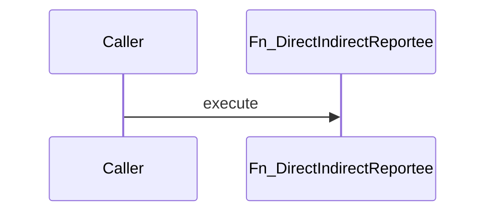
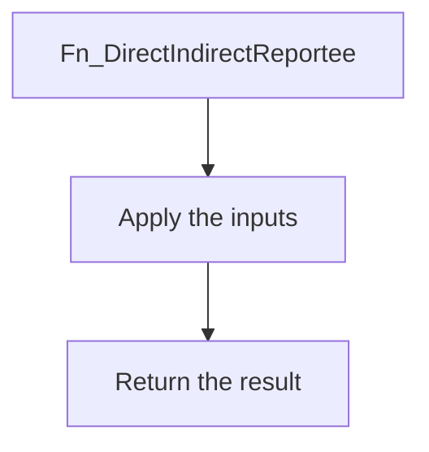

# Fn_DirectIndirectReportee

## What it does

Helper called by a Home dashboard procedure. It reads TORGChart, tEmployee, TEmployeeInfo, TRoles and returns that result to its caller.

## Parameters

| Name | Direction | What it is for |
|---|---|---|
| `@EmployeeId` | in | Employee the Home screen is loading or acting for (`int`) |
| `@RankLevel` | in | Input used by this procedure (`int`) |

## Call sequence

## Callers

| Object | Kind | Page |
|---|---|---|
| `OV_Rule_MasterSP` | procedure | [OV_Rule_MasterSP](/docs/database/hrms/OV_Rule_MasterSP) |
| `SP_AdminPMS_GetEmpByAppraisalCycle` | procedure | No page yet |
| `SP_Advances_GetAdvanceDetails` | procedure | No page yet |
| `SP_CheckIsEmployeeApprover` | procedure | [SP_CheckIsEmployeeApprover](/docs/database/hrms/SP_CheckIsEmployeeApprover) |
| `SP_CheckIsEmployeeReport` | procedure | No page yet |
| `SP_CM_GetNotificationCnt_04042023` | procedure | No page yet |
| `SP_CM_GetNotificationCnt_10072023` | procedure | No page yet |
| `SP_CM_GetNotificationCnt_101` | procedure | No page yet |
| `SP_CM_GetNotificationCnt_82724` | procedure | No page yet |
| `SP_CM_GetNotificationCnt_HT_NEW` | procedure | No page yet |
| `SP_CM_GetNotificationCnt_new` | procedure | No page yet |
| `SP_CM_GetNotificationCnt_newdp` | procedure | No page yet |
| `SP_CM_GetNotificationCnt_TST_DP` | procedure | No page yet |
| `SP_CM_GetNotificationCnt_V1` | procedure | No page yet |
| `SP_CM_GetNotificationCnt_V2` | procedure | No page yet |
| `SP_CM_GetNotificationCnt_version4232025` | procedure | No page yet |
| `SP_CM_GetNotificationCnt20230607` | procedure | No page yet |
| `SP_CM_GetNotificationCntBKP03052025` | procedure | No page yet |
| `Sp_CMS_GetConfirmationEmpRole` | procedure | No page yet |
| `Sp_CMS_GetConfStatusEmployeeListForExtract` | procedure | No page yet |
| `Sp_CMS_GetEmployeeListForExtract` | procedure | No page yet |
| `SP_CMS_GetPastTeamAppraisalAssessment` | procedure | No page yet |
| `SP_DayWiseAttendance` | procedure | No page yet |
| `SP_Geo_GetEmployeeList` | procedure | No page yet |
| `Sp_Geo_GetEmpTrackingByTripID_Opt` | procedure | No page yet |
| `Sp_Geo_GetEmpTrackingByTripID_OptV2` | procedure | No page yet |
| `Sp_Geo_GetEmpTrackLocationRports` | procedure | No page yet |
| `Sp_Geo_GetReporteesLastKnownLocation` | procedure | No page yet |
| `SP_Get_MyTeamCard_DirectReportees` | procedure | [SP_Get_MyTeamCard_DirectReportees](/docs/database/hrms/SP_Get_MyTeamCard_DirectReportees) |
| `SP_Get_MyTeamCard_InDirectReportees` | procedure | [SP_Get_MyTeamCard_InDirectReportees](/docs/database/hrms/SP_Get_MyTeamCard_InDirectReportees) |
| `Sp_GetConfirmationemployee_EmployeeRole` | procedure | No page yet |
| `Sp_GetEmpAttendanceDetails` | procedure | No page yet |
| `SP_GetGeoAttendanceRequestList` | procedure | No page yet |
| `SP_GetHomePageEmpDirectory` | procedure | No page yet |
| `SP_GetHomePageEmpDirectoryNew` | procedure | [SP_GetHomePageEmpDirectoryNew](/docs/database/hrms/SP_GetHomePageEmpDirectoryNew) |
| `SP_GetHRHelpDeskRequestStatus` | procedure | No page yet |
| `Sp_GetPMSAppraisalCycle_EmployeeRole` | procedure | No page yet |
| `Sp_GetPMSAppraisalEmployees_AppraisalCycleID` | procedure | No page yet |
| `SP_GetTeamAttendanceDetails` | procedure | No page yet |
| `SP_GetTeamAttendanceDetailsNew` | procedure | [SP_GetTeamAttendanceDetailsNew](/docs/database/hrms/SP_GetTeamAttendanceDetailsNew) |
| `SP_GetTeamLeaveCard` | procedure | [SP_GetTeamLeaveCard](/docs/database/hrms/SP_GetTeamLeaveCard) |
| `SP_GetTeamLeaveCard_DP` | procedure | No page yet |
| `SP_GetTeamMonthlyLeavePlan` | procedure | No page yet |
| `SP_GETTEAMRESIGNATIONDETAILSBKP03052025` | procedure | No page yet |
| `Sp_PMS_GetAppraisalCycleEmpRole` | procedure | No page yet |
| `Sp_PMS_GetAppraisalEmpByCycleID` | procedure | No page yet |
| `Sp_PMS_GetAppraisalEmpByCycleID_Old` | procedure | No page yet |
| `Sp_PMS_GetAssaessmentForFormstatusByEmployeeRole` | procedure | No page yet |
| `Sp_PMS_GetAssessmentDashboardCycleByEmpRole` | procedure | No page yet |
| `SP_PMS_GetAssessmentEmployeeData` | procedure | No page yet |
| `Sp_PMS_GetGoalDashboardByEmpRole` | procedure | No page yet |
| `SP_PMS_GetNineBoxAssessmentList` | procedure | No page yet |
| `SP_PMS_GetNineBoxAssessmentMatrix` | procedure | No page yet |
| `SP_PMS_GetPastAppraisalAssessment` | procedure | No page yet |
| `SP_PMS_GetPreviousAppraisalRecurings` | procedure | No page yet |
| `SP_Report_TimeAndAttendance_LateInEarlyOutReport` | procedure | No page yet |
| `SP_RPT_EmpCheckInCheckOut` | procedure | No page yet |
| `SP_RPT_Leave_ByDate` | procedure | No page yet |
| `SP_RRS_GetCandidateDashboardNEW` | procedure | No page yet |
| `SP_TNE_GetPayExpenseReportDetails` | procedure | No page yet |
| `Sp_TR_GetEmployeeTeamMembers` | procedure | No page yet |
| `Sp_TS_GetEmployeeCapacityDetails` | procedure | No page yet |
| `Sp_TS_GetEmpTimeSheetMonthWiseReport` | procedure | No page yet |
| `Sp_TS_GetEmpTimeSheetMonthWiseReport_Aj` | procedure | No page yet |
| `Sp_TS_GetProjectSDLCchart` | procedure | No page yet |
| `SP_TS_GetTeamTimePortDetails` | procedure | [SP_TS_GetTeamTimePortDetails](/docs/database/hrm-timeport/SP_TS_GetTeamTimePortDetails) |
| `Sp_TS_GetTimeSheetApprovalPageDetails` | procedure | No page yet |
| `Sp_TS_GetTimeSheetSummary` | procedure | No page yet |
| `sp_vw_AttendanceRegularizationSummaryReports` | procedure | No page yet |
| `SP_vw_LeaveLedgerReport` | procedure | No page yet |
| `SP_vw_LeaveSummaryReports` | procedure | No page yet |
| `SP_vw_WorkFromHomeSummaryReports` | procedure | No page yet |
| `USP_ClaimOT_Summary_Report` | procedure | No page yet |
| `USP_DirectIndirectReportee` | procedure | No page yet |
| `USP_Employee_List_By_Role` | procedure | No page yet |
| `USP_EmployeeListByEmployers` | procedure | No page yet |
| `USP_GeoTracking_EmployeeList` | procedure | No page yet |
| `USP_GetAttendanceForPayroll` | procedure | No page yet |
| `USP_GetEmployeeReporteeRelation` | procedure | No page yet |
| `USP_GetTerminationRecommendations` | procedure | No page yet |
| `USP_OT_OTRequest_PreApproval_Report` | procedure | No page yet |
| `USP_Report_Leave_GetAccessibleEmployees` | procedure | No page yet |
| `Usp_Sch_SendTimeSheetDetailsEmail` | procedure | No page yet |
| `USP_TFN_TimesheetTaskDurationSummaryHistory` | procedure | No page yet |
| `USP_TimesheetTaskDurationSummaryHistoryReport` | procedure | No page yet |
| `USP_TM_EmployeeHasReportees` | procedure | No page yet |
| `USP_TM_GetEmployeeName` | procedure | No page yet |
| `USP_TS_GetEmpTimeSheetReportByDaily_Summary` | procedure | No page yet |
| `USP_TS_GetEmpTimeSheetReportByDateRange` | procedure | No page yet |
| `USP_TTSEmpTimeSheet_TaskDuration` | procedure | No page yet |

## Nested

This object does not execute another procedure or user-defined function.

## Steps

In `HRMS-DATABASE/HRMS/FUNCTIONS/Fn_DirectIndirectReportee.sql`:

1. Read `TORGChart`, `tEmployee`, `TEmployeeInfo`, `TRoles`, `TUsers`, `TUserEmployee`.
2. Return the result set to the caller.

## Tables

| Table | Read or write |
|---|---|
| `TORGChart` | read |
| `tEmployee` | read |
| `TEmployeeInfo` | read |
| `TRoles` | read |
| `TUsers` | read |
| `TUserEmployee` | read |

## Flow

