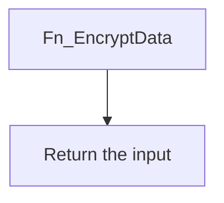

# Fn_EncryptData

## What it does

Returns the input string unchanged. Commented lines in the body would encrypt with `EncryptByKey` on `Encryption_Symmetric_Key` after `FN_ConvertSTRToBase64`. Those lines are not executed.

## Parameters

| Name | Direction | What it is for |
|---|---|---|
| `@ValueToEncrypt` | in | `VARCHAR(MAX)` value the function returns as-is |

## Call sequence

Calls no other procedures or functions.

## Callers

| Object | Kind | Page |
|---|---|---|
| `SP_AddEmployeePassportDetails` | procedure | No page yet |
| `SP_AdminPMS_EmployeeGoalSettingSearch` | procedure | No page yet |
| `SP_AdminPMS_EmployeeSearch` | procedure | No page yet |
| `SP_AdminUM_CreateUser` | procedure | No page yet |
| `Sp_BGV_InsertVerification` | procedure | No page yet |
| `SP_Bulk_AddNewEmployee` | procedure | No page yet |
| `SP_CheckIfEmployeeExists` | procedure | No page yet |
| `SP_CreateUser` | procedure | No page yet |
| `SP_EC_AddNewEmployee` | procedure | No page yet |
| `SP_EC_AddNewEmployeeImport` | procedure | No page yet |
| `SP_EC_CheckIfEmployeeExists` | procedure | No page yet |
| `SP_EC_ImportPOBEmployeeData` | procedure | No page yet |
| `SP_EC_UpdateEmployeePersonalInformation` | procedure | No page yet |
| `SP_EMPMD_AddEmpPassportDet` | procedure | No page yet |
| `SP_EMPMD_CheckIfEmployeeExists` | procedure | No page yet |
| `SP_GetExitInterviewAnsByEmp` | procedure | No page yet |
| `SP_GetPMSEmployeeAppraisalReport` | procedure | No page yet |
| `SP_Import_Employee_data` | procedure | No page yet |
| `SP_Import_Employee_data_Fiji` | procedure | No page yet |
| `SP_Insert_TDailyRegisterNew` | procedure | No page yet |
| `SP_Mydetails_Enhanced_AddEmpPassportDet` | procedure | No page yet |
| `SP_Mydetails_Enhanced_UpdateEmployeePersonalInformation` | procedure | [SP_Mydetails_Enhanced_UpdateEmployeePersonalInformation](/docs/database/hrms/SP_Mydetails_Enhanced_UpdateEmployeePersonalInformation) |
| `SP_PMS_GetEmployeeAppraisalReport` | procedure | No page yet |
| `SP_PMS_GETPMSAssessmentExportReportRequestData` | procedure | No page yet |
| `SP_PMS_GETPMSAssessmentReportRequestData` | procedure | No page yet |
| `SP_PMS_ParkPMSEmployeeAppraisalReportData` | procedure | No page yet |
| `SP_UpdateDailyRegisterNew_HT` | procedure | No page yet |
| `USP_COB_ProcessTEmployeeInfo` | procedure | No page yet |
| `uspProcessTEmployeeInfo_New` | procedure | No page yet |

## Nested

Calls no other procedures or functions.

## Steps

In `HRMS-DATABASE/HRMS/FUNCTIONS/Fn_EncryptData.sql`:

1. Return `@ValueToEncrypt`.

## Tables

| Table | Read or write |
|---|---|
| — | The function does not read or write a table |

## Flow

