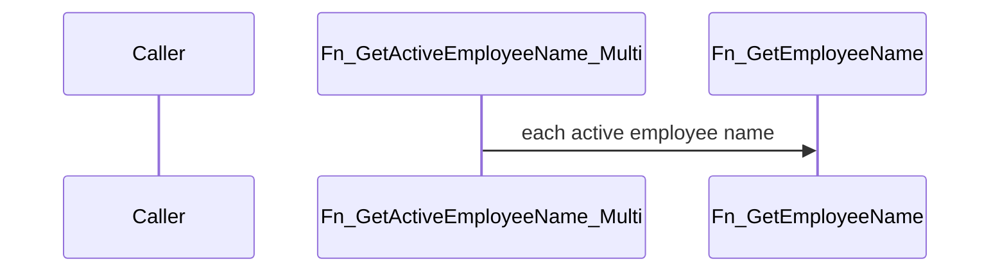
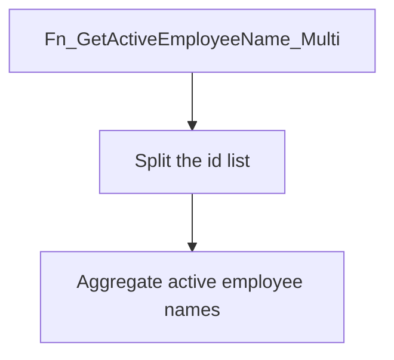

# Fn_GetActiveEmployeeName_Multi

## What it does

Turns a comma-separated employee id list into a comma-separated list of active employee names. Inactive ids are dropped. An empty list returns an empty string.

## Parameters

| Name | Direction | What it is for |
|---|---|---|
| `@EmployeeIds` | in | Comma-separated employee ids |

## Call sequence

## Callers

Procedures and functions that call this object.

| Object | Kind | Page |
|---|---|---|
| `SP_GetHRHelpDeskNotification` | procedure | No page yet |
| `SP_GetHRHelpDeskRequestStatus` | procedure | No page yet |
| `SP_HelpDeskGroup` | procedure | [SP_HelpDeskGroup](/docs/database/hrms/SP_HelpDeskGroup) |
| `SP_HelpDeskGroup_Category` | procedure | [SP_HelpDeskGroup_Category](/docs/database/hrms/SP_HelpDeskGroup_Category) |
| `SP_HelpDeskGroup_Category_Activity` | procedure | [SP_HelpDeskGroup_Category_Activity](/docs/database/hrms/SP_HelpDeskGroup_Category_Activity) |

## Nested

| Object | Kind | When | Page |
|---|---|---|---|
| `Fn_GetEmployeeName` | function | each active employee name | [Fn_GetEmployeeName](/docs/database/hrms/Fn_GetEmployeeName) |

## Steps

1. Split `@EmployeeIds` (`Fn_GetActiveEmployeeName_Multi.sql`).
2. Keep ids that match an active `TEmployee` row.
3. Aggregate `Fn_GetEmployeeName` for those ids.

## Tables

| Table | Read or write |
|---|---|
| `dbo.TEmployee` | read |

## Flow

