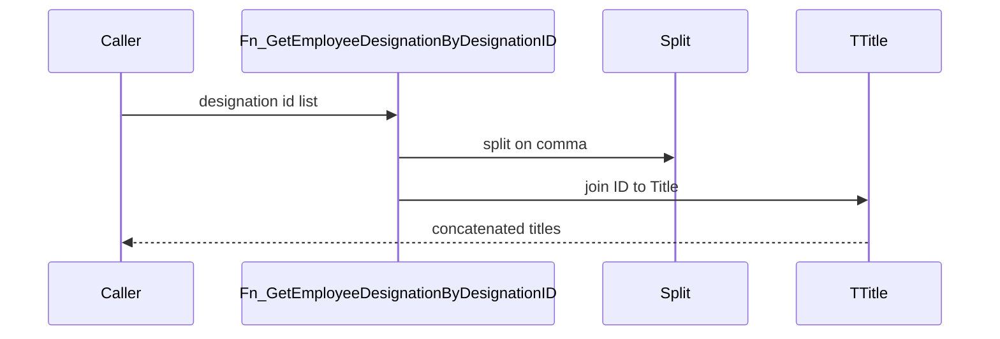
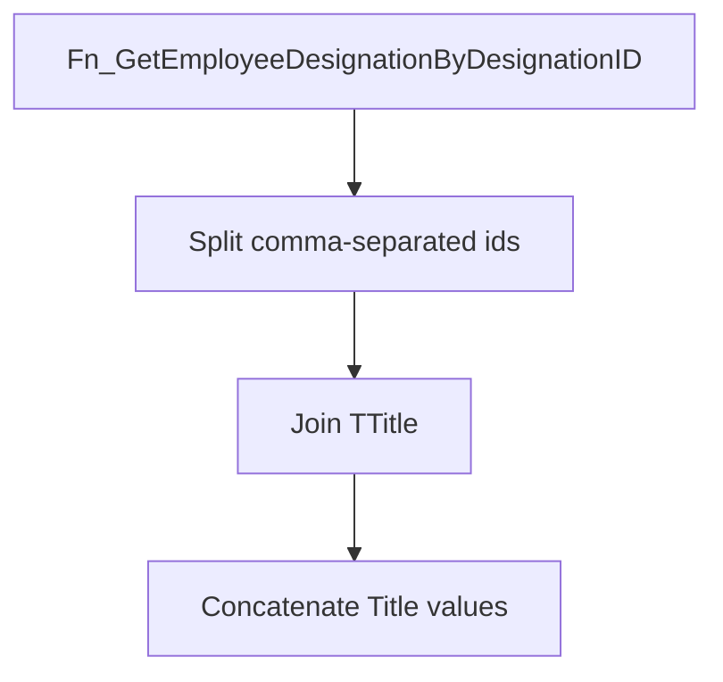

# Fn_GetEmployeeDesignationByDesignationID

## What it does

Scalar function. Accepts a comma-separated list of designation / title ids, splits them, joins each id to `TTitle`, and returns a single comma-concatenated string of `Title` values. Used by Appraisal Due (and older due-list procedures) to display `EmployeeDesignation` from `TEmployeeInfo.DesignationId`.

## Parameters

| Name | Direction | What it is for |
|---|---|---|
| `@EmployeeDesignation` | in | Comma-separated title ids (`TTitle.ID`) |

Returns `VARCHAR(MAX)` — the concatenated title string (or null when nothing matches).

## Call sequence

## Callers

| Object | Kind | Page |
|---|---|---|
| `SP_PMS_GetAppraisalCycleDueList_UI` | procedure | [SP_PMS_GetAppraisalCycleDueList_UI](/docs/database/hrms/SP_PMS_GetAppraisalCycleDueList_UI) |
| `SP_PMS_GetAppraisalCycleDueList` | procedure | No page yet |
| `SP_PMS_GetAppraisalCycleDueList_New` | procedure | No page yet |

Other callers may exist outside the PMS due-list scripts; the rows above are the Appraisal Due family.

## Nested

| Object | Kind | When | Page |
|---|---|---|---|
| `Split` | function | parse id list | [Split](/docs/database/hrms/Split) |

## Steps

1. In `HRMS-DATABASE/HRMS/FUNCTIONS/Fn_GetEmployeeDesignationByDesignationID.sql`, insert split ids from `dbo.Split(@EmployeeDesignation, ',')` into a table variable.
2. Join those ids to `TTitle` on `ID`.
3. Concatenate `Title` values with `COALESCE(@listStr + ',', '') + B.Title`.
4. Return `@listStr`.

## Tables

| Table | Read or write |
|---|---|
| `dbo.TTitle` | read |

## Unresolved calls

None.

## Flow

