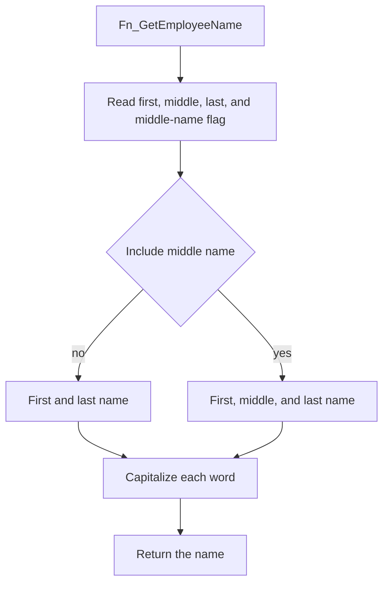

# Fn_GetEmployeeName

## What it does

Builds an employee's display name from first, optional middle, and last name, then capitalizes each word. The modification history says the decrypted-function call was removed on 19 June 2026. The script drops the function and creates it again.

## Parameters

| Name | Direction | What it is for |
|---|---|---|
| `@EmployeeID` | in | Employee whose name is read |

## Call sequence

Calls no other procedures or functions.

## Callers

| Object | Kind | Page |
|---|---|---|
| `Alter_SP_RPT_EmpCheckInCheckOut` | procedure | No page yet |
| `dbo.fn_GetAllocationTypeByRegisterAssetId` | function | No page yet |
| `dbo.usp_GetDataForEmailNotIfication.StoredProcedure` | procedure | No page yet |
| `Fn_DueAndOverdueDeactivations_Cnt` | function | No page yet |
| `Fn_EC_GetPendingActForEmpTypeChange` | function | No page yet |
| `Fn_GetActiveEmployeeName_Multi` | function | No page yet |
| `FN_GetActivityOwner_Details` | function | No page yet |
| `FN_GetCategoryOwner_Details` | function | No page yet |
| `FN_GetCompaRatioEmployeePopulation` | function | No page yet |
| `FN_GetEmployeeName_Multi` | function | No page yet |
| `Fn_GetEmployeeNameByEmployeeID` | function | No page yet |
| `Fn_GetEmployeeNameWithEmploymentNumber` | function | [Fn_GetEmployeeNameWithEmploymentNumber](/docs/database/hrms/Fn_GetEmployeeNameWithEmploymentNumber) |
| `FN_GetEmployeeOrgName` | function | No page yet |
| `Fn_GetEmpNameByEmpID` | function | No page yet |
| `Fn_GetPendingActForEmpTypeChange` | function | No page yet |
| `Fn_GetPendingActivitiesOfEmployee` | function | No page yet |
| `FN_SEP_BlacklistActor` | function | No page yet |
| `Hrms_Sp_DailyAttendanceReport` | procedure | No page yet |
| `Hrms_Sp_DailyAttendanceReport_DP` | procedure | No page yet |
| `OV_Rule_DetailSP` | procedure | No page yet |
| `OV_Rule_Employee_Confirmation_SelfAssessment_Card` | procedure | No page yet |
| `OV_Rule_Employee_EmployeeMissingData_Card` | procedure | No page yet |
| `OV_Rule_LeaveAttendance_Absenteeism_Card` | procedure | No page yet |
| `OV_Rule_LeaveAttendance_LateMark_Card` | procedure | No page yet |
| `OV_Rule_LeaveAttendance_PaidLeaves_Card` | procedure | No page yet |
| `OV_Rule_MasterSP` | procedure | No page yet |
| `OV_Rule_PMS_SelfAssessment_Card` | procedure | No page yet |
| `OV_Rule_Separation_Separation_Card` | procedure | No page yet |
| `ShowHierarchy` | procedure | No page yet |
| `SP_AddCompOffRequest_Mobile` | procedure | No page yet |
| `SP_AddRetirementReminderNotification` | procedure | No page yet |
| `SP_Admin_GetAllEmployeeListByOrg` | procedure | No page yet |
| `SP_AdminAM_GetAttendanceCategory` | procedure | No page yet |
| `Sp_AdminAM_GetTempCardDet` | procedure | No page yet |
| `Sp_AdminAM_InsTempCardDet` | procedure | No page yet |
| `SP_AdminCMS_SrchEmpForConfReAssign` | procedure | No page yet |
| `SP_AdminEMP_EmployeeSearch` | procedure | No page yet |
| `SP_AdminEMP_GetEmpListByOrg` | procedure | No page yet |
| `Sp_AdminEMP_UpdBulkEmployeeInfo` | procedure | No page yet |
| `SP_AdminESS_GetVoucherAppEmpList` | procedure | No page yet |
| `SP_AdminESS_GetVouchers` | procedure | No page yet |
| `SP_AdminESS_GetVoucherTypes` | procedure | No page yet |
| `SP_AdminLM_CompOffExpiry_EmailAlert` | procedure | No page yet |
| `SP_AdminLM_GetCalculationDataByTransId` | procedure | No page yet |
| `SP_AdminLM_GetEmpByLeaveType` | procedure | No page yet |
| `SP_AdminLM_GetLeaveBal` | procedure | No page yet |
| `SP_AdminLM_TruncateLeave` | procedure | No page yet |
| `SP_AdminLM_TruncateLeave_EmailAlert` | procedure | No page yet |
| `SP_AdminLM_ValidateCompOffLeaveReq` | procedure | No page yet |
| `SP_AdminMS_GetJobSchedulerDet` | procedure | No page yet |
| `SP_AdminMstr_GetActivities` | procedure | No page yet |
| `SP_AdminMstr_GetNewsAndEvents` | procedure | No page yet |
| `Sp_AdminORG_GetEmpByUnit` | procedure | No page yet |
| `Sp_AdminPD_GetAllPolicyDoc` | procedure | No page yet |
| `SP_AdminPMS_EmployeeAutoClosure` | procedure | No page yet |
| `SP_AdminPMS_EmployeeGoalSettingSearch` | procedure | No page yet |
| `SP_AdminPMS_EmployeeSearch` | procedure | No page yet |
| `SP_AdminPMS_ForceClosedAppStatus` | procedure | No page yet |
| `Sp_AdminPMS_GetAllCategoryDesMapping` | procedure | No page yet |
| `Sp_AdminPMS_GetAppraisalReviewFrequency` | procedure | No page yet |
| `SP_AdminPMS_GetEmpByAppraisalCycle` | procedure | No page yet |
| `SP_AdminPMS_GetEmpByAppraisalCyclePermission` | procedure | No page yet |
| `Sp_ADMINPMS_GetEmployeeDetailsByGoalID` | procedure | No page yet |
| `SP_ADMINPMS_GetEmployeeGoalDetails` | procedure | No page yet |
| `SP_ADMINPMS_GetEmployeeGoalFormDataForMe` | procedure | No page yet |
| `Sp_AdminPMS_GetEmployeeGoalFormDataHistory` | procedure | No page yet |
| `SP_ADMINPMS_GetEmployeeGoalSettingForMe` | procedure | No page yet |
| `Sp_AdminPMS_GetEmployeeReviewlevelData` | procedure | No page yet |
| `Sp_AdminPMS_GetGoalSettingReviewFrequency` | procedure | No page yet |
| `Sp_AdminPMS_GetPendingAppList` | procedure | No page yet |
| `Sp_AdminPMS_GetPendingEmployeesForGoalSetting` | procedure | No page yet |
| `SP_AdminPMS_GetSelfAppDetForExtract` | procedure | No page yet |
| `Sp_AdminPMS_GetWhatsAppAssessmentMappingData` | procedure | No page yet |
| `SP_AdminPMS_InsEmpAppraisalCycleMapping` | procedure | No page yet |
| `SP_AdminPMS_InsEmpGoalSettingMapping` | procedure | No page yet |
| `SP_AdminPMS_SrchEmpByAppraisalCycle` | procedure | No page yet |
| `SP_AdminPMS_SrchEmpByGoalPeriod` | procedure | No page yet |
| `SP_AdminPMS_UpdSalaryRevFreezed` | procedure | No page yet |
| `Sp_AdminRM_DeleteRecruitmentAdminMaster` | procedure | No page yet |
| `SP_AdminRM_GetEmployeeListByOrg` | procedure | No page yet |
| `Sp_AdminRM_GetInterviewTemplate` | procedure | No page yet |
| `Sp_AdminRM_GetRecruiteInfo` | procedure | No page yet |
| `Sp_AdminRM_GetRecruiter` | procedure | No page yet |
| `Sp_AdminRM_GetRecruiterMstr` | procedure | No page yet |
| `Sp_AdminRM_GetRecruitmentAdminMaster` | procedure | No page yet |
| `Sp_AdminRM_InsUpdRecruitmentAdminMaster` | procedure | No page yet |
| `SP_AdminRoleM_ChangeuserRole` | procedure | No page yet |
| `Sp_AdminRoleM_GetEmpRoles` | procedure | No page yet |
| `SP_AdminRoleM_GetEmpSumPermissionMapHist` | procedure | No page yet |
| `Sp_AdminRoleM_GetRolePageMapHistByTransid` | procedure | No page yet |
| `SP_AdminRoleM_GetRoles` | procedure | No page yet |
| `SP_AdminRoleM_GetRoles_Latest` | procedure | No page yet |
| `Sp_AdminRoleM_GetUserAccMenuItemsHist` | procedure | No page yet |
| `Sp_AdminRoleM_GetUserPageMapHistByid` | procedure | No page yet |
| `SP_AdminRoleM_InsUserPageMap` | procedure | No page yet |
| `SP_AdminSCCT_GetChangesForApprByMe` | procedure | No page yet |
| `SP_AdminSCCT_GetChangesForApproval` | procedure | No page yet |
| `SP_AdminUM_GetActiveUserList` | procedure | No page yet |
| `SP_AdminUM_GETUserDetails` | procedure | No page yet |
| `SP_AdminWM_GetSpecificWFListDetails` | procedure | No page yet |
| `sp_AR_RPT_ByCount` | procedure | No page yet |
| `SP_Asset_BusinessUnitHistory` | procedure | No page yet |
| `SP_Asset_LocationHistory` | procedure | No page yet |
| `SP_AttendanceReport_Employerwise_Datewise` | procedure | No page yet |
| `SP_AverageActualWorkHoursDetailed` | procedure | No page yet |
| `SP_AverageActualWorkHoursSummary` | procedure | No page yet |
| `SP_BGV_GetHomePageVerificationDet` | procedure | No page yet |
| `SP_BGV_GetVerificationDet` | procedure | No page yet |
| `SP_Bulk_Create_Activate_Employee` | procedure | No page yet |
| `SP_BulkProfile_ErrorValidation` | procedure | No page yet |
| `SP_BulkProfile_UpdateEmployeeOfficialInformation` | procedure | No page yet |
| `SP_BulkProfileUpdate_EmployeeListByFilters` | procedure | No page yet |
| `SP_CandidateJoiningDateHistory` | procedure | No page yet |
| `SP_Celebration_BroadcastCreators` | procedure | No page yet |
| `SP_Celebration_BroadcastGet` | procedure | No page yet |
| `SP_Celebration_BroadcastList` | procedure | No page yet |
| `SP_Celebration_BroadcastResolve` | procedure | No page yet |
| `SP_Celebration_CommentAdd` | procedure | No page yet |
| `SP_Celebration_CommentList` | procedure | No page yet |
| `SP_Celebration_CommentUpdate` | procedure | No page yet |
| `SP_Celebration_EmployeeEventDate` | procedure | No page yet |
| `SP_Celebration_EmployeeSearch` | procedure | No page yet |
| `SP_Celebration_FeedList` | procedure | No page yet |
| `SP_Celebration_GetEmailPayload` | procedure | No page yet |
| `SP_Celebration_ListAutoScheduleCandidates` | procedure | No page yet |
| `SP_Celebration_ListNotificationOptOuts` | procedure | No page yet |
| `SP_Celebration_MilestoneList` | procedure | No page yet |
| `SP_Celebration_ReadAudienceList` | procedure | No page yet |
| `SP_Celebration_TemplateCreate` | procedure | No page yet |
| `SP_Celebration_TemplateGet` | procedure | No page yet |
| `SP_Celebration_TemplateList` | procedure | No page yet |
| `SP_Celebration_TemplateUpdate` | procedure | No page yet |
| `SP_Celebration_WishList` | procedure | No page yet |
| `SP_ChangeuserRole` | procedure | No page yet |
| `SP_CM_ApproveWorkFlowRequest` | procedure | No page yet |
| `SP_CM_ApproveWorkFlowRequestBKP03052025` | procedure | No page yet |
| `SP_CM_GetAllEmployeeDetails` | procedure | No page yet |
| `SP_CM_GetAllEmployeeListByOrg` | procedure | No page yet |
| `SP_CM_GetAllEmployeeListByOrg_Clone` | procedure | No page yet |
| `SP_CM_GetEmployeeFullInformation` | procedure | No page yet |
| `SP_CM_GetEmployeeListByOrganization` | procedure | No page yet |
| `SP_CM_GetEmployeeSummaryData` | procedure | No page yet |
| `SP_CM_GetHRContactDetails` | procedure | No page yet |
| `SP_CM_GetNotificationCnt_04042023` | procedure | No page yet |
| `SP_CM_GetNotificationCnt_10072023` | procedure | No page yet |
| `SP_CM_GetNotificationCnt_101` | procedure | No page yet |
| `SP_CM_GetNotificationCnt_82724` | procedure | No page yet |
| `SP_CM_GetNotificationCnt_HT_NEW` | procedure | No page yet |
| `SP_CM_GetNotificationCnt_new` | procedure | No page yet |
| `SP_CM_GetNotificationCnt_newdp` | procedure | No page yet |
| `SP_CM_GetNotificationCnt_TST_DP` | procedure | No page yet |
| `SP_CM_GetNotificationCnt_V1` | procedure | No page yet |
| `SP_CM_GetNotificationCnt_V2` | procedure | No page yet |
| `SP_CM_GetNotificationCnt_version4232025` | procedure | No page yet |
| `SP_CM_GetNotificationCnt20230607` | procedure | No page yet |
| `SP_CM_GetNotificationCntBKP03052025` | procedure | No page yet |
| `SP_CM_GetSkills` | procedure | No page yet |
| `SP_CM_RejectWorkFlowRequest` | procedure | No page yet |
| `SP_CM_RejectWorkFlowRequestBKP03052025` | procedure | No page yet |
| `SP_CMS_GetCompetencyforConfirmation` | procedure | No page yet |
| `SP_CMS_GetConfirmationDetailsforExtract` | procedure | No page yet |
| `Sp_CMS_GetConfirmationDueList` | procedure | No page yet |
| `Sp_CMS_GetConfirmationEmpRole` | procedure | No page yet |
| `SP_CMS_GetConfirmationForApproval` | procedure | No page yet |
| `SP_CMS_GetConfirmationForApprovalAll` | procedure | No page yet |
| `Sp_CMS_GetConfStatusEmployeeListForExtract` | procedure | No page yet |
| `Sp_CMS_GetEmployeeAllUpdates` | procedure | No page yet |
| `Sp_CMS_GetEmployeeListForExtract` | procedure | No page yet |
| `Sp_CMS_GetNotificationListForConfirmationDueList` | procedure | No page yet |
| `SP_CMS_GetPastTeamAppraisalAssessment` | procedure | No page yet |
| `SP_CMSSearchEmployeeForConfirmationReAssign` | procedure | No page yet |
| `Sp_ContinuousAbsenceRule_Getlist` | procedure | No page yet |
| `Sp_DailyabsentEmployeelist` | procedure | No page yet |
| `Sp_DailyabsentEmployeelistSummary` | procedure | No page yet |
| `Sp_DailyAttendanceReport_New` | procedure | No page yet |
| `SP_DB_EmployeeAttendanceDetails` | procedure | No page yet |
| `SP_DB_GetDocumentRepositoryDetails` | procedure | No page yet |
| `SP_DB_GetEmployeeProfile` | procedure | No page yet |
| `SP_DB_GetNewsAndEvents` | procedure | No page yet |
| `SP_DeActivateEmployee` | procedure | No page yet |
| `SP_DeviceRegistrations_ApproveAndResetOthers` | procedure | No page yet |
| `SP_DigitalIdCard_GetCreatedByOptions` | procedure | No page yet |
| `SP_DigitalIdCard_GetFieldValues` | procedure | No page yet |
| `SP_DigitalIdCardTemplate_List` | procedure | No page yet |
| `Sp_DSH_GetRRSAllocated` | procedure | No page yet |
| `SP_EC_CheckIfCompanyCEOExists` | procedure | No page yet |
| `SP_EC_GetPendingPOBImportList` | procedure | No page yet |
| `SP_EC_UpdateEmployeeOfficialInformation` | procedure | No page yet |
| `SP_EC_UpdateEmployeeOfficialInformation_240624` | procedure | No page yet |
| `Sp_EmployeeDashboard_AttritionChart_DrillDown` | procedure | No page yet |
| `Sp_EmployeeDashboard_Chart_DrillDown` | procedure | No page yet |
| `SP_Employeedashboard_DrillDownEmployeeDetails` | procedure | No page yet |
| `SP_Employeedashboard_DrillDownEmployeeDetailsbyRole` | procedure | No page yet |
| `SP_Employeedashboard_DrillDownEmployeeDetailsbyRolesEmployee` | procedure | No page yet |
| `SP_Employeedashboard_OrgChartbyRole` | procedure | No page yet |
| `SP_Employeedashboard_OrgChartbyRoleDetails` | procedure | No page yet |
| `SP_Employeedashboard_OrgChartFunctionalReport` | procedure | No page yet |
| `SP_Employeedashboard_OrgChartReportingReport` | procedure | No page yet |
| `SP_EmployeeFilterSearch` | procedure | No page yet |
| `Sp_employeeListByEmployerAndEmployee` | procedure | No page yet |
| `Sp_employeeListByEmployerId` | procedure | No page yet |
| `SP_EmployeeSearch` | procedure | No page yet |
| `SP_EmployeeSelfService_VoucherRequestStatus` | procedure | No page yet |
| `SP_EmployeeSelfService_VoucherRequestStatus_GlobalFilter` | procedure | No page yet |
| `Sp_EmployeeSkillSummary` | procedure | No page yet |
| `Sp_EmployeeSkillSummaryDetails` | procedure | No page yet |
| `SP_EmployeeWorkflowFilterSearch` | procedure | No page yet |
| `SP_Employer_LicenseDashboard_Detail_Employees` | procedure | No page yet |
| `SP_Employer_POBCandidate` | procedure | No page yet |
| `SP_EMPMD_AddEmpNominationInfo` | procedure | No page yet |
| `SP_EMPMD_AddEmpVisaInfo` | procedure | No page yet |
| `SP_EMPMD_AddPastEmploymentDet` | procedure | No page yet |
| `SP_EMPMD_GetEmergencyRelDet` | procedure | No page yet |
| `SP_EMPMD_GetEmpEmergencyContHistData` | procedure | No page yet |
| `Sp_EMPMD_GetEmpHistory` | procedure | No page yet |
| `Sp_EMPMD_GetEmployeeFutureInfo` | procedure | No page yet |
| `SP_EMPMD_GetEmployeeWelcomeEmailDet` | procedure | No page yet |
| `SP_EMPMD_GetEmpOFficialHistoryData` | procedure | No page yet |
| `SP_EMPMD_GetEmpPassportHistData` | procedure | No page yet |
| `SP_EMPMD_GetEmpPersonalInfoHistData` | procedure | No page yet |
| `SP_EMPMD_GetEmpSummaryData` | procedure | No page yet |
| `SP_EMPMD_GetEmpVISAHistoryData` | procedure | No page yet |
| `SP_EMPMD_GetPassportDet` | procedure | No page yet |
| `Sp_EMPMD_GetSpecificFutureEmpinfo` | procedure | No page yet |
| `SP_EMPMD_UpdEducationDet` | procedure | No page yet |
| `SP_EMPMD_UpdPastEmploymentDet` | procedure | No page yet |
| `SP_ESS_GetBusinessCardDetails` | procedure | No page yet |
| `SP_ESS_GetBusinessCardRequestsForApproval` | procedure | No page yet |
| `Sp_ESS_GetHelpdeskCategoryList` | procedure | No page yet |
| `SP_ForceClosedAppraisalStatus` | procedure | No page yet |
| `SP_GenerateDocument_HistoryGet` | procedure | No page yet |
| `SP_GenerateDocument_List` | procedure | No page yet |
| `Sp_Geo_GetEmpTrackingByTripID` | procedure | No page yet |
| `Sp_Geo_GetEmpTrackingByTripID_Opt` | procedure | No page yet |
| `Sp_Geo_GetEmpTrackingByTripID_OptV2` | procedure | No page yet |
| `Sp_Geo_GetEmpTrackingDetails` | procedure | No page yet |
| `Sp_Geo_GetEmpTrackingTripByLastLoc` | procedure | No page yet |
| `Sp_Geo_GetEmpTrackLocationRports` | procedure | No page yet |
| `Sp_Geo_GetReporteesLastKnownLocation` | procedure | No page yet |
| `SP_Geo_GetReporteesList` | procedure | No page yet |
| `SP_GeoTagging_GetEmployeesByBusinessUnit` | procedure | No page yet |
| `SP_GET_AllApprovedRRSCandidateList` | procedure | No page yet |
| `SP_Get_Attendance_Punch` | procedure | No page yet |
| `SP_Get_BudgetList` | procedure | No page yet |
| `SP_Get_BudgetUtilizationDetails` | procedure | No page yet |
| `SP_Get_ChartPermissions` | procedure | No page yet |
| `SP_Get_Document_EmployeesList` | procedure | No page yet |
| `SP_Get_DocumentTemplate_Role_Employees` | procedure | No page yet |
| `SP_GET_GetAllPOBCandidateList` | procedure | No page yet |
| `SP_GET_GetNewJoineeListAndCount` | procedure | No page yet |
| `SP_GET_GetNewJoinneeEmpDetails` | procedure | No page yet |
| `SP_Get_MultiOrg_Employee_BU` | procedure | No page yet |
| `SP_Get_MyTeamCard_DirectReportees` | procedure | No page yet |
| `SP_Get_MyTeamCard_InDirectReportees` | procedure | No page yet |
| `Sp_GET_TRRSCandidateSourcing` | procedure | No page yet |
| `Sp_GET_TRRSCandidateSourcing_dp_v2` | procedure | No page yet |
| `SP_Get_TrrsCtcComments` | procedure | No page yet |
| `SP_GetActiveUserList` | procedure | No page yet |
| `SP_GetActivities` | procedure | No page yet |
| `SP_GetActivityDetailsByActivityId` | procedure | No page yet |
| `SP_GetActivityNameListByActivityType` | procedure | No page yet |
| `SP_GetActualOfficeWorkingTimeForAllEmployee` | procedure | No page yet |
| `SP_GetActualOfficeWorkingTimeForAllEmployeeInDateRange` | procedure | No page yet |
| `SP_GetAdminChangesForApproval` | procedure | No page yet |
| `SP_GetAdminChangesForApproval_ByMe` | procedure | No page yet |
| `SP_GetAdminChangesForApprovalDetails` | procedure | No page yet |
| `SP_GetAdminUsersEmails` | procedure | No page yet |
| `SP_GetAllCompensatoryLeaveExpired` | procedure | No page yet |
| `SP_GetAllEmployeeDetails` | procedure | No page yet |
| `SP_GetAllEmployeeDetailsForReports` | procedure | No page yet |
| `SP_GetAllEmployeeListByOrganization` | procedure | No page yet |
| `SP_GetAllEmpResignationDetails` | procedure | No page yet |
| `SP_GetAllInactiveEmployees` | procedure | No page yet |
| `SP_GetAllResignationByTemplateId` | procedure | No page yet |
| `SP_GetAllResignationDetails` | procedure | No page yet |
| `SP_GetAllTemplates` | procedure | No page yet |
| `Sp_GetAllTrackingConfigurations` | procedure | No page yet |
| `SP_GetApplyLeaveTO` | procedure | No page yet |
| `SP_GetARforCancellation` | procedure | No page yet |
| `SP_GetAssetCat_EmployeeList` | procedure | No page yet |
| `SP_GetAssetManager_EmployeeList` | procedure | No page yet |
| `SP_GetAttendaceReport_GUIBase` | procedure | No page yet |
| `SP_GetAttendaceReport_GUIBaseDateWise` | procedure | No page yet |
| `SP_GetAttendanceNotificationForEmail` | procedure | No page yet |
| `sp_GetAttendanceRegularizationDetailed` | procedure | No page yet |
| `sp_GetAttendanceRegularizationDetailedDayBased` | procedure | No page yet |
| `sp_GetAttendanceRegularizationSummary` | procedure | No page yet |
| `sp_GetAttendanceRegularizationSummaryDayBased` | procedure | No page yet |
| `sp_GetAttendanceRegularizationTimeDetailed` | procedure | No page yet |
| `sp_GetAttendanceRegularizationTimeSummary` | procedure | No page yet |
| `Sp_GetAuthenticationOptionList` | procedure | No page yet |
| `SP_GetBudgetHistory` | procedure | No page yet |
| `SP_GetBusinessCardDetails` | procedure | No page yet |
| `SP_GetBusinessCardRequestsForApproval` | procedure | No page yet |
| `SP_GetCandidateApplicationHistory` | procedure | No page yet |
| `SP_GetCandidateDetailsSSRS` | procedure | No page yet |
| `SP_GetCandidateJoiningDetailsSSRS` | procedure | No page yet |
| `SP_GetChangeRequestDetails` | procedure | No page yet |
| `SP_GetCheckinCheckoutTimeForAllEmployee` | procedure | No page yet |
| `SP_GetClearanceCategoryStatusDetails` | procedure | No page yet |
| `SP_GetClearanceStatusDetails` | procedure | No page yet |
| `SP_GetCMSConfirmationDetailsforExtract` | procedure | No page yet |
| `Sp_GetCMSConfirmationDueList` | procedure | No page yet |
| `SP_GetCMSConfirmationForApproval` | procedure | No page yet |
| `SP_GetCMSConfirmationForApprovalAll` | procedure | No page yet |
| `Sp_GetCMSEmployeeListForExtract` | procedure | No page yet |
| `SP_GetCompensationReferenceData` | procedure | No page yet |
| `SP_GetCompOffRequestDetails` | procedure | No page yet |
| `Sp_GetConfirmationemployee_EmployeeRole` | procedure | No page yet |
| `SP_GetDataForEmailNotIfication` | procedure | No page yet |
| `SP_GetDataForEmailNotIfication_Backup_2Sept25` | procedure | No page yet |
| `SP_GetDataForEmailNotIfication_newbkp` | procedure | No page yet |
| `Sp_GetDataForPendingApprovalsNotification` | procedure | No page yet |
| `SP_GetDeptList` | procedure | No page yet |
| `sp_GetDynamicUserAccessMenuItemsHistory` | procedure | No page yet |
| `SP_GetEmailIdOfAdminUsers` | procedure | No page yet |
| `Sp_GetEmpAttendanceDetailsScheduler` | procedure | No page yet |
| `Sp_GetEmpBirthDayAnniversaryDetails` | procedure | No page yet |
| `Sp_GetEmpBirthDayAnniversaryDetails_DP` | procedure | No page yet |
| `Sp_GetEmpBirthDayAnniversaryDetails_Mobile` | procedure | No page yet |
| `Sp_GetEmpDailyAbsentRpt` | procedure | No page yet |
| `SP_GetEmpDocGeneratedDetails` | procedure | No page yet |
| `SP_GetEmpDocGeneratedPathByID` | procedure | No page yet |
| `SP_GetEmpListBy_Org_AllowedBU_EmployeeId` | procedure | No page yet |
| `SP_GetEmployeeActivitiesForApproval` | procedure | No page yet |
| `SP_GetEmployeeActivityDetailsByActivityDetailId` | procedure | No page yet |
| `SP_GetEmployeeActivityDetailsByEmployeeId` | procedure | No page yet |
| `SP_GetEmployeeAssetList` | procedure | No page yet |
| `SP_GetEmployeeAssets` | procedure | No page yet |
| `SP_GetEmployeeByLeaveType` | procedure | No page yet |
| `sp_GetEmployeeByUnit` | procedure | No page yet |
| `SP_GetEmployeeDetails` | procedure | No page yet |
| `SP_GetEmployeeEmergencyContactHistoryData` | procedure | No page yet |
| `SP_GetEmployeeFullInformation` | procedure | No page yet |
| `Sp_GetEmployeeFutureInfo` | procedure | No page yet |
| `SP_GetEmployeeHelpdeskHistory` | procedure | No page yet |
| `Sp_GetEmployeeHistory` | procedure | No page yet |
| `SP_GetEmployeeInformation` | procedure | No page yet |
| `SP_GetEmployeeLetterDetails` | procedure | No page yet |
| `SP_GetEmployeeList` | procedure | No page yet |
| `SP_GetEmployeeListAsRoleType` | procedure | No page yet |
| `SP_GetEmployeeListByOrg` | procedure | No page yet |
| `SP_GetEmployeeListByOrgAndBU` | procedure | No page yet |
| `SP_GetEmployeeListByOrganization` | procedure | No page yet |
| `SP_GetEmployeeListForMobileAccess` | procedure | No page yet |
| `SP_GetEmployeeListWithNoLeaveAssigned` | procedure | No page yet |
| `SP_GetEmployeeOFficialHistoryData` | procedure | No page yet |
| `SP_GetEmployeePassportHistoryData` | procedure | No page yet |
| `SP_GetEmployeePersonalInfoHistoryData` | procedure | No page yet |
| `SP_GetEmployeePersonalInformation` | procedure | No page yet |
| `SP_GetEmployeeResignationDetailsForClearence` | procedure | No page yet |
| `sp_GetEmployeeRoles` | procedure | No page yet |
| `SP_GetEmployeesAccToSalaryStructure` | procedure | No page yet |
| `sp_GetEmployeesByApplicableTo` | procedure | No page yet |
| `SP_GetEmployeeSummaryData` | procedure | No page yet |
| `SP_GetEmployeeTrainingInfo` | procedure | No page yet |
| `SP_GetEmployeeVISAHistoryData` | procedure | No page yet |
| `SP_GetEmpSummaryPermissionMappingHistory` | procedure | No page yet |
| `SP_GetExitInterviewAnsByEmp` | procedure | No page yet |
| `sp_getExitInterviewDetails` | procedure | No page yet |
| `SP_GetGeoAttendanceRequestDetails` | procedure | No page yet |
| `SP_GetGeoAttendanceRequestList` | procedure | No page yet |
| `SP_GetHelpdeskRequestDetails` | procedure | No page yet |
| `SP_GetHomePageDetails` | procedure | No page yet |
| `SP_GetHomePageDetails1` | procedure | No page yet |
| `SP_GetHomePageEmpDirectory` | procedure | No page yet |
| `SP_GetHomePageEmpDirectoryNew` | procedure | No page yet |
| `SP_GetHomePageEmpSearch` | procedure | No page yet |
| `SP_GetHomePagePEndingDetailsByMe` | procedure | No page yet |
| `SP_GetHRHelpDeskRequestStatus` | procedure | No page yet |
| `SP_GetJobSchedulerDetails` | procedure | No page yet |
| `SP_GETLEAVEBALANCE` | procedure | No page yet |
| `SP_GetLeaveCancellationRequests` | procedure | No page yet |
| `SP_GetLeavePlan` | procedure | No page yet |
| `SP_GetLeavePullbackForApproval` | procedure | No page yet |
| `SP_GetLeaveRequestDetails` | procedure | No page yet |
| `SP_GetLocationWiseARDetails` | procedure | No page yet |
| `SP_GetLocationWiseARSummary` | procedure | No page yet |
| `SP_GetLockUnlockUserAccList` | procedure | No page yet |
| `SP_GETMYRESIGNATIONDETAILS` | procedure | No page yet |
| `SP_GETMYRESIGNATIONDETAILSBKP03052025` | procedure | No page yet |
| `SP_GetNewsANDEventDetails` | procedure | No page yet |
| `SP_GetNewsAndEvents` | procedure | No page yet |
| `SP_GetNotificationDetails` | procedure | No page yet |
| `SP_GetNotificationDetailsBKP03052025` | procedure | No page yet |
| `SP_GetOnHoldCandidatesList` | procedure | No page yet |
| `sp_GetOrgStructureHistory` | procedure | No page yet |
| `SP_GetOverDueTATHelpDeskNotification` | procedure | No page yet |
| `SP_GetPartialEmployeeDet` | procedure | No page yet |
| `SP_GetPassportDetails` | procedure | No page yet |
| `SP_GetPayrollSyncFailureDetails` | procedure | No page yet |
| `SP_GetPayrollSyncHistory` | procedure | No page yet |
| `SP_GetPayrollSyncSuccessDetails` | procedure | No page yet |
| `Sp_GetPendingActivitiesForAdminChanges` | procedure | No page yet |
| `SP_GetPendingAssets` | procedure | No page yet |
| `SP_GetPendingGeneratedDocumentApprovalList` | procedure | No page yet |
| `SP_GetPendingLeaveApplications` | procedure | No page yet |
| `SP_GetPendingmyDetailsReview` | procedure | No page yet |
| `SP_GetPendingOptionalHoliday` | procedure | No page yet |
| `Sp_GetPMSAppraisalEmployees_AppraisalCycleID` | procedure | No page yet |
| `SP_GetPMSAppraisalForApproval` | procedure | No page yet |
| `SP_GetPMSAppraisalForApprovalAll` | procedure | No page yet |
| `SP_GetPMSCompetenciesforSelfAppraisal` | procedure | No page yet |
| `Sp_GetPMSConfirmationDueList` | procedure | No page yet |
| `SP_GetPMSEmployeeAppraisalReport` | procedure | No page yet |
| `SP_GetPMSEmployeeByAppraisalCycle` | procedure | No page yet |
| `sp_GETPMSPendingAppraisalList` | procedure | No page yet |
| `SP_GetPMSSelfAppraisalDetailsForExtract` | procedure | No page yet |
| `SP_GetPOBCandidateDetailsByID` | procedure | No page yet |
| `SP_GetPOBCandidateHistory` | procedure | No page yet |
| `SP_GetPOBCandidateInfo` | procedure | No page yet |
| `SP_GetPOBReviewCandidateList` | procedure | No page yet |
| `SP_GETPoisePayrollHrEmployeeFullInfo` | procedure | No page yet |
| `SP_GetProcessStatus` | procedure | No page yet |
| `sp_GetRecalculationByEmployer` | procedure | No page yet |
| `sp_GetRecalculationDetails` | procedure | No page yet |
| `SP_GetRecruitementDashboardsPermissionListAsPerEmployee` | procedure | No page yet |
| `Sp_GetRecruiter` | procedure | No page yet |
| `Sp_GetRecruiterMstr` | procedure | No page yet |
| `SP_GetResignationPullbackRequests` | procedure | No page yet |
| `sp_getRoleHomePageNotifyMapHistoryByTransid` | procedure | No page yet |
| `SP_GetRoleManagementList` | procedure | No page yet |
| `sp_getRolePageMappingHistoryByTransid` | procedure | No page yet |
| `Sp_GetRRSApprovedByList` | procedure | No page yet |
| `SP_GetRRSAssignRecruiterHistory` | procedure | No page yet |
| `Sp_GetRrsCandidate` | procedure | No page yet |
| `Sp_GetRRSCandidateActivity` | procedure | No page yet |
| `Sp_GetRRSCandidateAssessmentDet` | procedure | No page yet |
| `Sp_GetRRSCandidateInterview` | procedure | No page yet |
| `Sp_GetRRSCandidateNotes` | procedure | No page yet |
| `SP_GetRRSDetailsSSRS` | procedure | No page yet |
| `Sp_GetRrsHrCandidateDetails` | procedure | No page yet |
| `Sp_GetRrsInitiateHiringDetails` | procedure | No page yet |
| `SP_GetRRSInitiateHiringForApproval` | procedure | No page yet |
| `Sp_GetRrsInterviewTemplate` | procedure | No page yet |
| `Sp_GetRRSMyApprovedDetails` | procedure | No page yet |
| `SP_GetRRSPositionChangeHistory` | procedure | No page yet |
| `Sp_GetRrstoApprove` | procedure | No page yet |
| `Sp_GetRrsTransactinDetails` | procedure | No page yet |
| `Sp_GetRrstransdetails` | procedure | No page yet |
| `SP_GetRRSWorkflowStatus` | procedure | No page yet |
| `SP_GetSealSignatureImage` | procedure | No page yet |
| `SP_GetSealSignatureImagebySignId` | procedure | No page yet |
| `Sp_GetSKillTypes` | procedure | No page yet |
| `Sp_GetSpecificFutureEmployeeinfo` | procedure | No page yet |
| `SP_GetTeamAttendanceDetails` | procedure | No page yet |
| `SP_GetTeamAttendanceDetailsNew` | procedure | No page yet |
| `SP_GetTeamLeaveCard` | procedure | No page yet |
| `SP_GetTeamLeaveCard_DP` | procedure | No page yet |
| `SP_GetTeamMonthlyLeavePlan` | procedure | No page yet |
| `SP_GETTEAMRESIGNATIONDETAILS` | procedure | No page yet |
| `SP_GETTEAMRESIGNATIONDETAILSBKP03052025` | procedure | No page yet |
| `Sp_GetTeamResignationStatusDetails` | procedure | No page yet |
| `Sp_GetTemplateFieldValues` | procedure | No page yet |
| `SP_GetTempLocationLog` | procedure | No page yet |
| `SP_GetTEmployeeSessionMapping` | procedure | No page yet |
| `Sp_GetTemporaryCard_Details` | procedure | No page yet |
| `SP_GetUnLockEmployeeList` | procedure | No page yet |
| `SP_GETUserDetails` | procedure | No page yet |
| `sp_GetUserPageMappingHistoryByUserid` | procedure | No page yet |
| `SP_GetUserPassword` | procedure | No page yet |
| `SP_GetVoucherAppliedEmpList` | procedure | No page yet |
| `SP_GetVouchers` | procedure | No page yet |
| `SP_GetVoucherTypes` | procedure | No page yet |
| `SP_GetWFHforCancellation` | procedure | No page yet |
| `Sp_GetWhatsAppNotificationDetails` | procedure | No page yet |
| `SP_GetZenx_PayrollHrEmployeeFullInfo` | procedure | No page yet |
| `SP_HelpDeskGroup` | procedure | No page yet |
| `SP_HelpDeskGroup_Category` | procedure | No page yet |
| `SP_HelpDeskGroup_Category_Activity` | procedure | No page yet |
| `SP_HelpDeskGroup_Category_Lkp` | procedure | No page yet |
| `SP_HivePayRoll_FnFSettlement` | procedure | No page yet |
| `SP_Insert_TDailyRegisterNew` | procedure | No page yet |
| `Sp_InsertEventDetails` | procedure | No page yet |
| `Sp_InsertRrscandidate` | procedure | No page yet |
| `SP_InsertUpdateCompaRatioConfig` | procedure | No page yet |
| `SP_InsertUserPageMapping` | procedure | No page yet |
| `sp_InsTemporaryCard_Details` | procedure | No page yet |
| `Sp_IT_GetIncomeTaxCategoryTypeDet` | procedure | No page yet |
| `Sp_IT_GetIncomeTaxSecCategoryDet` | procedure | No page yet |
| `Sp_IT_GetIncomeTaxSectionDet` | procedure | No page yet |
| `SP_LA_GetAllNotificationToReassign` | procedure | No page yet |
| `SP_LA_GetARCancellationForApproval` | procedure | No page yet |
| `SP_LA_GetAROthersPendingForSameEmployee` | procedure | No page yet |
| `SP_LA_GetARPendingOfReportees` | procedure | No page yet |
| `SP_LA_GetAttendanceForApproval` | procedure | No page yet |
| `SP_LA_GetAttendanceForApproval_DP` | procedure | No page yet |
| `SP_LA_GetAttendanceForRejection` | procedure | No page yet |
| `SP_LA_GetAttendanceRegularisationCategories` | procedure | No page yet |
| `SP_LA_GetAttendanceRegularizationAppliedList` | procedure | No page yet |
| `SP_LA_GetCompOffRequestDetails` | procedure | No page yet |
| `SP_LA_GetLeaveCancellationForApproval` | procedure | No page yet |
| `SP_LA_GetLeaveDetails` | procedure | No page yet |
| `SP_LA_GetLeaveforCancellation` | procedure | No page yet |
| `SP_LA_GetLeaveRequestDetails` | procedure | No page yet |
| `SP_LA_GetLeaveRequestDetails_DP` | procedure | No page yet |
| `SP_LA_GetODCancellationForApproval` | procedure | No page yet |
| `SP_LA_GetOnDutyRequests` | procedure | No page yet |
| `SP_LA_GetOptionalHolidayCancellationForApproval` | procedure | No page yet |
| `SP_LA_GetOptionalHolidayCancellationForApproval_DP` | procedure | No page yet |
| `SP_LA_GetOptionalHolidayRequestDetails` | procedure | No page yet |
| `SP_LA_GetOptionalHolidayRequestDetails_DP` | procedure | No page yet |
| `Sp_LA_GetPendingActivitiesForApproval` | procedure | No page yet |
| `Sp_LA_GetPendingApprovalsNotification` | procedure | No page yet |
| `Sp_LA_GetPendingApprovalsNotification_DP` | procedure | No page yet |
| `SP_LA_GetPendingLeaveDetails` | procedure | No page yet |
| `SP_LA_GetPendingOptionalHoliday` | procedure | No page yet |
| `SP_LA_GetStatusHistory` | procedure | No page yet |
| `SP_LA_GetWFHCancellationForApproval` | procedure | No page yet |
| `SP_LA_GetWFHPullbackListForApproval` | procedure | No page yet |
| `SP_LA_GetWFHPullbackListForApproval_DP` | procedure | No page yet |
| `SP_LA_GetWorkFromHomeRequestListForApproval` | procedure | No page yet |
| `SP_LA_GetWorkFromHomeRequestListForApproval_DP` | procedure | No page yet |
| `SP_LA_GetWorkFromHomeRequests` | procedure | No page yet |
| `SP_LA_SOL_LeaveDetails_ForExit` | procedure | No page yet |
| `SP_LeaveAttendance_DashBoard` | procedure | No page yet |
| `SP_LeaveAttendanceGetAttendanceSourceAnalysisChartDrillDown_Compact` | procedure | No page yet |
| `SP_LeaveAttendanceGetLeaveTrendAnalysis_DrillDown_Compact` | procedure | No page yet |
| `SP_LeaveAttendanceGetLeaveUtilizedByType_DrillDown_Compact` | procedure | No page yet |
| `SP_LeaveAttendanceGetLiveAttendanceSummaryChart_DrillDown_Compact` | procedure | No page yet |
| `SP_LeaveAttendanceGetOTSummaryChartDrillDown_Compact` | procedure | No page yet |
| `SP_LeaveAttendanceGetTeamAvailabilityCalendarDrillDown_Compact` | procedure | No page yet |
| `SP_LeaveAttendanceGetTeamHealthAlerts_DrillDown_Compact` | procedure | No page yet |
| `SP_Licence_ListDataRetention` | procedure | No page yet |
| `SP_Licence_ListDataRetention_Documents` | procedure | No page yet |
| `SP_Licence_ListDataRetentionHistory` | procedure | No page yet |
| `SP_List_LeaveBalanceAdjustment` | procedure | No page yet |
| `SP_LOG_UserEmployee` | procedure | No page yet |
| `SP_ManagementDashboard_ResignationPullback_DrillDown_GlobalFilter` | procedure | No page yet |
| `SP_ManagementDashboard_TotalExperience_DrillDown_GlobalFilter` | procedure | No page yet |
| `SP_Mob_GetTempLocationDetails` | procedure | No page yet |
| `Sp_MQB_GetEvaluationTemplateList` | procedure | No page yet |
| `Sp_MQB_GetQuestionList` | procedure | No page yet |
| `Sp_MQB_GetTemplateChangeHistory` | procedure | No page yet |
| `SP_Mydetails_Enhanced_AddEmpNominationInfo` | procedure | No page yet |
| `SP_Mydetails_Enhanced_AddEmpNomineeDet` | procedure | No page yet |
| `SP_Mydetails_Enhanced_AddEmpVisaInfo` | procedure | No page yet |
| `SP_Mydetails_Enhanced_AddPastEmploymentDet` | procedure | No page yet |
| `SP_Mydetails_Enhanced_ErrorValidation` | procedure | No page yet |
| `SP_Mydetails_Enhanced_UpdateEmployeeOfficialInformation` | procedure | No page yet |
| `SP_Mydetails_Enhanced_UpdEducationDet` | procedure | No page yet |
| `SP_Mydetails_Enhanced_UpdPastEmploymentDet` | procedure | No page yet |
| `Sp_MydetailsGetEmployeeRoleName` | procedure | No page yet |
| `SP_OD_GetOnDutyForApproval` | procedure | No page yet |
| `SP_OrgChartByID` | procedure | No page yet |
| `SP_OrgChartTest` | procedure | No page yet |
| `SP_OverDueTATRequestDetails` | procedure | No page yet |
| `SP_PendingCompOffRequestByEmployee` | procedure | No page yet |
| `SP_PendingCompOffRequestByEmployee_DP` | procedure | No page yet |
| `SP_PendingDocumentBuilderESS` | procedure | No page yet |
| `SP_PendingDocumentBuilderRecruitment` | procedure | No page yet |
| `SP_PMS_GET_Feedback360DevelopmentPlan` | procedure | No page yet |
| `SP_PMS_GET_Feedback360ExternalForm` | procedure | No page yet |
| `SP_PMS_GET_Feedback360ExternalInviteContext` | procedure | No page yet |
| `SP_PMS_GET_Feedback360MyNominations` | procedure | No page yet |
| `SP_PMS_GET_Feedback360MyTasks` | procedure | No page yet |
| `SP_PMS_GET_Feedback360NominationQueue` | procedure | No page yet |
| `SP_PMS_GET_Feedback360OrgManagers` | procedure | No page yet |
| `SP_PMS_GET_Feedback360ParticipantVisibility` | procedure | No page yet |
| `SP_PMS_GET_Feedback360RateForm` | procedure | No page yet |
| `SP_PMS_GET_Feedback360ReminderDue` | procedure | No page yet |
| `SP_PMS_GET_Feedback360ReportDashboard` | procedure | No page yet |
| `SP_PMS_GET_Feedback360ReportList` | procedure | No page yet |
| `SP_PMS_GET_Feedback360ReviewerGrid` | procedure | No page yet |
| `SP_PMS_GetAppraisalAssessment` | procedure | No page yet |
| `SP_PMS_GetAppraisalCycleDueList` | procedure | No page yet |
| `SP_PMS_GetAppraisalCycleDueList_New` | procedure | No page yet |
| `SP_PMS_GetAppraisalCycleDueList_UI` | procedure | No page yet |
| `Sp_PMS_GetAppraisalCycleForEmployeeBellCurve` | procedure | No page yet |
| `Sp_PMS_GetAppraisalEmpByCycleID` | procedure | No page yet |
| `Sp_PMS_GetAppraisalEmpByCycleID_Old` | procedure | No page yet |
| `SP_PMS_GetAppraisalForApproval` | procedure | No page yet |
| `SP_PMS_GetAppraisalForApprovalAll` | procedure | No page yet |
| `SP_PMS_GetAssessmentEmployeeData` | procedure | No page yet |
| `Sp_PMS_GetAuditSalaryRevisionForAssessment` | procedure | No page yet |
| `SP_PMS_GetAutoEmployeeConfirmationDueList` | procedure | No page yet |
| `SP_PMS_GetCompetencyforSelfAppraisal` | procedure | No page yet |
| `SP_PMS_GetConfirmationAsessment` | procedure | No page yet |
| `SP_PMS_GetConfirmationDueList` | procedure | No page yet |
| `SP_PMS_GetConfirmationDueListForUI` | procedure | No page yet |
| `Sp_PMS_GetEmployeeAllUpdates` | procedure | No page yet |
| `SP_PMS_GetEmployeeAppraisalReport` | procedure | No page yet |
| `Sp_PMS_GetEmployeeGoalFormAllUpdates` | procedure | No page yet |
| `SP_PMS_GetEmployeeGoalSettingForApproval` | procedure | No page yet |
| `Sp_PMS_GetEmployeeSalaryRevisionForAssessment` | procedure | No page yet |
| `Sp_PMS_GetEmployeeSalaryRevisionForMoreinfo` | procedure | No page yet |
| `SP_PMS_GetNineBoxAssessmentList` | procedure | No page yet |
| `SP_PMS_GetNineBoxAssessmentMatrix` | procedure | No page yet |
| `SP_PMS_GetPastAppraisalAssessment` | procedure | No page yet |
| `SP_PMS_GetPastTeamAppraisalAssessment` | procedure | No page yet |
| `SP_PMS_GetPastTeamGoalAssessment` | procedure | No page yet |
| `SP_PMS_GetPendingAckEmployeeGoalSettingForMe` | procedure | No page yet |
| `SP_PMS_GetPendingAckforAppraisalAssessment` | procedure | No page yet |
| `SP_PMS_GETPMSAssessmentExportReportRequestData` | procedure | No page yet |
| `SP_PMS_GETPMSAssessmentReportRequestData` | procedure | No page yet |
| `SP_PMS_GETPREVIOUSAPPRAISALRATINGS` | procedure | No page yet |
| `SP_PMS_GetPreviousAppraisalRecurings` | procedure | No page yet |
| `Sp_PMS_GetRevokeEmployeeSalaryRevisionForAssessment` | procedure | No page yet |
| `SP_PMS_GetSelfAppDetForComparativeView` | procedure | No page yet |
| `SP_PMS_GetSubmittedAssessment` | procedure | No page yet |
| `SP_PMS_GetSubmittedGoalSettings` | procedure | No page yet |
| `SP_PMS_GetSubmittedTeamAssessment` | procedure | No page yet |
| `Sp_PMS_GetTrainingDetHistoryEmpList` | procedure | No page yet |
| `SP_PMS_InsEmpGoalMappingForNewJoinees` | procedure | No page yet |
| `SP_PMS_ParkPMSEmployeeAppraisalReportData` | procedure | No page yet |
| `SP_PMS_PullbackSalaryRevForEmployeeAssessment` | procedure | No page yet |
| `SP_PMS_RejectSalaryRevForEmployeeAssessment` | procedure | No page yet |
| `SP_PMS_UpdSalaryRevForEmployeeAssessment` | procedure | No page yet |
| `SP_PMSEmployeeSearch` | procedure | No page yet |
| `SP_PMSInsertEmployeeAppraisalCycleMapping` | procedure | No page yet |
| `SP_PMSSearchEmployeeByAppraisalCycle` | procedure | No page yet |
| `SP_PopulateHomePagePendingCntByMe` | procedure | No page yet |
| `Sp_PopulateTHomePageNotificationCnts` | procedure | No page yet |
| `SP_Recruitment_CandidateConversion` | procedure | No page yet |
| `SP_Report_TimeAndAttendance_LateInEarlyOutReport` | procedure | No page yet |
| `sp_RPT_AR_ByCount_Details` | procedure | No page yet |
| `SP_RPT_EmpCheckInCheckOut` | procedure | No page yet |
| `SP_RPT_EmpCheckInCheckOut_Alter` | procedure | No page yet |
| `SP_RPT_EmpCompetency` | procedure | No page yet |
| `SP_RPT_GetActOffWorkingTimeForAllEmp` | procedure | No page yet |
| `SP_RPT_GetAllEmployeeRoleWiseDet` | procedure | No page yet |
| `SP_RPT_GetAssetMappingDetails` | procedure | No page yet |
| `SP_RPT_GetEmployeeCompensation` | procedure | No page yet |
| `SP_RPT_GetEmployeeDetails` | procedure | No page yet |
| `SP_RPT_GetRoles` | procedure | No page yet |
| `SP_RPT_Leave_ByDate` | procedure | No page yet |
| `SP_RPT_vw_WorkLocationReport` | procedure | No page yet |
| `SP_RRS_GetApprovalLevel` | procedure | No page yet |
| `Sp_RRS_GetApprovedByList` | procedure | No page yet |
| `Sp_RRS_GetCandidate` | procedure | No page yet |
| `Sp_RRS_GetCandidateActivity` | procedure | No page yet |
| `Sp_RRS_GetCandidateAssessmentDet` | procedure | No page yet |
| `Sp_RRS_GetCandidateComment` | procedure | No page yet |
| `SP_RRS_GetCandidateDashboardNEW` | procedure | No page yet |
| `Sp_RRS_GetCandidateInitiateHiringComments` | procedure | No page yet |
| `Sp_RRS_GetCandidateInterview` | procedure | No page yet |
| `Sp_RRS_GetCandidateInterview_051523` | procedure | No page yet |
| `Sp_RRS_GetCandidateNotes` | procedure | No page yet |
| `Sp_RRS_GetCandidateShortListDetByShortListID` | procedure | No page yet |
| `Sp_RRS_GetCandidateShortlistingDashboard` | procedure | No page yet |
| `Sp_RRS_GetCandidateWithoutMappingId` | procedure | No page yet |
| `Sp_RRS_GetComment` | procedure | No page yet |
| `Sp_RRS_GetDashboard_RecruiterIDs` | procedure | No page yet |
| `SP_RRS_GetDuplicateCandidateByShortListIDs` | procedure | No page yet |
| `Sp_RRS_GetHiringApproveSummaryForEmail` | procedure | No page yet |
| `Sp_RRS_GetHrCandidateDetails` | procedure | No page yet |
| `Sp_RRS_GetInitiateHiringDetails` | procedure | No page yet |
| `SP_RRS_GetInitiateHiringForApproval` | procedure | No page yet |
| `SP_RRS_GetInititateHiringCandidateStatus` | procedure | No page yet |
| `SP_RRS_GetInititateHiringCommentDetails` | procedure | No page yet |
| `Sp_RRS_GetinterviewDetails` | procedure | No page yet |
| `Sp_RRS_GetinterviewDetails_HT` | procedure | No page yet |
| `Sp_RRS_GetInterviewFeedbackSummaryForEmail` | procedure | No page yet |
| `Sp_RRS_GetInterviewTemplate` | procedure | No page yet |
| `Sp_RRS_GetJobPosting` | procedure | No page yet |
| `Sp_RRS_GetJobPostingExternal` | procedure | No page yet |
| `Sp_RRS_Getjobreferral` | procedure | No page yet |
| `Sp_RRS_GetMyApprovedDetails` | procedure | No page yet |
| `SP_RRS_GetPendingForReviewForApproval` | procedure | No page yet |
| `SP_RRS_GetRecAdminInitiateHiringForApproval` | procedure | No page yet |
| `Sp_RRS_GetRecruiterInterviewDashboard` | procedure | No page yet |
| `Sp_RRS_GetRecruiterInterviewDashboard_10312023` | procedure | No page yet |
| `Sp_RRS_GetRecruiterInterviewDashboard_test` | procedure | No page yet |
| `Sp_RRS_GetRecruiterInterviewDashboardPagination` | procedure | No page yet |
| `Sp_RRS_GetReminderDataForCandidateShortlisting` | procedure | No page yet |
| `SP_RRS_GetReqForInformation` | procedure | No page yet |
| `Sp_RRS_GetRRSCandidateMapping` | procedure | No page yet |
| `Sp_RRS_GetRRSDashboard` | procedure | No page yet |
| `Sp_RRS_GetRRSDashboard_4423` | procedure | No page yet |
| `Sp_RRS_GetRRSNotes` | procedure | No page yet |
| `Sp_RRS_GetShortlistingDashboard` | procedure | No page yet |
| `Sp_RRS_GetTransactionDetails` | procedure | No page yet |
| `Sp_RRS_Gettransdetails` | procedure | No page yet |
| `Sp_RRS_GetUpdatedHiringComments` | procedure | No page yet |
| `Sp_RRS_InsertCandidate` | procedure | No page yet |
| `Sp_RRS_RRSStatus` | procedure | No page yet |
| `Sp_RRS_UpdateChildDetails` | procedure | No page yet |
| `SP_RRS_UpdateCommentOfReqForInformation` | procedure | No page yet |
| `Sp_RRS_UpdateDetails` | procedure | No page yet |
| `SP_SARALAPI_GetAttendanceDetails` | procedure | No page yet |
| `SP_SARALAPI_GetUpdatedEmployeeDetailsonUpdatedDate` | procedure | No page yet |
| `SP_SendGlobalAccessNotification` | procedure | No page yet |
| `SP_SEP_AddResignationDetailsForApprover` | procedure | No page yet |
| `SP_SEP_AddScheduleInterview` | procedure | No page yet |
| `SP_SEP_DeActivateEmployee` | procedure | No page yet |
| `SP_SEP_DeActivateEmployeeBKP03052025` | procedure | No page yet |
| `SP_SEP_EmployeeBulkDeactivate` | procedure | No page yet |
| `SP_SEP_GetActivityDetailsByActivityId` | procedure | No page yet |
| `SP_SEP_GetActivityDetByActId` | procedure | No page yet |
| `SP_SEP_GetActivityDetByActIdForEmployee` | procedure | No page yet |
| `SP_SEP_GetActivityNameByActType` | procedure | No page yet |
| `SP_SEP_GetActivityTypeList` | procedure | No page yet |
| `SP_SEP_GetAllEmpResignationDetails` | procedure | No page yet |
| `SP_SEP_GetAllPendingClearances` | procedure | No page yet |
| `SP_SEP_GetAllResignationByTemplateId` | procedure | No page yet |
| `SP_SEP_GetAllResignationDetails` | procedure | No page yet |
| `SP_SEP_GetAllResignationDetails_DP` | procedure | No page yet |
| `SP_SEP_GetAllResignationDetails_Old` | procedure | No page yet |
| `SP_SEP_GETALLRESIGNATIONDETAILSFILTER` | procedure | No page yet |
| `SP_SEP_GETALLRESIGNATIONDETAILSFILTERBKP03052025` | procedure | No page yet |
| `SP_SEP_GetAllSubmittedResignations` | procedure | No page yet |
| `SP_SEP_GetAutoClearance_History` | procedure | No page yet |
| `Sp_SEP_GetAutoExitInterviewMappedEmployees` | procedure | No page yet |
| `SP_SEP_GetCategoryDetailsForAutoClearance` | procedure | No page yet |
| `SP_SEP_GetClearanceActivitiesActivityType` | procedure | No page yet |
| `SP_SEP_GetClearanceActivity_History` | procedure | No page yet |
| `SP_SEP_GetClearanceCategory_History` | procedure | No page yet |
| `SP_SEP_GetClearanceConfig_History` | procedure | No page yet |
| `SP_SEP_GetClearancesGroupedByClearanceCategory` | procedure | No page yet |
| `SP_SEP_GetEmailReminderConfig_History` | procedure | No page yet |
| `SP_SEP_GetEmpActDetByDetId` | procedure | No page yet |
| `SP_SEP_GetEmpActForApproval` | procedure | No page yet |
| `SP_SEP_GetEmployeeActivityDetailsByEmpAct` | procedure | No page yet |
| `SP_SEP_GetEmployeeActivityDetailsByEmployeeId` | procedure | No page yet |
| `SP_SEP_GetEmployeeActivityDetailsByEmployeeIdActivityType` | procedure | No page yet |
| `SP_SEP_GetEmployeeCategoryDetailsByEmployeeId` | procedure | No page yet |
| `SP_SEP_GetEmployeeResignationDetails` | procedure | No page yet |
| `SP_SEP_GetEmpResDetForClearence` | procedure | No page yet |
| `SP_SEP_GetExitInterviewDetails` | procedure | No page yet |
| `SP_SEP_GETEXITINTERVIEWNOTIFICATIONDATA` | procedure | No page yet |
| `SP_SEP_GetExitInterviewOverrideDetails` | procedure | No page yet |
| `SP_SEP_GetMyResignationFieldDetails` | procedure | No page yet |
| `SP_SEP_GetMyResignationFieldDetailsBKP03052025` | procedure | No page yet |
| `SP_SEP_GetPendingActivitiesForDeactivation` | procedure | No page yet |
| `SP_SEP_GetReInitiatedEmpActForApproval` | procedure | No page yet |
| `SP_SEP_GETRESIGNATION_PULLBACKDETAILS` | procedure | No page yet |
| `SP_SEP_GetResignationConfig_History` | procedure | No page yet |
| `SP_SEP_GetResignationPullbackRequests` | procedure | No page yet |
| `Sp_SEP_GetSetupAutoExitInterviewMapping` | procedure | No page yet |
| `SP_SEP_GetTerminationConfig_History` | procedure | No page yet |
| `SP_SEP_GetTerminationDetails` | procedure | No page yet |
| `SP_SEP_PendingDeactivations` | procedure | No page yet |
| `SP_SeparationDashBoard_CardChartInformation_MultiEmployer` | procedure | No page yet |
| `Sp_SeparationDashboard_Chart_DrillDown_MultiEmployer` | procedure | No page yet |
| `SP_TESTGETLEAVEBALANCE` | procedure | No page yet |
| `Sp_TnE_GetExpenseRequestStatusDetails` | procedure | No page yet |
| `Sp_TS_GetEmpTimeSheetReportByWeeklyMonthly` | procedure | No page yet |
| `SP_UnreadMessagesCount` | procedure | No page yet |
| `SP_UpdateDailyRegisterNew_HT` | procedure | No page yet |
| `Sp_UserAccessRights_Rpt` | procedure | No page yet |
| `SP_UserEmployee` | procedure | No page yet |
| `SP_Validate_AllEmployeeeRoleDetailsImport` | procedure | No page yet |
| `SP_Validate_AssetCategory` | procedure | No page yet |
| `Sp_Validate_RecruitmentManagementMaster` | procedure | No page yet |
| `SP_Validate_RemoteLocationGeoTracking` | procedure | No page yet |
| `SP_Validate_RemoteLocationTemplate` | procedure | No page yet |
| `SP_Validate_TimeportResourceMappingData` | procedure | No page yet |
| `SP_ValidateCompensatoryOffLeaveRequest` | procedure | No page yet |
| `sp_vw_AttendanceRegularizationSummaryReports` | procedure | No page yet |
| `SP_vw_EmplEstablishmentDetailsyeeFullInfoReports_TDG_PROD_BY_DP` | procedure | No page yet |
| `SP_vw_EmployeeFullInfoReports` | procedure | No page yet |
| `SP_vw_EmployeeFullInfoReports_dev` | procedure | No page yet |
| `SP_vw_LeaveLedgerReport` | procedure | No page yet |
| `SP_vw_LeaveSummaryReports` | procedure | No page yet |
| `SP_vw_WorkFromHomeSummaryReports` | procedure | No page yet |
| `UFN_Get_ResignationPullbackStatus` | function | No page yet |
| `UFN_Get_ResignationStatus` | function | No page yet |
| `UFN_GetPendingAccountantName` | function | No page yet |
| `UFN_Separation_GetRequestReassignReasonByID` | function | No page yet |
| `USP_API_Holiday_List` | procedure | No page yet |
| `USP_Approval_LeavePolicyChanges_GetByChangeRequestId` | procedure | No page yet |
| `USP_ASSET_AllocationTrendSummaryForGrid` | procedure | No page yet |
| `USP_ASSET_DistributionByAllocationType_Chart` | procedure | No page yet |
| `USP_ASSET_ExpiryDetail_Grid` | procedure | No page yet |
| `USP_Asset_GetAssetStatusHistory` | procedure | No page yet |
| `USP_Asset_GetDetailHistory` | procedure | No page yet |
| `USP_ASSET_GetEmployeeAssetSummary` | procedure | No page yet |
| `USP_ASSET_GetRegisterAssetDetailsByAssetId` | procedure | No page yet |
| `USP_ASSET_GetRegisterAssetDetailsByEmployerId` | procedure | No page yet |
| `USP_ASSET_IsAssetRegisteredMapped` | procedure | No page yet |
| `USP_ASSET_MAPPED_AssetHistory` | procedure | No page yet |
| `usp_AssetDepreciationOverride_GetHistory` | procedure | No page yet |
| `usp_AssetDepreciationSetting_GetHistory` | procedure | No page yet |
| `USP_AssetDisplaySettings_GetHistory` | procedure | No page yet |
| `USP_AssetDisplaySettings_GetHistoryByEmployer` | procedure | No page yet |
| `USP_AssetDisplaySettings_ListByEmployer` | procedure | No page yet |
| `USP_AssetDisplaySettings_ListEmployees` | procedure | No page yet |
| `USP_AttendanceOverTime_Email_Link` | procedure | No page yet |
| `USP_AttendanceOverTime_Notification_Detail` | procedure | No page yet |
| `USP_AttendanceOverTime_Notification_List` | procedure | No page yet |
| `USP_AttendanceOverTime_Notification_ModalView` | procedure | No page yet |
| `USP_AttendanceOverTime_Report` | procedure | No page yet |
| `USP_AttendanceOverTimeRule_History_List` | procedure | No page yet |
| `USP_AttendanceOverTimeRule_List` | procedure | No page yet |
| `USP_BlacklistReason_List` | procedure | No page yet |
| `USP_BlacklistReason_SaveUpdate` | procedure | No page yet |
| `USP_BlacklistRegistry_GetCase` | procedure | No page yet |
| `USP_BlacklistRegistry_GetHistory` | procedure | No page yet |
| `USP_BlacklistRegistry_GetPullbackApprovalAlert` | procedure | No page yet |
| `USP_BlacklistRegistry_GetStandaloneEligible` | procedure | No page yet |
| `USP_BlacklistRegistry_List` | procedure | No page yet |
| `USP_BlacklistRegistry_StandaloneBlacklist` | procedure | No page yet |
| `USP_CalculateDailyAttendance` | procedure | No page yet |
| `USP_CandiadteProcessingConfig_List` | procedure | No page yet |
| `USP_Candidate_ExpectedDOJ_History_List` | procedure | No page yet |
| `USP_Check_Budget_Validity_Scheduler` | procedure | No page yet |
| `USP_Check_Donor_Validity_Scheduler` | procedure | No page yet |
| `USP_ClaimCompOff_Report` | procedure | No page yet |
| `USP_ClaimEventLeave_EmailData_Get` | procedure | No page yet |
| `USP_ClaimEventLeave_Notification_ModalView` | procedure | No page yet |
| `USP_ClaimEventLeave_Notification_Pullback_Approved_List` | procedure | No page yet |
| `USP_ClaimEventLeave_Notification_Pullback_ApprovedAll_List` | procedure | No page yet |
| `USP_ClaimEventLeave_Notification_Pullback_Pending_List` | procedure | No page yet |
| `USP_ClaimEventLeave_Notification_Request_Approved_List` | procedure | No page yet |
| `USP_ClaimEventLeave_Notification_Request_ApprovedAll_List` | procedure | No page yet |
| `USP_ClaimEventLeave_Notification_Request_Pending_List` | procedure | No page yet |
| `USP_ClaimEventLeave_RequestList` | procedure | No page yet |
| `USP_ClaimEventLeave_Status_History` | procedure | No page yet |
| `USP_ClaimEventLeave_Truncate_EmailAlert` | procedure | No page yet |
| `usp_ClaimLocum` | procedure | No page yet |
| `USP_ClaimLocum_List` | procedure | No page yet |
| `USP_ClaimLocum_Notification_Cancellation_Details` | procedure | No page yet |
| `USP_ClaimLocum_Notification_ModalView` | procedure | No page yet |
| `USP_ClaimLocum_Notification_Request_Details` | procedure | No page yet |
| `USP_ClaimLocum_Notification_RequestDetails` | procedure | No page yet |
| `USP_ClaimLocum_Report` | procedure | No page yet |
| `USP_ClaimLocum_Status_History_ClaimLocum` | procedure | No page yet |
| `USP_ClaimOT_Detail_Report` | procedure | No page yet |
| `USP_ClaimOT_List` | procedure | No page yet |
| `USP_ClaimOT_Rule_History_List` | procedure | No page yet |
| `USP_ClaimOT_Summary_Report` | procedure | No page yet |
| `usp_ClaimOverTime` | procedure | No page yet |
| `USP_ClaimPH_Notification_Cancellation_Details` | procedure | No page yet |
| `USP_ClaimPH_Notification_ModalView` | procedure | No page yet |
| `USP_ClaimPH_Notification_RequestDetails` | procedure | No page yet |
| `USP_ClaimPH_Report` | procedure | No page yet |
| `USP_ClaimPH_Status_History` | procedure | No page yet |
| `USP_CM_FilterMasterData` | procedure | No page yet |
| `USP_CM_GetEmployeeInformation` | procedure | No page yet |
| `USP_COB_ProcessTResignation` | procedure | No page yet |
| `USP_CompOff_RequestList` | procedure | No page yet |
| `USP_CompOff_StatusHistory` | procedure | No page yet |
| `USP_CompOff_ValidateClaimCompOff` | procedure | No page yet |
| `Usp_CRB_GetAllConfBookings` | procedure | No page yet |
| `Usp_CRB_GetEmpConfBookings` | procedure | No page yet |
| `USP_Create_Employee_BudgetSourceHistory_List` | procedure | No page yet |
| `USP_DataPrivacyAcknowledgement_Report` | procedure | No page yet |
| `USP_DayWiseAttendance` | procedure | No page yet |
| `USP_DirectIndirectReportee` | procedure | No page yet |
| `USP_Download_EmployeeRosterTemplateData` | procedure | No page yet |
| `USP_EmailCommunication_List` | procedure | No page yet |
| `USP_EmailNotificaion_ClaimPH` | procedure | No page yet |
| `USP_Employee_List_By_Role` | procedure | No page yet |
| `USP_EmployeeAccessPermission_History_List` | procedure | No page yet |
| `USP_EmployeeAccessPermission_List` | procedure | No page yet |
| `USP_EmployeeBlacklist_GetByEmployee` | procedure | No page yet |
| `USP_EmployeeFullInfoReports` | procedure | No page yet |
| `usp_EmployeeLeaveLimitExceedsDetails` | procedure | No page yet |
| `USP_EmployeeLeaveRequestDaysLog_Save` | procedure | No page yet |
| `USP_EmployeeListByEmployers` | procedure | No page yet |
| `USP_EmployeeListBySiblingEmployers` | procedure | No page yet |
| `USP_EmployeeOrgScope_GetHistoryByEmployer` | procedure | No page yet |
| `USP_EmployeeOrgScope_ListByEmployer` | procedure | No page yet |
| `USP_EmployeeOrgScope_ListEmployees` | procedure | No page yet |
| `usp_EmployeeRetirementDetails` | procedure | No page yet |
| `USP_Employees_List` | procedure | No page yet |
| `USP_Employer_Master_Data_Select` | procedure | No page yet |
| `USP_EmployerMaster_GetData` | procedure | No page yet |
| `USP_EmployerOTSettings_List` | procedure | No page yet |
| `USP_EmployerOTSettingsHistory_List` | procedure | No page yet |
| `USP_EmployerTermsCondition_List` | procedure | No page yet |
| `USP_FNF_Employee_Command` | procedure | No page yet |
| `USP_FNF_Employee_History_FNF` | procedure | No page yet |
| `USP_FNF_Employee_List` | procedure | No page yet |
| `USP_FNF_Notification_List` | procedure | No page yet |
| `USP_FNF_Payment_List` | procedure | No page yet |
| `usp_Forgotcheckoutdetailed` | procedure | No page yet |
| `usp_Forgotcheckoutdetails` | procedure | No page yet |
| `USP_FreezeAttendance_List` | procedure | No page yet |
| `USP_FreezeAttendance_Status_History` | procedure | No page yet |
| `USP_GeoTrackingDistanceReport` | procedure | No page yet |
| `USP_GET_AllConversationDetailsByUser` | procedure | No page yet |
| `USP_GET_ASSETSETTINGS_EMAILPREFERENCE_HISTORY` | procedure | No page yet |
| `USP_Get_AttendanceReportForIASYS` | procedure | No page yet |
| `USP_Get_AutoRegistartion_History` | procedure | No page yet |
| `USP_GET_ConversationDetailsByUserID` | procedure | No page yet |
| `USP_Get_EmployeeList` | procedure | No page yet |
| `USP_Get_EmployeeRosterTemplateData` | procedure | No page yet |
| `USP_Get_EmployeesList_ByEmployer` | procedure | No page yet |
| `USP_Get_ManageRoasterHistory` | procedure | No page yet |
| `USP_Get_PreviousRoasterDetails` | procedure | No page yet |
| `USP_Get_ShiftRoasterDetails` | procedure | No page yet |
| `USP_Get_ShiftRoasterDetails_30082023` | procedure | No page yet |
| `USP_Get_ShiftRoasterDetails_Divyang_25Jan2023` | procedure | No page yet |
| `USP_GetAllWorkstationsEditHistory` | procedure | No page yet |
| `usp_GetAssetAttribute_ByName` | procedure | No page yet |
| `usp_GetAssetAttributesHistory_ByEmployerId` | procedure | No page yet |
| `USP_GetAssetEndDateByTimePeriod` | procedure | No page yet |
| `USP_GetAssetEndDateByTimePeriodByKey` | procedure | No page yet |
| `USP_GetAttendanceForPayroll` | procedure | No page yet |
| `usp_GetAutoGenerateRegistration_Category` | procedure | No page yet |
| `USP_GetCandidateProcessStatus_MileStone` | procedure | No page yet |
| `USP_GetCommunication` | procedure | No page yet |
| `USP_GetCommunicationEmailDetails` | procedure | No page yet |
| `USP_GetCommunicationRecipientOptions` | procedure | No page yet |
| `USP_GetCommunications` | procedure | No page yet |
| `USP_GetCurrentYearJoinedEmployee` | procedure | No page yet |
| `USP_GetEmpListByOrgBU` | procedure | No page yet |
| `USP_GetEmployeeAssetHistory` | procedure | No page yet |
| `USP_GetEmployeeAttendanceDetails` | procedure | No page yet |
| `USP_GetEmployeeDocuments` | procedure | No page yet |
| `Usp_GetEmployeeManager` | procedure | No page yet |
| `USP_GetEmployeePreviousEmploymentDetail` | procedure | No page yet |
| `USP_GetEmployeesInSameBusinessUnit` | procedure | No page yet |
| `USP_GetEmpTaskDeatils` | procedure | No page yet |
| `USP_GetFPFEmailNotification` | procedure | No page yet |
| `USP_GetManagerList` | procedure | No page yet |
| `USP_GetMyDetailsFieldsConfig_History` | procedure | No page yet |
| `USP_GetOnDutyConfigList` | procedure | No page yet |
| `USP_GetPendingTerminationDetail` | procedure | No page yet |
| `USP_GetPermissionHistory` | procedure | No page yet |
| `USP_GetPOCandidateInitiateInfo` | procedure | No page yet |
| `USP_GetPOCandidateInitiateReviewList` | procedure | No page yet |
| `USP_GetProcessStatusNew` | procedure | No page yet |
| `USP_GetTeamTerminationStatusDetails` | procedure | No page yet |
| `USP_GetTerminationDetail_List` | procedure | No page yet |
| `USP_GetTerminationRecommendations` | procedure | No page yet |
| `USP_LA_Approved_All_AR_Cancellation` | procedure | No page yet |
| `USP_LA_Approved_All_AR_Request` | procedure | No page yet |
| `USP_LA_Approved_All_ClaimLocum_Cancellation` | procedure | No page yet |
| `USP_LA_Approved_All_ClaimLocum_Request` | procedure | No page yet |
| `USP_LA_Approved_All_ClaimOT_Request` | procedure | No page yet |
| `USP_LA_Approved_All_ClaimPH_Cancellation` | procedure | No page yet |
| `USP_LA_Approved_All_ClaimPH_Request` | procedure | No page yet |
| `USP_LA_Approved_All_CompOff_Request_ByEmployee` | procedure | No page yet |
| `USP_LA_Approved_All_CompOffCreditRequest` | procedure | No page yet |
| `USP_LA_Approved_All_Leave_Cancellation` | procedure | No page yet |
| `USP_LA_Approved_All_Leave_Encashment` | procedure | No page yet |
| `USP_LA_Approved_All_Leave_Request` | procedure | No page yet |
| `USP_LA_Approved_All_OptionalHoliday_Cancellation` | procedure | No page yet |
| `USP_LA_Approved_All_OptionalHoliday_Request` | procedure | No page yet |
| `USP_LA_Approved_All_PreApprovalOT_Request_Details` | procedure | No page yet |
| `USP_LA_Approved_All_WFH_Cancellation` | procedure | No page yet |
| `USP_LA_Approved_All_WFH_Request` | procedure | No page yet |
| `USP_LA_Approved_AR_Cancellation` | procedure | No page yet |
| `USP_LA_Approved_AR_Request` | procedure | No page yet |
| `USP_LA_Approved_ClaimLocum_Cancellation` | procedure | No page yet |
| `USP_LA_Approved_ClaimLocum_Request` | procedure | No page yet |
| `USP_LA_Approved_ClaimOT_Request` | procedure | No page yet |
| `USP_LA_Approved_ClaimPH_Cancellation` | procedure | No page yet |
| `USP_LA_Approved_ClaimPH_Request` | procedure | No page yet |
| `USP_LA_Approved_CompOff_Request_ByEmployee` | procedure | No page yet |
| `USP_LA_Approved_CompOffCreditRequest` | procedure | No page yet |
| `USP_LA_Approved_Leave_Cancellation` | procedure | No page yet |
| `USP_LA_Approved_Leave_Encashment` | procedure | No page yet |
| `USP_LA_Approved_Leave_Request` | procedure | No page yet |
| `USP_LA_Approved_OptionalHoliday_Cancellation` | procedure | No page yet |
| `USP_LA_Approved_OptionalHoliday_Request` | procedure | No page yet |
| `USP_LA_Approved_PreApprovalOT_Request_Details` | procedure | No page yet |
| `USP_LA_Approved_WFH_Cancellation` | procedure | No page yet |
| `USP_LA_Approved_WFH_Request` | procedure | No page yet |
| `USP_LA_Employee_Attendance_CustomReport` | procedure | No page yet |
| `USP_LA_Employee_Attendance_Report` | procedure | No page yet |
| `USP_LA_Employee_Leave_CustomReport` | procedure | No page yet |
| `USP_LA_Employee_Leave_Report` | procedure | No page yet |
| `USP_LA_Employee_Shift_CustomReport` | procedure | No page yet |
| `USP_LA_EmployeeAttendanceDetails` | procedure | No page yet |
| `USP_LA_EmployeeAttendanceModeOverview` | procedure | No page yet |
| `USP_LA_EmployeeAttendanceModeOverview_GlobalFilter` | procedure | No page yet |
| `USP_LA_EmployeeAttendanceOverview` | procedure | No page yet |
| `USP_LA_EmployeeAttendanceOverview_GlobalFilter` | procedure | No page yet |
| `USP_LA_GetLeaveMappingById` | procedure | No page yet |
| `USP_LA_GetLeaveRequestDetails_By_Manager` | procedure | No page yet |
| `USP_LA_GetStatusHistory` | procedure | No page yet |
| `USP_LA_LeaveType_History_Display` | procedure | No page yet |
| `USP_LA_LeaveType_LeaveLapse_EmailAlert` | procedure | No page yet |
| `USP_LA_LeaveType_Policy_Approval_GetByChangeRequestId` | procedure | No page yet |
| `USP_LA_LeaveType_Policy_History_GetList` | procedure | No page yet |
| `USP_LA_Notification_Request_Pending_ByMe_List` | procedure | No page yet |
| `USP_LA_Status_History_AttendanceOverTime` | procedure | No page yet |
| `USP_LA_Status_History_AttendanceRegularize` | procedure | No page yet |
| `USP_LA_Status_History_ClaimLocum` | procedure | No page yet |
| `USP_LA_Status_History_CompOff` | procedure | No page yet |
| `USP_LA_Status_History_CompOffCreditRequest` | procedure | No page yet |
| `USP_LA_Status_History_CompOffRequest` | procedure | No page yet |
| `USP_LA_Status_History_Leave` | procedure | No page yet |
| `USP_LA_Status_History_OnDuty` | procedure | No page yet |
| `USP_LA_Status_History_OptionalHoliday` | procedure | No page yet |
| `USP_LA_Status_History_WorkFromHome` | procedure | No page yet |
| `USP_LA_Validate_RequestCompOff` | procedure | No page yet |
| `USP_LE_EmailNotification` | procedure | No page yet |
| `USP_LE_Encashment_Notification_List` | procedure | No page yet |
| `USP_LE_List` | procedure | No page yet |
| `USP_LE_Report` | procedure | No page yet |
| `USP_LE_Status_History` | procedure | No page yet |
| `USP_Leave_Policy_History_List` | procedure | No page yet |
| `USP_LeaveCFEncash_ProcessBalances` | procedure | No page yet |
| `USP_LeaveCFEncash_SendNotifications` | procedure | No page yet |
| `USP_LeaveRequest_Notification_ModalView` | procedure | No page yet |
| `USP_License_ModuleUsageReport` | procedure | No page yet |
| `USP_LM_LBA_Adjustment_List` | procedure | No page yet |
| `USP_LM_LBA_Adjustment_Upload` | procedure | No page yet |
| `USP_LM_LBA_EmployeesByLeaveType` | procedure | No page yet |
| `USP_LM_LBA_ValidateCompOffRequest` | procedure | No page yet |
| `USP_LWP_Details_GUIBaseDateWise` | procedure | No page yet |
| `Usp_Mydetails_Enhanced_EmployeeSummary` | procedure | No page yet |
| `USP_NonEmployeesByEmployers` | procedure | No page yet |
| `USP_OfferAcceptance_History_List` | procedure | No page yet |
| `USP_OfferAcceptance_List` | procedure | No page yet |
| `USP_OH_RequestList` | procedure | No page yet |
| `USP_OptionHolidayConfiguration_List` | procedure | No page yet |
| `USP_OrgChart` | procedure | No page yet |
| `USP_OT_AR_Link_Deactivate` | procedure | No page yet |
| `USP_OT_AR_Link_GetForApproval` | procedure | No page yet |
| `USP_OT_Claim_DetailsPopup_Get` | procedure | No page yet |
| `USP_OT_Claim_List` | procedure | No page yet |
| `USP_OT_Claim_NotificationData_Get` | procedure | No page yet |
| `USP_OT_Claim_Status_History` | procedure | No page yet |
| `USP_OT_Claim_ThresholdAlert_EmailData_Get` | procedure | No page yet |
| `USP_OT_Deviation_List` | procedure | No page yet |
| `USP_OT_Deviation_Unsubmitted_List` | procedure | No page yet |
| `USP_OT_Notification_Claim_Approved_List` | procedure | No page yet |
| `USP_OT_Notification_Claim_ApprovedAll_List` | procedure | No page yet |
| `USP_OT_Notification_Claim_Pending_List` | procedure | No page yet |
| `USP_OT_Notification_Deviation_Approved_List` | procedure | No page yet |
| `USP_OT_Notification_Deviation_ApprovedAll_List` | procedure | No page yet |
| `USP_OT_Notification_Deviation_Pending_List` | procedure | No page yet |
| `USP_OT_Notification_List` | procedure | No page yet |
| `USP_OT_Notification_ModalView` | procedure | No page yet |
| `USP_OT_Notification_Planned_Approved_List` | procedure | No page yet |
| `USP_OT_Notification_Planned_ApprovedAll_List` | procedure | No page yet |
| `USP_OT_Notification_Planned_Pending_List` | procedure | No page yet |
| `USP_OT_OTRequest_List` | procedure | No page yet |
| `USP_OT_OTRequest_MyTeamsOT` | procedure | No page yet |
| `USP_OT_OTRequest_Notification_List` | procedure | No page yet |
| `USP_OT_OTRequest_OverTime_Report` | procedure | No page yet |
| `USP_OT_OTRequest_Preapproval_Report` | procedure | No page yet |
| `USP_OT_OTRequest_PreApprovalOT_Updates` | procedure | No page yet |
| `USP_OT_OTRequest_UpcomingOT` | procedure | No page yet |
| `USP_OT_Planned_CompletedOT` | procedure | No page yet |
| `USP_OT_Planned_List` | procedure | No page yet |
| `USP_OT_Planned_Reminder_EmailData_Get` | procedure | No page yet |
| `USP_OT_Planned_Status_History` | procedure | No page yet |
| `USP_OT_Planned_UpcomingOT` | procedure | No page yet |
| `USP_OT_Popup_Claim_Details_Get` | procedure | No page yet |
| `USP_OT_PreApproved_DayWise_Report` | procedure | No page yet |
| `USP_OT_Rule_History_List` | procedure | No page yet |
| `USP_OT_SendThresholdAlertEmail` | procedure | No page yet |
| `USP_OT_Settings_History_List` | procedure | No page yet |
| `USP_OT_Settings_List` | procedure | No page yet |
| `USP_Payroll_LeaveOT_Information` | procedure | No page yet |
| `USP_PermissionRoles_ActiveList` | procedure | No page yet |
| `USP_PermissionRoles_List` | procedure | No page yet |
| `USP_PermissionRolesEmployeeBU_List` | procedure | No page yet |
| `USP_POCandidateInitiateHistory_List` | procedure | No page yet |
| `USP_PreOfferAttachmentListByCandiadteID` | procedure | No page yet |
| `USP_PreOfferAttachmentListByCandidateMappingID` | procedure | No page yet |
| `USP_PreOfferPersonalDetails_List` | procedure | No page yet |
| `USP_PreventiveEmail_History_Get` | procedure | No page yet |
| `USP_ReasonCommentsConfig_GetByModule` | procedure | No page yet |
| `USP_Reassign_GetCandidateEligibilityDetail` | procedure | No page yet |
| `USP_Reassign_List` | procedure | No page yet |
| `USP_Report_EmployeeInfo_EducationCertification` | procedure | No page yet |
| `USP_Report_EmployeeInfo_PassportVisaInfo` | procedure | No page yet |
| `USP_Report_EmployeeInfo_PolicyDocuments` | procedure | No page yet |
| `USP_Report_Leave_ClaimEventLeave` | procedure | No page yet |
| `USP_Report_Leave_LeaveEncashmment` | procedure | No page yet |
| `USP_Report_Leave_LeaveLedger` | procedure | No page yet |
| `USP_Report_Leave_LeaveRange` | procedure | No page yet |
| `USP_Report_Leave_LeaveReport` | procedure | No page yet |
| `USP_Report_Leave_LeaveSummary` | procedure | No page yet |
| `USP_Report_Leave_PendingApprovals` | procedure | No page yet |
| `USP_Report_TimeAttendance_ClaimEventLeave` | procedure | No page yet |
| `USP_Report_TimeAttendance_OptionalHoliday` | procedure | No page yet |
| `USP_Report_TimeAttendance_Overtime_DayWise` | procedure | No page yet |
| `USP_Report_TimeAttendance_OverTime_Detail` | procedure | No page yet |
| `USP_Report_TimeAttendance_Overtime_Planned` | procedure | No page yet |
| `USP_Report_TimeAttendance_OverTime_Summary` | procedure | No page yet |
| `USP_Report_TimeAttendance_WorkFromHomeSummary` | procedure | No page yet |
| `USP_RI_NonEmployeesByEmployers` | procedure | No page yet |
| `USP_Roster_Download_Template` | procedure | No page yet |
| `USP_Roster_Template_List` | procedure | No page yet |
| `USP_RosterPattern_Get` | procedure | No page yet |
| `USP_RosterPattern_Template_List` | procedure | No page yet |
| `USP_RPT_Attendance` | procedure | No page yet |
| `USP_RRS_GetAllocationRRS` | procedure | No page yet |
| `USP_RRS_GetCandidateJoiningIntimiationStatus` | procedure | No page yet |
| `usp_RRSStatusDistribution` | procedure | No page yet |
| `Usp_Sch_SendTimeSheetDetailsEmail` | procedure | No page yet |
| `USP_SearchEmployee` | procedure | No page yet |
| `USP_SEP_DeactivationPendingActivities` | procedure | No page yet |
| `USP_SEP_ReAssignClearanceRequest` | procedure | No page yet |
| `Usp_SeparationClearanceReport` | procedure | No page yet |
| `usp_SeparationDetail_SaveUpdatePullback` | procedure | No page yet |
| `USP_SSRS_RPT_AR_ByCount_Details` | procedure | No page yet |
| `USP_SSRS_RPT_AR_RPT_ByCount` | procedure | No page yet |
| `USP_SSRS_RPT_AverageActualWorkHoursDetailed` | procedure | No page yet |
| `USP_SSRS_RPT_AverageActualWorkHoursSummary` | procedure | No page yet |
| `USP_SSRS_RPT_DailyabsentEmployeelist` | procedure | No page yet |
| `USP_SSRS_RPT_DailyabsentEmployeelistSummary` | procedure | No page yet |
| `USP_SSRS_RPT_EmployeeSkillSummary` | procedure | No page yet |
| `USP_SSRS_RPT_EmployeeSkillSummaryDetails` | procedure | No page yet |
| `USP_SSRS_RPT_Forgotcheckoutdetailed` | procedure | No page yet |
| `USP_SSRS_RPT_Forgotcheckoutdetails` | procedure | No page yet |
| `USP_SSRS_RPT_GetAttendanceRegularizationDetailed` | procedure | No page yet |
| `USP_SSRS_RPT_GetAttendanceRegularizationDetailed_Consolidated` | procedure | No page yet |
| `USP_SSRS_RPT_GetAttendanceRegularizationDetailedDayBased` | procedure | No page yet |
| `USP_SSRS_RPT_GetAttendanceRegularizationSummary` | procedure | No page yet |
| `USP_SSRS_RPT_GetAttendanceRegularizationSummary_Consolidated` | procedure | No page yet |
| `USP_SSRS_RPT_GetAttendanceRegularizationSummaryDayBased` | procedure | No page yet |
| `USP_SSRS_RPT_GetAttendanceRegularizationTimeDetailed` | procedure | No page yet |
| `USP_SSRS_RPT_GetAttendanceRegularizationTimeSummary` | procedure | No page yet |
| `USP_SSRS_RPT_GetLocationWiseARDetails` | procedure | No page yet |
| `USP_SSRS_RPT_GetLocationWiseARSummary` | procedure | No page yet |
| `USP_Termination_GetEmployeeActivityDetailsByEmployeeId` | procedure | No page yet |
| `USP_Termination_GetEmployeeExitInterviewDetails` | procedure | No page yet |
| `USP_TerminationClearanceReport` | procedure | No page yet |
| `USP_TerminationDetail_SaveUpdate` | procedure | No page yet |
| `USP_TerminationReason_List` | procedure | No page yet |
| `USP_TLicence_List` | procedure | No page yet |
| `USP_TLicenceHistory_List` | procedure | No page yet |
| `USP_TM_GetEmployeeName` | procedure | No page yet |
| `USP_TM_My_Tasks` | procedure | No page yet |
| `USP_TM_Notification_Tasks_List` | procedure | No page yet |
| `USP_TM_Task_Detail_By_TaskID` | procedure | No page yet |
| `USP_TM_TaskChat_List` | procedure | No page yet |
| `USP_TM_TaskList` | procedure | No page yet |
| `USP_TM_TaskReport_List` | procedure | No page yet |
| `USP_TS_GetTimeSheetStatusCountReport` | procedure | No page yet |
| `USP_TS_GetTimeSheetStatusCountReport_GlobalFilter` | procedure | No page yet |
| `usp_UVW_AttendanceOverTime` | procedure | No page yet |
| `usp_UVW_EmployeeFNF` | procedure | No page yet |
| `usp_UVW_OT_OTRequest_PreApproval_Report` | procedure | No page yet |
| `usp_UVW_RnR_EmployeeRecognitionDetails` | procedure | No page yet |
| `usp_UVW_RnR_EmployeeSpotlightDetails` | procedure | No page yet |
| `usp_UVW_RnR_JuryAwardDetails` | procedure | No page yet |
| `usp_UVW_RnR_RecognitionAwardDetails` | procedure | No page yet |
| `usp_UVW_RnR_RewardFinanceChangeDetails` | procedure | No page yet |
| `usp_UVW_RnR_WallOfFameDetails` | procedure | No page yet |
| `usp_vw_AdminChangeRequest` | procedure | No page yet |
| `usp_vw_AdvanceRequest` | procedure | No page yet |
| `usp_vw_AppraisalInitiation` | procedure | No page yet |
| `usp_vw_AssetAllocationDetails` | procedure | No page yet |
| `USP_vw_AssignedEmployeeReport` | procedure | No page yet |
| `usp_vw_AttendanceRegularization` | procedure | No page yet |
| `usp_vw_BirthdayNotification` | procedure | No page yet |
| `usp_vw_BudgetApproval` | procedure | No page yet |
| `usp_vw_BusinessCards` | procedure | No page yet |
| `usp_vw_CandidateInterviewInvite` | procedure | No page yet |
| `usp_vw_CandidateOnHoldDetails` | procedure | No page yet |
| `usp_vw_CandidateProcessingRecruitment` | procedure | No page yet |
| `usp_vw_CandidateStatusData` | procedure | No page yet |
| `usp_Vw_CMSConfirmationAssessment` | procedure | No page yet |
| `usp_vw_CompOffCreditRequest` | procedure | No page yet |
| `usp_vw_CompOffRequestEmailData` | procedure | No page yet |
| `usp_vw_ConferenceRoomBookingDetails` | procedure | No page yet |
| `usp_vw_ConfirmationInitiation` | procedure | No page yet |
| `usp_vw_DocumentBuilderESS` | procedure | No page yet |
| `usp_vw_EmployeeCreation` | procedure | No page yet |
| `usp_vw_EmployeeDeactivation` | procedure | No page yet |
| `usp_vw_EmployeePolicySignOfffDetails` | procedure | No page yet |
| `usp_vw_EmployeeReactivation` | procedure | No page yet |
| `usp_vw_EmployeeWelcomeMail` | procedure | No page yet |
| `usp_Vw_EmploymentTypeChange` | procedure | No page yet |
| `usp_vw_EndOfContractDetails` | procedure | No page yet |
| `usp_vw_ESS_EmailReminder` | procedure | No page yet |
| `usp_vw_ESS_OverDueEmail` | procedure | No page yet |
| `usp_vw_ExitInterviewCompleted` | procedure | No page yet |
| `usp_vw_ExitInterviewInitiated` | procedure | No page yet |
| `usp_vw_ExitInterviewSubmitted` | procedure | No page yet |
| `usp_vw_GenerateDocument_Reminder` | procedure | No page yet |
| `usp_vw_GoalPeriodInitiation` | procedure | No page yet |
| `usp_Vw_HelpdeskRequest` | procedure | No page yet |
| `usp_vw_LeaveCreditNotification` | procedure | No page yet |
| `usp_vw_LeaveLapseNotification` | procedure | No page yet |
| `usp_vw_LeaveRequest` | procedure | No page yet |
| `usp_vw_MyChangeRequest` | procedure | No page yet |
| `usp_vw_OfferRolledOutCandidateDetails` | procedure | No page yet |
| `usp_vw_OptionalHolidayRequest` | procedure | No page yet |
| `USP_VW_PendingClearanceActivities` | procedure | No page yet |
| `usp_Vw_PMSSelfAssessment` | procedure | No page yet |
| `usp_vw_PolicyDocument_Activation` | procedure | No page yet |
| `usp_vw_PolicyDocument_Attestation` | procedure | No page yet |
| `usp_vw_PolicyDocument_Deactivated` | procedure | No page yet |
| `usp_Vw_PrePostEmpBackgroundVerification` | procedure | No page yet |
| `usp_Vw_RequestReroute` | procedure | No page yet |
| `usp_vw_RequestTimelineExtension` | procedure | No page yet |
| `usp_vw_Resignationactivities` | procedure | No page yet |
| `usp_vw_ResignationApproved` | procedure | No page yet |
| `usp_vw_ResignationDetails` | procedure | No page yet |
| `usp_vw_RetirementReminder` | procedure | No page yet |
| `usp_vw_ReviewTimelineExtension` | procedure | No page yet |
| `usp_vw_RRS_NotificationToCandidate` | procedure | No page yet |
| `usp_vw_RRS_ShortlistCandidate` | procedure | No page yet |
| `usp_vw_RRSAllocation` | procedure | No page yet |
| `usp_vw_RRSBillingDueDateNotification` | procedure | No page yet |
| `usp_vw_RRSCancellation` | procedure | No page yet |
| `USP_Vw_RRSCandidateFieldsReport` | procedure | No page yet |
| `usp_vw_RRSCandidateOfferLetter` | procedure | No page yet |
| `usp_Vw_RRSCandidateReferral` | procedure | No page yet |
| `usp_vw_RRSCloserDueDateNotification` | procedure | No page yet |
| `usp_vw_RRSInitiateHiring` | procedure | No page yet |
| `usp_vw_RRSInterviewFeedback` | procedure | No page yet |
| `usp_vw_RRSInterviewReschedule` | procedure | No page yet |
| `usp_Vw_RRSJobPosting` | procedure | No page yet |
| `usp_vw_RRSofferSendForReview` | procedure | No page yet |
| `usp_vw_RRSPositionAction` | procedure | No page yet |
| `usp_vw_RRSRecruitmentManagement` | procedure | No page yet |
| `usp_vw_RRSSCandidateJoining` | procedure | No page yet |
| `usp_vw_RRSScheduleInterview` | procedure | No page yet |
| `usp_vw_SEP_EmployeeDeactivated` | procedure | No page yet |
| `usp_vw_StageHandoffAccepted` | procedure | No page yet |
| `usp_vw_StageHandoffCancelled` | procedure | No page yet |
| `usp_vw_StageHandoffInitiated` | procedure | No page yet |
| `usp_vw_StageHandoffRejected` | procedure | No page yet |
| `usp_vw_StageHandoffRolledBack` | procedure | No page yet |
| `usp_vw_TaskAssigned` | procedure | No page yet |
| `usp_vw_TaskAtRisk` | procedure | No page yet |
| `usp_vw_TaskCompletion` | procedure | No page yet |
| `usp_vw_TaskFinishedEarly` | procedure | No page yet |
| `usp_vw_TaskOverdue` | procedure | No page yet |
| `usp_vw_TaskReopened` | procedure | No page yet |
| `usp_vw_TaskReopened_Changes` | procedure | No page yet |
| `usp_vw_TaskUpdated` | procedure | No page yet |
| `usp_vw_TerminationActivities` | procedure | No page yet |
| `usp_vw_TerminationDetail_SaveUpdatePullback` | procedure | No page yet |
| `usp_vw_TerminationUserAccountEnableDisable` | procedure | No page yet |
| `usp_vw_TimeportDetails` | procedure | No page yet |
| `usp_vw_UserAccountEnableDisable` | procedure | No page yet |
| `usp_VW_UserCreation` | procedure | No page yet |
| `usp_Vw_VoucherApplied` | procedure | No page yet |
| `usp_vw_WorkAnniversaryNotification` | procedure | No page yet |
| `usp_vw_WorkFromhomeRequest` | procedure | No page yet |
| `usp_vw_WorkLogCompletionUpdate` | procedure | No page yet |
| `USP_Weekly_Absentee_Report` | procedure | No page yet |
| `USP_WFH_RequestList` | procedure | No page yet |
| `USP_WM_CHAT_GN_GetBusinessUnitDetailsByID` | procedure | No page yet |
| `USP_WM_CHAT_GN_GetCandidateDetailsById` | procedure | No page yet |
| `USP_WM_CHAT_GN_GetChannelMessages` | procedure | No page yet |
| `USP_WM_CHAT_GN_GetChannelUnreadMessages` | procedure | No page yet |
| `USP_WM_CHAT_GN_GetDirectMessages` | procedure | No page yet |
| `USP_WM_CHAT_GN_GetEmployeeDetailsById` | procedure | No page yet |
| `USP_WM_CHAT_GN_GetMentionedMessagesForThread` | procedure | No page yet |
| `USP_WM_CHAT_GN_GetProjectDetailsByProjectID` | procedure | No page yet |
| `USP_WM_CHAT_GN_GetRRSDetailsById` | procedure | No page yet |
| `USP_WM_CHAT_GN_GetTaskDetails` | procedure | No page yet |
| `USP_WM_CHAT_GN_GetTaskTimelineUpdateRequests` | procedure | No page yet |
| `USP_WM_CHAT_GN_GetUnreadMessages` | procedure | No page yet |
| `USP_WM_CHAT_GN_ReviewTaskTimeline` | procedure | No page yet |
| `USP_WM_CHAT_GN_UpsertChannelMessages` | procedure | No page yet |
| `USP_WM_CHAT_GN_UpsertDirectMessages` | procedure | No page yet |
| `USP_WM_ST_GetMessages` | procedure | No page yet |
| `USP_WM_ST_GetUnreadMessages` | procedure | No page yet |
| `USP_WM_ST_UpsertMessage` | procedure | No page yet |
| `USP_WorkFlow_Levels_Details` | procedure | No page yet |
| `uspTResignation` | procedure | No page yet |

## Nested

Calls no other procedures or functions.

## Steps

In `HRMS-DATABASE/HRMS/FUNCTIONS/Fn_GetEmployeeName.sql`:

1. From `dbo.TEmployee` left-joined to `dbo.tCustomerSettings` on `EmployerId`, read trimmed `FName`, `LName`, and `MiddleName`, and `IsIncludeMiddleName`, for `@EmployeeID`. `FName` and `LName` are cast to `VARCHAR(50)` before the trim.
2. When `ISNULL(@IsIncludeMiddleName, 0) = 0`, concatenate first and last name, then split the lowercased string on spaces and uppercase the first character of each word.
3. When `@IsIncludeMiddleName = 1`, concatenate first, middle, and last name and apply the same word capitalization.
4. Return `@EmployeeName` as `VARCHAR(500)`.

## Tables

| Table | Read or write |
|---|---|
| `dbo.TEmployee` | read |
| `dbo.tCustomerSettings` | read |

## Flow

