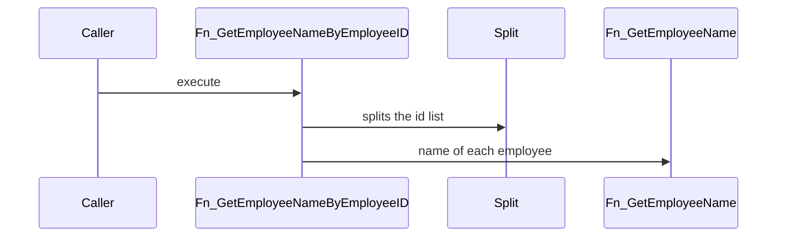
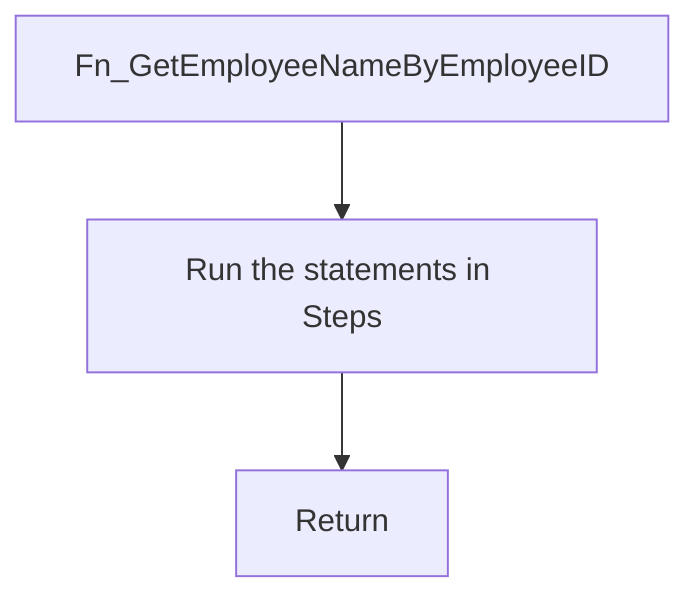

# Fn_GetEmployeeNameByEmployeeID

## What it does

Turns a comma-separated list of employee ids into one string of name and employment number, separated by commas.

## Parameters

| Name | Direction | What it is for |
|---|---|---|
| `@EmployeeIDs` | in | Comma-separated employee ids |

## Call sequence

## Callers

| Object | Kind | Page |
|---|---|---|
| `Sp_AdminPMS_GetAppPermissions` | procedure | No page yet |
| `Sp_AdminPMS_GetAppPermissionsByID` | procedure | No page yet |
| `SP_AdminRoleM_GetEmpSumPermissionByRoleID` | procedure | [SP_AdminRoleM_GetEmpSumPermissionByRoleID](/docs/database/hrms/SP_AdminRoleM_GetEmpSumPermissionByRoleID) |
| `SP_AdminRoleM_GetEmpSumPermissionHistByID` | procedure | [SP_AdminRoleM_GetEmpSumPermissionHistByID](/docs/database/hrms/SP_AdminRoleM_GetEmpSumPermissionHistByID) |
| `SP_AdminSCCT_GetChangesForApproval` | procedure | [SP_AdminSCCT_GetChangesForApproval](/docs/database/hrms/SP_AdminSCCT_GetChangesForApproval) |
| `SP_CMS_GetManagerRatingPermissions` | procedure | No page yet |
| `SP_GetAdminChangesForApprovalDetails` | procedure | No page yet |
| `Sp_GetAppraisalPermissions` | procedure | No page yet |
| `Sp_GetAppraisalPermissions_ByID` | procedure | No page yet |
| `SP_GetRRSRecruiterNames` | procedure | No page yet |
| `SP_RPT_GetRRSCreators` | procedure | No page yet |
| `SP_RPT_GetRRSInterviewPanelName` | procedure | No page yet |
| `USP_AdminLM_GetLeaveTypeDetById` | procedure | No page yet |
| `USP_AttendanceOverTime_Details` | procedure | No page yet |
| `USP_AttendanceOverTime_Notification_Detail` | procedure | No page yet |
| `USP_ClaimOT_Rule_List` | procedure | No page yet |
| `USP_FNF_Deactivated_Employee_List` | procedure | No page yet |
| `USP_FNF_Payment_Employee_List` | procedure | No page yet |
| `USP_LA_EmployeeAttendanceDetails` | procedure | No page yet |
| `USP_LA_LeaveEvent_GetByID` | procedure | No page yet |
| `USP_LA_LeaveType_GetById` | procedure | No page yet |
| `USP_LA_LeaveType_Policy_GetList` | procedure | No page yet |
| `USP_LA_LeaveType_Policy_GetPendingApprovalChanges` | procedure | No page yet |
| `USP_Leave_Policy_GetChangesForApproval` | procedure | No page yet |
| `USP_Leave_Policy_List` | procedure | No page yet |
| `USP_LeaveRequest_Notification_ModalView` | procedure | No page yet |
| `USP_OT_Rule_List` | procedure | No page yet |
| `USP_Process_EmployeeRosterTemplateData` | procedure | No page yet |
| `usp_UVW_RnR_EmployeeRecognitionDetails` | procedure | No page yet |
| `usp_UVW_RnR_EmployeeSpotlightDetails` | procedure | No page yet |
| `usp_UVW_RnR_JuryAwardDetails` | procedure | No page yet |
| `usp_UVW_RnR_RecognitionAwardDetails` | procedure | No page yet |
| `usp_UVW_RnR_RewardFinanceChangeDetails` | procedure | No page yet |
| `usp_UVW_RnR_WallOfFameDetails` | procedure | No page yet |
| `usp_vw_AdminChangeRequest` | procedure | No page yet |

## Nested

| Object | Kind | When | Page |
|---|---|---|
| `Split` | function | splits the id list | [Split](/docs/database/hrms/Split) |
| `Fn_GetEmployeeName` | function | name of each employee | [Fn_GetEmployeeName](/docs/database/hrms/Fn_GetEmployeeName) |

## Steps

1. Split @EmployeeIDs into a table of ids.
2. Join TEmployee and TEmployeeInfo and concatenate Fn_GetEmployeeName with the employment number.
3. Return the single varchar list.

## Tables

| Table | Read or write |
|---|---|
| `TEmployee` | read |
| `TEmployeeInfo` | read |

## Flow

