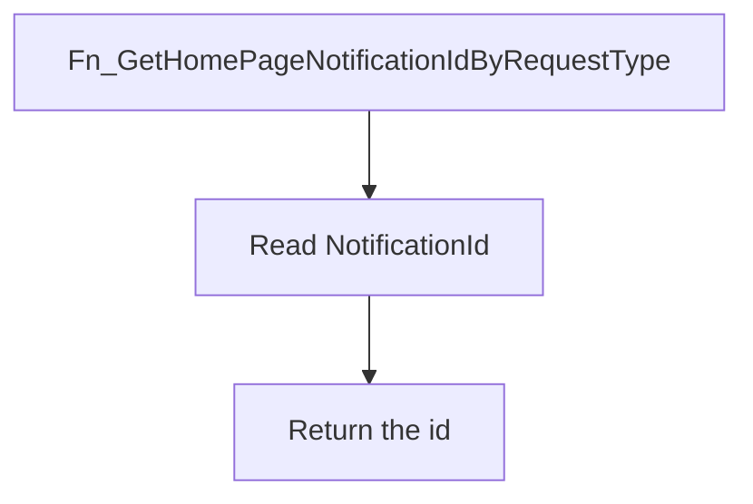

# Fn_GetHomePageNotificationIdByRequestType

## What it does

Returns `THomepageNotifications.NotificationId` for a request type. The cancel path calls it with `AdminChanges`. If no row matches, the function returns null.

## Parameters

| Name | Direction | What it is for |
|---|---|---|
| `@RequestType` | in | `THomepageNotifications.RequestType`. The parameter is `VARCHAR(50)`. |

The return type is `INT`.

## Call sequence

Calls no other procedures or functions.

## Callers

Procedures and functions whose live statements invoke this object. Views are omitted.

| Object | Kind | Page |
|---|---|---|
| `SP_AddAdminChanges` | procedure | [SP_AddAdminChanges](/docs/database/hrms/SP_AddAdminChanges) |
| `SP_AddAdminChanges_DP` | procedure | No page yet |
| `SP_AddCompOffRequest` | procedure | No page yet |
| `SP_AddCompOffRequest_Mobile` | procedure | No page yet |
| `SP_AddEmployeeActivityDetails` | procedure | No page yet |
| `SP_AddResignationDetails` | procedure | No page yet |
| `SP_AdminCMS_UpdReassignManager` | procedure | No page yet |
| `SP_AdminLM_UpdNewLeaveType` | procedure | No page yet |
| `SP_AdminMstr_UpdEmploymentType` | procedure | No page yet |
| `SP_ADMINPMS_EmployeeGoalApproveWF` | procedure | No page yet |
| `SP_AdminPMS_ForceClosedAppStatus` | procedure | No page yet |
| `SP_AdminPMS_UpdEmployeeGoalFormDataSubmit` | procedure | No page yet |
| `SP_AdminPMS_UpdInitiateAppraisalCycle` | procedure | No page yet |
| `SP_AdminPMS_UpdReassignManager` | procedure | No page yet |
| `SP_AdminRM_InsDocTemplatesNew` | procedure | No page yet |
| `SP_AdminSCCT_CancelChangesRequest` | procedure | [SP_AdminSCCT_CancelChangesRequest](/docs/database/hrms/SP_AdminSCCT_CancelChangesRequest) |
| `SP_AdminWM_UpdateRoles` | procedure | No page yet |
| `SP_ApproveAdminChangesRequest` | procedure | No page yet |
| `SP_ApproveWorkFlowRequest` | procedure | No page yet |
| `SP_CancelAdminChangesRequest` | procedure | No page yet |
| `SP_CM_ApproveAdminChangesRequest` | procedure | No page yet |
| `SP_CM_ApproveWorkFlowRequest` | procedure | No page yet |
| `SP_CM_ApproveWorkFlowRequest_240624` | procedure | No page yet |
| `SP_CM_ApproveWorkFlowRequest_test` | procedure | No page yet |
| `SP_CM_ApproveWorkFlowRequestBKP03052025` | procedure | No page yet |
| `SP_CM_ApproveWorkFlowRequestbkp21032024` | procedure | No page yet |
| `SP_CM_RejectAdminChangesRequest` | procedure | No page yet |
| `SP_CM_RejectWorkFlowRequest` | procedure | No page yet |
| `SP_CM_RejectWorkFlowRequest_240624` | procedure | No page yet |
| `SP_CM_RejectWorkFlowRequestBKP03052025` | procedure | No page yet |
| `SP_CM_RequestReRoute` | procedure | No page yet |
| `SP_CM_RequestReRouteBKP03052025` | procedure | No page yet |
| `SP_CMS_UpdEmpConfirmationRatings` | procedure | No page yet |
| `Sp_DeleteRrsDetails` | procedure | No page yet |
| `SP_ESS_InsertBusinessCardDetails` | procedure | No page yet |
| `SP_ForceClosedAppraisalStatus` | procedure | No page yet |
| `SP_InsertBusinessCardDetails` | procedure | No page yet |
| `SP_InsertEmpDocGeneratedDetailsNew` | procedure | No page yet |
| `SP_InsertHelpdeskRequest` | procedure | No page yet |
| `SP_InsertLeaveRequestDetails` | procedure | No page yet |
| `Sp_InsertRRSCandidateFeedback` | procedure | No page yet |
| `Sp_InsertRrsDetails` | procedure | No page yet |
| `SP_LA_AddAttendanceRegularisationDetails` | procedure | No page yet |
| `SP_LA_AddWorkFromHomeRequestDetails` | procedure | No page yet |
| `SP_LA_InsertLeaveRequestDetails` | procedure | No page yet |
| `SP_LA_InsertLeaveRequestDetails_dp` | procedure | No page yet |
| `SP_LA_LeaveCancellation` | procedure | No page yet |
| `SP_LA_OptionalHolidayCancellation` | procedure | No page yet |
| `SP_PMS_UpdBulkEmpAppraisalRatings` | procedure | No page yet |
| `SP_PMS_UpdEmpAppraisalRatings` | procedure | No page yet |
| `SP_PMS_UpdEmployeeGoalFormDataSubmit_WithoutTag` | procedure | No page yet |
| `SP_PMS_UpdReviewerOverallComments` | procedure | No page yet |
| `SP_PMS_UpdSalaryRevForEmployeeAssessment` | procedure | No page yet |
| `SP_PullbackCompOffRequestByEmployee` | procedure | No page yet |
| `SP_PullbackRequest` | procedure | No page yet |
| `SP_RejectAdminChangesRequest` | procedure | No page yet |
| `SP_RejectWorkFlowRequest` | procedure | No page yet |
| `SP_RejectWorkFlowRequestBKP03052025` | procedure | No page yet |
| `SP_RemoveSelectedActivityDetail` | procedure | No page yet |
| `SP_ResignationPullback` | procedure | No page yet |
| `Sp_RRS_CloseRRS` | procedure | No page yet |
| `Sp_RRS_DeleteDetails` | procedure | No page yet |
| `Sp_RRS_InsertCandidateFeedback` | procedure | No page yet |
| `Sp_RRS_InsertCandidateFeedback_051523` | procedure | No page yet |
| `SP_RRS_InsertCandidateInterview` | procedure | No page yet |
| `Sp_RRS_InsertDetails` | procedure | No page yet |
| `SP_RRS_UpdateCandidateInterviewStatus` | procedure | No page yet |
| `Sp_RRS_UpdateChildDetails` | procedure | No page yet |
| `Sp_RRS_UpdateDetails` | procedure | No page yet |
| `Sp_RRS_UpdateInitiateHiring` | procedure | No page yet |
| `SP_SEP_AddEmployeeActivityDetails` | procedure | No page yet |
| `SP_SEP_AddResignationDetails` | procedure | No page yet |
| `SP_SEP_ClearanceRequestReRoute` | procedure | No page yet |
| `SP_SEP_RemoveSelectedActivityDetail` | procedure | No page yet |
| `SP_SEP_ResignationPullback` | procedure | No page yet |
| `SP_UpdateCMSEmployeeConfirmationRatings` | procedure | No page yet |
| `SP_UpdatecMSReassignManager` | procedure | No page yet |
| `SP_UpdateEmployeeActivityDetails` | procedure | No page yet |
| `SP_UpdateEmploymentType` | procedure | No page yet |
| `SP_UpdateHelpdeskRequest` | procedure | No page yet |
| `SP_UpdateNewLeaveTypeMaster` | procedure | No page yet |
| `SP_UpdatePMSEmployeeAppraisalRatings` | procedure | No page yet |
| `SP_UpdatePMSReassignManager` | procedure | No page yet |
| `SP_UpdateRoles` | procedure | No page yet |
| `Sp_UpdateRrsDetails` | procedure | No page yet |
| `Sp_UpdateRrsInitiateHiring` | procedure | No page yet |
| `USP_Admin_InsDocTemplates` | procedure | No page yet |
| `USP_CompOff_PullbackRequestByEmployee` | procedure | No page yet |
| `USP_CompOff_SaveRequest` | procedure | No page yet |
| `USP_Termination_UpdateEmployeeActivityDetails` | procedure | No page yet |

## Nested

Calls no other procedures or functions.

## Steps

From `HRMS-DATABASE/HRMS/FUNCTIONS/Fn_GetHomePageNotificationIdByRequestType.sql`.

1. Select `NotificationId` from `THomepageNotifications` where `RequestType` equals `@RequestType`.
2. Return that id.

## Tables

| Table | Read or write |
|---|---|
| `THomepageNotifications` | read |

## Flow

