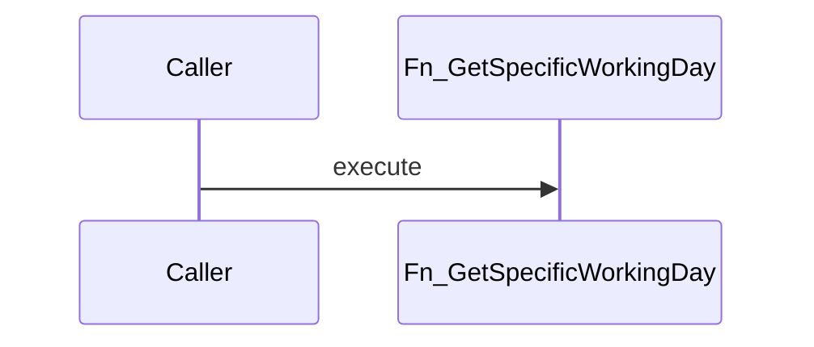
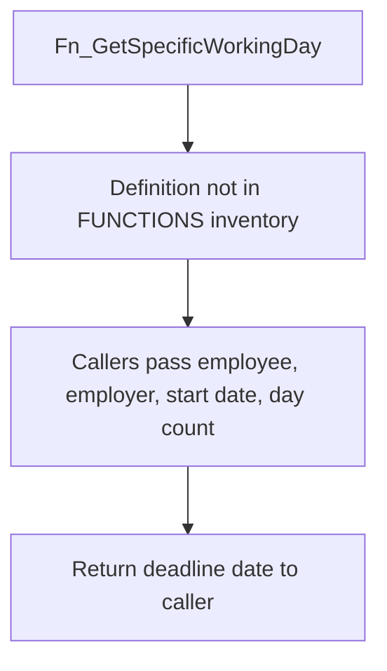

# Fn_GetSpecificWorkingDay

## What it does

Scalar helper used by Violations & Occurrence rule procedures to turn a start date plus a working-day offset into a deadline date. Call sites assign the return value to resignation decision end time (`DicisionEndTime`) or confirmation self-assessment deadline (`DeadlineToDate`). No `CREATE FUNCTION` script for this name exists under `HRMS-DATABASE/HRMS/FUNCTIONS/` or the functions Liquibase inventory in this checkout, so the body is not available to analyze.

## Parameters

Names below are positional from live call sites (formal parameter names are not in repo SQL).

| Name | Direction | What it is for |
|---|---|---|
| (1) employee id | in | Employee context (e.g. `@Employeeid`, `ManagerId`, or `RequestForEmployee` at callers) |
| (2) employer id | in | Employer scope (`@Employerid`) |
| (3) start date | in | Anchor date (`InitiatedDate` or `DicisionStartTime`) |
| (4) day count | in | Working-day offset (`@ConditionFrom` or computed `@Days`) |

## Call sequence

Function body is not in inventory; nested calls cannot be listed from a script.

## Callers

| Object | Kind | Page |
|---|---|---|
| `OV_Rule_Employee_Confirmation_SelfAssessment_Card` | procedure | [OV_Rule_Employee_Confirmation_SelfAssessment_Card](/docs/database/hrms/OV_Rule_Employee_Confirmation_SelfAssessment_Card) |
| `OV_Rule_Employee_Confirmation_SelfAssessment_Detail` | procedure | [OV_Rule_Employee_Confirmation_SelfAssessment_Detail](/docs/database/hrms/OV_Rule_Employee_Confirmation_SelfAssessment_Detail) |
| `OV_Rule_Employee_Confirmation_SelfAssessment_Summary` | procedure | [OV_Rule_Employee_Confirmation_SelfAssessment_Summary](/docs/database/hrms/OV_Rule_Employee_Confirmation_SelfAssessment_Summary) |
| `OV_Rule_Separation_Separation_Card` | procedure | [OV_Rule_Separation_Separation_Card](/docs/database/hrms/OV_Rule_Separation_Separation_Card) |
| `OV_Rule_Separation_Separation_Detail` | procedure | [OV_Rule_Separation_Separation_Detail](/docs/database/hrms/OV_Rule_Separation_Separation_Detail) |
| `OV_Rule_Separation_Separation_Summary` | procedure | [OV_Rule_Separation_Separation_Summary](/docs/database/hrms/OV_Rule_Separation_Separation_Summary) |

## Nested

Calls no other procedures or functions that can be verified from a repo script (definition missing).

## Steps

1. No script at `HRMS-DATABASE/HRMS/FUNCTIONS/Fn_GetSpecificWorkingDay.sql` (and no matching functions changelog entry).
2. From callers: invoked as `[dbo].[Fn_GetSpecificWorkingDay](<employeeId>, <employerId>, <startDate>, <dayCount>)`.
3. Separation rule procs pass manager id, employer id, decision start time, and a day count derived from condition bands (days / weeks×7 / months×30), then store the result as `DicisionEndTime`.
4. Confirmation self-assessment rule procs pass employee id, employer id, `InitiatedDate`, and `ConditionFrom`, then store the result as `DeadlineToDate` for overdue checks.

## Tables

Unknown — function body is not in this checkout.

## Unresolved calls

Function definition itself is unresolved in `HRMS-DATABASE/HRMS/FUNCTIONS/`.

## Flow

