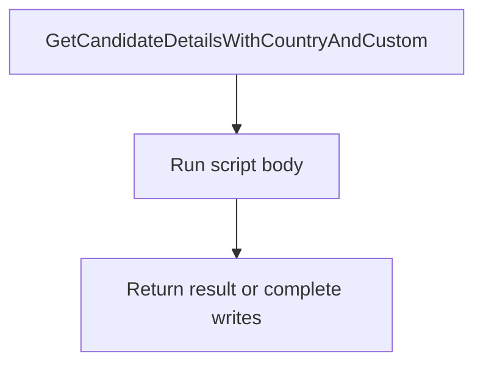

# GetCandidateDetailsWithCountryAndCustom

## What it does

Helper used by SP_Employer_POBCandidate to assemble country and custom-field candidate detail columns.

## Parameters

| Name | Direction | What it is for |
|---|---|---|
| `@EmployerId` | in | INT |
| `@SectionIds` | in | NVARCHAR |
| `@TempTableName` | in | SYSNAME |
| `@JoinColumn` | in | SYSNAME |
| `@JoinDetailColumn` | in | SYSNAME |

## Call sequence

Calls no other procedures or functions.

## Callers

Application callers include Core API `preOnBoardingDAL` methods used by **Employee Management → Pre-Onboarding Candidate** (`PreOnboardCandidate.aspx`). Search HRMS `STOREPROCEDURE/` and `FUNCTIONS/` for additional `EXEC`/`dbo.` callers when extending this page.

## Nested

Calls no other procedures or functions.

## Steps

From `HRMS-DATABASE/HRMS/STOREPROCEDURE/GetCandidateDetailsWithCountryAndCustom.sql`:

1. See script body for ordered statements.

## Tables

| Table | Read or write |
|---|---|
| `dbo.UniqueFields` | read |
| `dbo.UniqueCountryFields` | read |
| `dbo.POBCandidateCustomFields` | read |
| `dbo.TEmployeedetailCustomFieldValues` | read |
| `dbo.POBTemplate` | read |

## Unresolved calls

Uses `sp_executesql` (dynamic SQL). Do not guess the object name built at runtime.

## Flow

