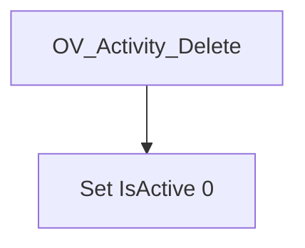

# OV_Activity_Delete

## What it does

Soft-deletes an activity master for an employer by setting IsActive to 0 and recording ModifiedBy and ModifiedDate.

## Parameters

| Name | Direction | What it is for |
|---|---|---|
| `@OccuranceVialoationActivityMasterID` | in | Activity to deactivate |
| `@EmployerID` | in | Employer scope for the update |
| `@ModifiedBy` | in | Employee id writing the soft delete |

## Call sequence

Calls no other procedures or functions.

## Callers

No other procedure or function calls this object. `ViolationsOccurrenceDAL` in Core API executes it for Setup Violations & Occurrence (Setup Violation Activity delete handler).

## Nested

Calls no other procedures or functions.

## Steps

1. In `HRMS-DATABASE/HRMS/STOREPROCEDURE/OV_Activity_Delete.sql`, update `OccuranceVialoationActivityMaster` set IsActive = 0 where master id and EmployerID match.

## Tables

| Table | Read or write |
|---|---|
| `dbo.OccuranceVialoationActivityMaster` | write |

## Flow

