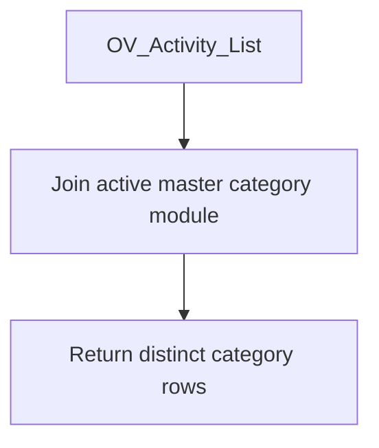

# OV_Activity_List

## What it does

Returns the distinct active violation activities for an employer — master id, module name, activity name/description, and category name — used to build dynamic score columns on the Violations & Occurrence team grid.

## Parameters

| Name | Direction | What it is for |
|---|---|---|
| `@EmployerID` | in | Employer whose active activities are listed |

## Call sequence

Calls no other procedures or functions.

## Callers

No other procedure or function calls this object. `ViolationsOccurrenceDAL.GetEmployerSpecificRulesList` in Core API executes it for the Violations & Occurrence team grid column list.

## Nested

Calls no other procedures or functions.

## Steps

1. In `HRMS-DATABASE/HRMS/STOREPROCEDURE/OV_Activity_List.sql`, set `NOCOUNT` and `READ UNCOMMITTED`.
2. Select distinct rows from `OccuranceVialoationActivityMaster` joined to `OccuranceVialoationSPCategory`, `OccuranceVialoationSPsCategoryMaster`, and `THrmsModules` where the master is active and `EmployerID = @EmployerID`.
3. Return `OccuranceVialoationActivityMasterID`, `ModuleName`, `ActivityName`, `ActivityDescription`, and `SPCategoryName` as `CategoryName`.

## Tables

| Table | Read or write |
|---|---|
| `dbo.OccuranceVialoationActivityMaster` | read |
| `dbo.OccuranceVialoationSPCategory` | read |
| `dbo.OccuranceVialoationSPsCategoryMaster` | read |
| `dbo.THrmsModules` | read |

## Flow

