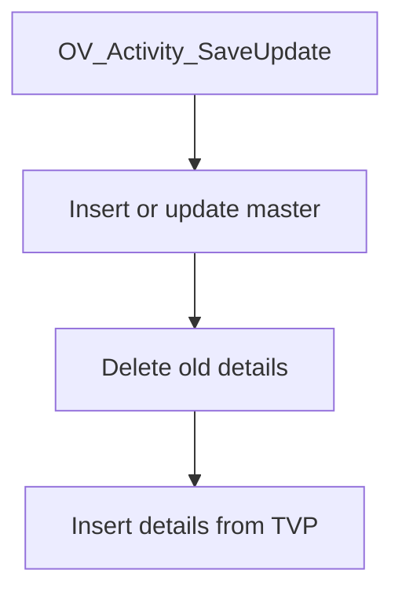

# OV_Activity_SaveUpdate

## What it does

Inserts or updates an activity master row, deletes existing detail rows for that master, then inserts detail rows from UDT_OccuranceVialoationActivityDetail.

## Parameters

| Name | Direction | What it is for |
|---|---|---|
| `@OccuranceVialoationActivityDetail` | in | UDT_OccuranceVialoationActivityDetail readonly TVP |
| `@OccuranceVialoationActivityMasterID` | in | 0 to insert; existing id to update |
| `@ModuleID` | in | HRMS module id |
| `@ActivityName` | in | Activity name |
| `@ActivityDescription` | in | Activity description |
| `@OccuranceVialoationSPCategoryID` | in | Category mapping id |
| `@EffectiveDtm` | in | Effective date |
| `@EmployerID` | in | Employer owning the activity |
| `@CreatedBy` | in | Creator on insert and details |
| `@ModifiedBy` | in | Modifier on update and details |
| `@IsActive` | in | Active flag on the master |

## Call sequence

Calls no other procedures or functions.

## Callers

No other procedure or function calls this object. `ViolationsOccurrenceDAL` in Core API executes it for Setup Violations & Occurrence (Setup Violation Activity save).

## Nested

Calls no other procedures or functions.

## Steps

1. In `HRMS-DATABASE/HRMS/STOREPROCEDURE/OV_Activity_SaveUpdate.sql`, insert into `OccuranceVialoationActivityMaster` when master id is 0 and capture @@IDENTITY; otherwise update the master.
2. If detail rows exist for the master, DELETE them.
3. INSERT detail rows from the TVP with creator and modifier timestamps.

## Tables

| Table | Read or write |
|---|---|
| `dbo.OccuranceVialoationActivityMaster` | write |
| `dbo.OccuranceVialoationActivityDetail` | write |

## Flow

