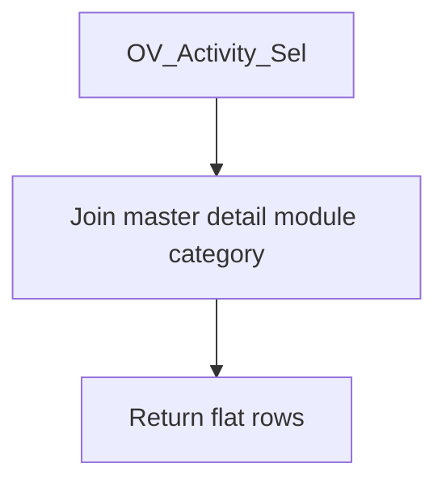

# OV_Activity_Sel

## What it does

Returns a flat join of activity master and detail rows for an employer, including module, category name, effective date, and per-condition points and card colour for the activity grid.

## Parameters

| Name | Direction | What it is for |
|---|---|---|
| `@EmployerID` | in | Employer whose activities are listed |

## Call sequence

Calls no other procedures or functions.

## Callers

No other procedure or function calls this object. `ViolationsOccurrenceDAL` in Core API executes it for Setup Violations & Occurrence (Setup Violation Activity grid).

## Nested

Calls no other procedures or functions.

## Steps

1. In `HRMS-DATABASE/HRMS/STOREPROCEDURE/OV_Activity_Sel.sql`, join `OccuranceVialoationActivityMaster` to detail, `THrmsModules`, `OccuranceVialoationSPCategory`, and category master for `@EmployerID`.
2. Return MasterStatus Active/InActive and formatted EffectiveDtm.

## Tables

| Table | Read or write |
|---|---|
| `dbo.OccuranceVialoationActivityMaster` | read |
| `dbo.OccuranceVialoationActivityDetail` | read |
| `dbo.THrmsModules` | read |
| `dbo.OccuranceVialoationSPCategory` | read |
| `dbo.OccuranceVialoationSPsCategoryMaster` | read |

## Flow

