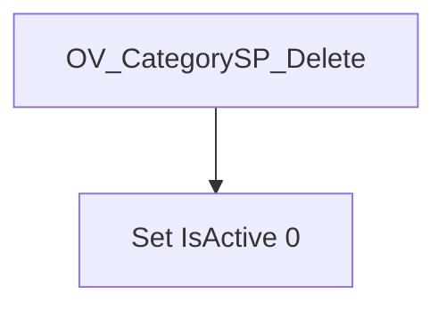

# OV_CategorySP_Delete

## What it does

Soft-deletes an employer category mapping by setting IsActive to 0 and recording UpdatedBy.

## Parameters

| Name | Direction | What it is for |
|---|---|---|
| `@OccuranceVialoationSPCategoryID` | in | Category mapping to deactivate |
| `@UpdatedBy` | in | Employee id writing the soft delete |

## Call sequence

Calls no other procedures or functions.

## Callers

No other procedure or function calls this object. `ViolationsOccurrenceDAL` in Core API executes it for Setup Violations & Occurrence (Setup Category delete).

## Nested

Calls no other procedures or functions.

## Steps

1. In `HRMS-DATABASE/HRMS/STOREPROCEDURE/OV_CategorySP_Delete.sql`, update `OccuranceVialoationSPCategory` set IsActive = 0 and UpdatedBy for the given id.

## Tables

| Table | Read or write |
|---|---|
| `dbo.OccuranceVialoationSPCategory` | write |

## Flow

