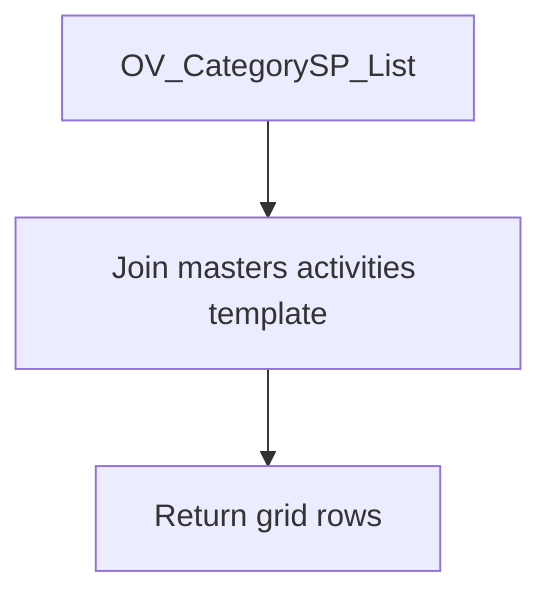

# OV_CategorySP_List

## What it does

Lists active employer module-to-category mappings with module and category master names, optional linked template name, and CanDelete (0 when an active activity references the category).

## Parameters

| Name | Direction | What it is for |
|---|---|---|
| `@EmployerID` | in | Employer whose category mappings are listed |

## Call sequence

Calls no other procedures or functions.

## Callers

No other procedure or function calls this object. `ViolationsOccurrenceDAL` in Core API executes it for Setup Violations & Occurrence (Setup Category grid).

## Nested

Calls no other procedures or functions.

## Steps

1. In `HRMS-DATABASE/HRMS/STOREPROCEDURE/OV_CategorySP_List.sql`, select active `OccuranceVialoationSPCategory` rows for `@EmployerID`.
2. Join `THrmsModules` and `OccuranceVialoationSPsCategoryMaster`.
3. Left join active `OccuranceVialoationActivityMaster` to compute CanDelete.
4. Left join `OccuranceVialoationFieldTemplate` for TemplateName.

## Tables

| Table | Read or write |
|---|---|
| `dbo.OccuranceVialoationSPCategory` | read |
| `dbo.THrmsModules` | read |
| `dbo.OccuranceVialoationSPsCategoryMaster` | read |
| `dbo.OccuranceVialoationActivityMaster` | read |
| `dbo.OccuranceVialoationFieldTemplate` | read |

## Flow

