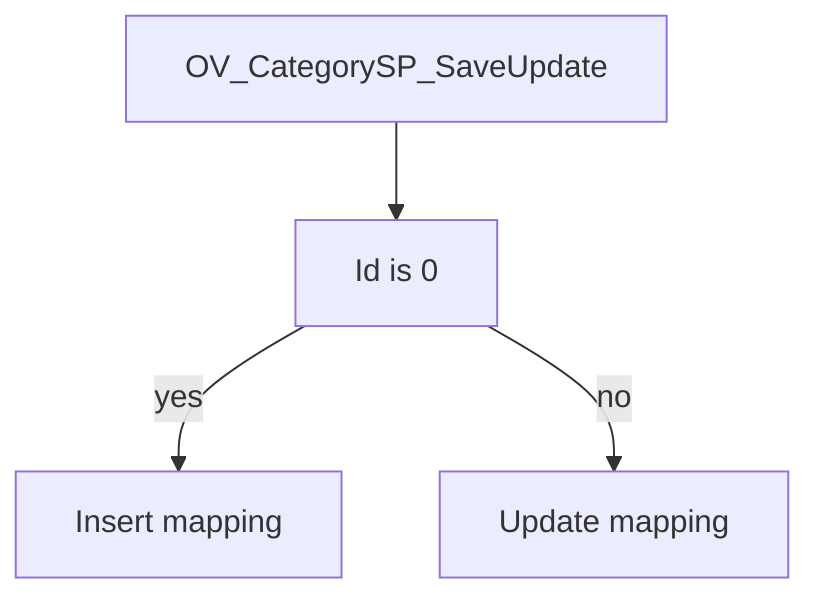

# OV_CategorySP_SaveUpdate

## What it does

Inserts a new OccuranceVialoationSPCategory mapping when the id is 0, otherwise updates the existing mapping including optional field template id.

## Parameters

| Name | Direction | What it is for |
|---|---|---|
| `@OccuranceVialoationSPCategoryID` | in | 0 to insert; existing id to update |
| `@ModuleID` | in | HRMS module id |
| `@OccuranceVialoationSPsCategoryMasterID` | in | Category master id |
| `@OccuranceVialoationFieldTemplateID` | in | Optional field template id |
| `@EmployerID` | in | Employer for the mapping |
| `@IsActive` | in | Active flag |
| `@CreatedBy` | in | Creator employee id on insert |
| `@UpdatedBy` | in | Updater employee id on update |

## Call sequence

Calls no other procedures or functions.

## Callers

No other procedure or function calls this object. `ViolationsOccurrenceDAL` in Core API executes it for Setup Violations & Occurrence (Setup Category save).

## Nested

Calls no other procedures or functions.

## Steps

1. In `HRMS-DATABASE/HRMS/STOREPROCEDURE/OV_CategorySP_SaveUpdate.sql`, when `@OccuranceVialoationSPCategoryID` is 0, insert into `OccuranceVialoationSPCategory`.
2. Otherwise update ModuleID, category master id, template id, EmployerID, IsActive, UpdatedBy, and UpdatedDate for that id.

## Tables

| Table | Read or write |
|---|---|
| `dbo.OccuranceVialoationSPCategory` | write |

## Flow

