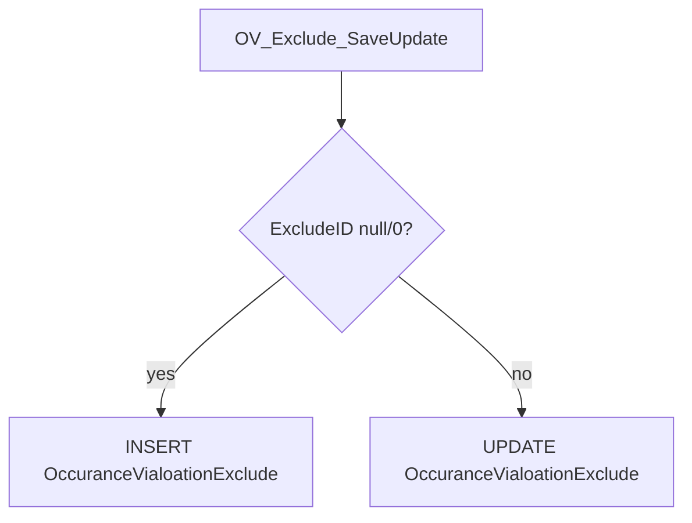

# OV_Exclude_SaveUpdate

## What it does

Inserts a new soft-exclude row into `OccuranceVialoationExclude`, or updates an existing exclude by id, for Edit on a Violations & Occurrence category card.

## Parameters

| Name | Direction | What it is for |
|---|---|---|
| `@OccuranceVialoationExcludeID` | in | 0/null to insert; existing id to update |
| `@OccuranceVialoationActivityMasterID` | in | Activity master being excluded |
| `@OccuranceVialoationActivityDetailID` | in | Activity detail band being excluded |
| `@Param1` | in | Exclude key 1 (often employee id) |
| `@Param2` | in | Exclude key 2 (often record/transaction id) |
| `@Param3` | in | Exclude key 3 (often register group list) |
| `@ParamType` | in | Exclude shape (Employee, Record, RecordGroup, ...) |
| `@EmployerID` | in | Employer scope |
| `@EmployeeId` | in | Employee being scored or shown on the card |
| `@IsActive` | in | Active flag on the exclude row |
| `@Comment` | in | Exclude comment |
| `@CreatedBy` | in | Creator on insert |
| `@UpdatedBy` | in | Updater on update |

## Call sequence

Calls no other procedures or functions.

## Callers

No other procedure or function calls this object. `ViolationsOccurrenceDAL.DeactivateEmployeeMissingDataActivity` in Core API executes it on Edit soft-exclude.

## Nested

Calls no other procedures or functions.

## Steps

1. In `HRMS-DATABASE/HRMS/STOREPROCEDURE/OV_Exclude_SaveUpdate.sql`, set `NOCOUNT`.
2. When `@OccuranceVialoationExcludeID` is null/0, INSERT into `OccuranceVialoationExclude` with `CreatedWhen = GETDATE()`.
3. Otherwise UPDATE that exclude id with the supplied fields and `UpdatedDate = GETDATE()`.

## Tables

| Table | Read or write |
|---|---|
| `dbo.OccuranceVialoationExclude` | write |

## Flow

