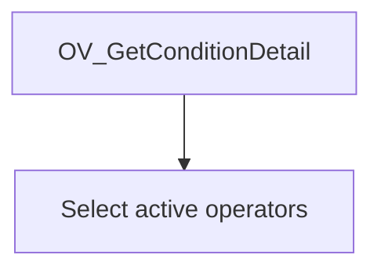

# OV_GetConditionDetail

## What it does

Lists active operators configured for one module condition as ConditionDetailId and OperatorName.

## Parameters

| Name | Direction | What it is for |
|---|---|---|
| `@ModuleConditionId` | in | Module condition whose operators are listed |

## Call sequence

Calls no other procedures or functions.

## Callers

No other procedure or function calls this object. `ViolationsOccurrenceDAL` in Core API executes it for Setup Violations & Occurrence (Setup Violation Activity operator dropdown).

## Nested

Calls no other procedures or functions.

## Steps

1. In `HRMS-DATABASE/HRMS/STOREPROCEDURE/OV_GetConditionDetail.sql`, join active `OccuranceVialoationModuleConditionDetail` to `OccuranceVialoationConditionOperatorMaster` for `@ModuleConditionId`.

## Tables

| Table | Read or write |
|---|---|
| `dbo.OccuranceVialoationModuleConditionDetail` | read |
| `dbo.OccuranceVialoationConditionOperatorMaster` | read |

## Flow

