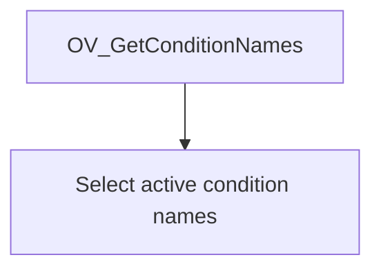

# OV_GetConditionNames

## What it does

Lists distinct active module conditions for a module and employer as ConditionId (ModuleConditionId) and ConditionName.

## Parameters

| Name | Direction | What it is for |
|---|---|---|
| `@ModuleID` | in | Module whose conditions are listed |
| `@EmployerId` | in | Employer whose conditions are listed |

## Call sequence

Calls no other procedures or functions.

## Callers

No other procedure or function calls this object. `ViolationsOccurrenceDAL` in Core API executes it for Setup Violations & Occurrence (Setup Violation Activity condition dropdown).

## Nested

Calls no other procedures or functions.

## Steps

1. In `HRMS-DATABASE/HRMS/STOREPROCEDURE/OV_GetConditionNames.sql`, join active `OccuranceVialoationModuleCondition` to `OccuranceVialoationConditionMaster` for the module and employer.

## Tables

| Table | Read or write |
|---|---|
| `dbo.OccuranceVialoationModuleCondition` | read |
| `dbo.OccuranceVialoationConditionMaster` | read |

## Flow

