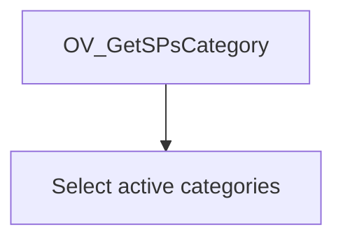

# OV_GetSPsCategory

## What it does

Lists active employer category mappings for a module as OccuranceVialoationSPCategoryID and CategoryName for the activity category dropdown.

## Parameters

| Name | Direction | What it is for |
|---|---|---|
| `@ModuleID` | in | Module whose categories are listed |
| `@EmployerID` | in | Employer whose mappings are listed |

## Call sequence

Calls no other procedures or functions.

## Callers

No other procedure or function calls this object. `ViolationsOccurrenceDAL` in Core API executes it for Setup Violations & Occurrence (Setup Violation Activity category dropdown).

## Nested

Calls no other procedures or functions.

## Steps

1. In `HRMS-DATABASE/HRMS/STOREPROCEDURE/OV_GetSPsCategory.sql`, join active `OccuranceVialoationSPCategory` to `OccuranceVialoationSPsCategoryMaster` for `@ModuleID` and `@EmployerID`.

## Tables

| Table | Read or write |
|---|---|
| `dbo.OccuranceVialoationSPCategory` | read |
| `dbo.OccuranceVialoationSPsCategoryMaster` | read |

## Flow

