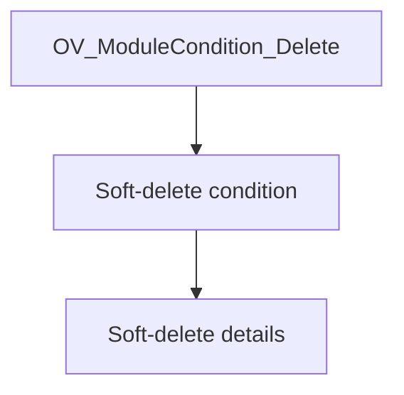

# OV_ModuleCondition_Delete

## What it does

Soft-deletes a module condition and all of its operator detail rows by setting IsActive to 0.

## Parameters

| Name | Direction | What it is for |
|---|---|---|
| `@ModuleConditionId` | in | Module condition to deactivate |
| `@ModifiedBy` | in | Employee id writing the soft delete |

## Call sequence

Calls no other procedures or functions.

## Callers

No other procedure or function calls this object. `ViolationsOccurrenceDAL` in Core API executes it for Setup Violations & Occurrence (Setup Condition delete).

## Nested

Calls no other procedures or functions.

## Steps

1. In `HRMS-DATABASE/HRMS/STOREPROCEDURE/OV_ModuleCondition_Delete.sql`, update `OccuranceVialoationModuleCondition` set IsActive = 0.
2. Update matching `OccuranceVialoationModuleConditionDetail` rows the same way.

## Tables

| Table | Read or write |
|---|---|
| `dbo.OccuranceVialoationModuleCondition` | write |
| `dbo.OccuranceVialoationModuleConditionDetail` | write |

## Flow

