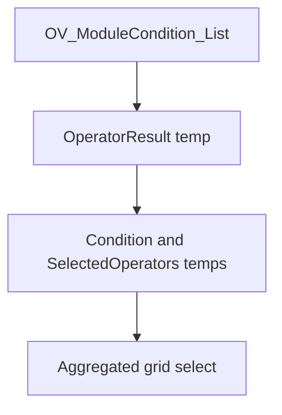

# OV_ModuleCondition_List

## What it does

Builds the Setup Condition grid for an employer: each active module condition with aggregated operator ids/names, CanDelete, and SelectedConditionOperatorIDs based on live activities.

## Parameters

| Name | Direction | What it is for |
|---|---|---|
| `@EmployerID` | in | Employer whose module conditions are listed |

## Call sequence

Calls no other procedures or functions.

## Callers

No other procedure or function calls this object. `ViolationsOccurrenceDAL` in Core API executes it for Setup Violations & Occurrence (Setup Condition grid).

## Nested

Calls no other procedures or functions.

## Steps

1. In `HRMS-DATABASE/HRMS/STOREPROCEDURE/OV_ModuleCondition_List.sql`, load `#OperatorResult` from module conditions, masters, and active operator details.
2. Build `#ConditionResult` for conditions referenced by active activities.
3. Build `#SelectedOperators` for operators currently used on activities.
4. Select distinct module-condition rows with STUFF/FOR XML aggregated ConditionOperatorIDs and names plus CanDelete flags.

## Tables

| Table | Read or write |
|---|---|
| `dbo.OccuranceVialoationModuleCondition` | read |
| `dbo.THrmsModules` | read |
| `dbo.OccuranceVialoationConditionMaster` | read |
| `dbo.OccuranceVialoationModuleConditionDetail` | read |
| `dbo.OccuranceVialoationConditionOperatorMaster` | read |
| `dbo.OccuranceVialoationActivityDetail` | read |
| `dbo.OccuranceVialoationActivityMaster` | read |

## Flow

