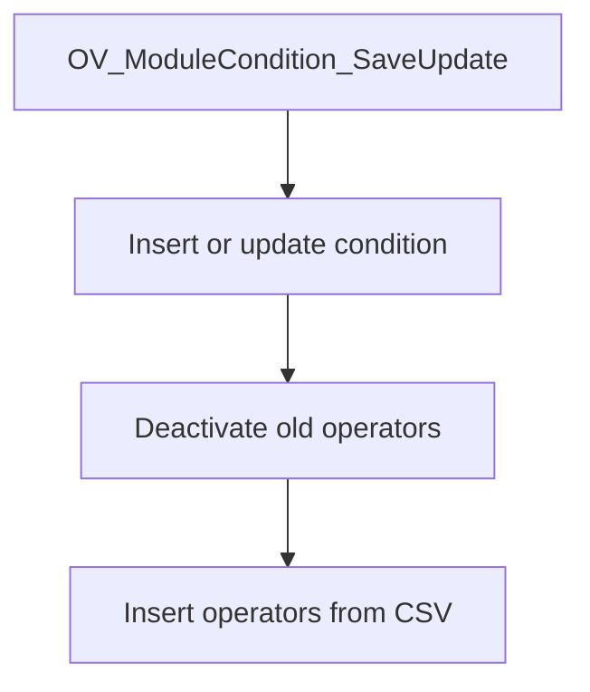

# OV_ModuleCondition_SaveUpdate

## What it does

Inserts or updates a module-condition mapping, soft-deactivates prior operator detail rows, then inserts one detail row per ConditionOperatorID from a CSV via STRING_SPLIT.

## Parameters

| Name | Direction | What it is for |
|---|---|---|
| `@ModuleConditionId` | in | 0 to insert; existing id to update |
| `@ModuleID` | in | HRMS module id |
| `@ConditionID` | in | Condition master id |
| `@ConditionOperatorIDs` | in | Comma-separated operator ids |
| `@EmployerID` | in | Employer for the mapping |
| `@IsActive` | in | Active flag |
| `@CreatedBy` | in | Creator on insert and new details |
| `@UpdatedBy` | in | Updater on header and soft-delete |

## Call sequence

Calls no other procedures or functions.

## Callers

No other procedure or function calls this object. `ViolationsOccurrenceDAL` in Core API executes it for Setup Violations & Occurrence (Setup Condition save).

## Nested

Calls no other procedures or functions.

## Steps

1. In `HRMS-DATABASE/HRMS/STOREPROCEDURE/OV_ModuleCondition_SaveUpdate.sql`, insert into `OccuranceVialoationModuleCondition` when id is 0, else update the row and capture SCOPE_IDENTITY on insert.
2. Soft-deactivate existing `OccuranceVialoationModuleConditionDetail` rows for that ModuleConditionId.
3. Insert new detail rows from STRING_SPLIT of `@ConditionOperatorIDs`.

## Tables

| Table | Read or write |
|---|---|
| `dbo.OccuranceVialoationModuleCondition` | write |
| `dbo.OccuranceVialoationModuleConditionDetail` | write |

## Flow

