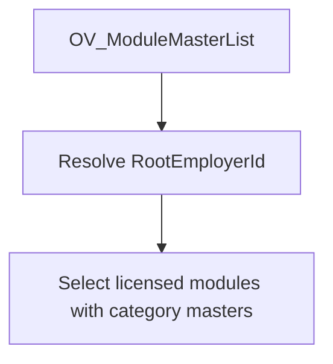

# OV_ModuleMasterList

## What it does

Lists distinct active HRMS modules licensed to the employer root employer that also have at least one row in OccuranceVialoationSPsCategoryMaster.

## Parameters

| Name | Direction | What it is for |
|---|---|---|
| `@EmployerID` | in | Employer whose RootEmployerId scopes TEmployerModule |

## Call sequence

Calls no other procedures or functions.

## Callers

No other procedure or function calls this object. `ViolationsOccurrenceDAL` in Core API executes it for Setup Violations & Occurrence (module dropdowns on all three setup tabs).

## Nested

Calls no other procedures or functions.

## Steps

1. In `HRMS-DATABASE/HRMS/STOREPROCEDURE/OV_ModuleMasterList.sql`, read `RootEmployerId` from `TEmployerDetails` for `@EmployerID`.
2. Join active `THrmsModules` to active `TEmployerModule` for that root employer.
3. Inner join `OccuranceVialoationSPsCategoryMaster` on module id and return distinct ModuleId and ModuleName.

## Tables

| Table | Read or write |
|---|---|
| `dbo.TEmployerDetails` | read |
| `dbo.THrmsModules` | read |
| `dbo.TEmployerModule` | read |
| `dbo.OccuranceVialoationSPsCategoryMaster` | read |

## Flow

