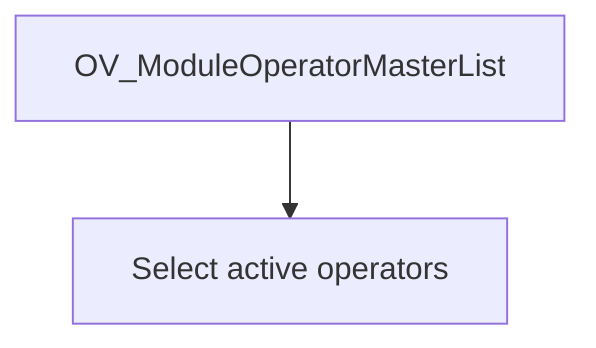

# OV_ModuleOperatorMasterList

## What it does

Lists active condition operator master names used by Setup Condition multi-selects.

## Parameters

| Name | Direction | What it is for |
|---|---|---|
| `(none)` | - | Procedure takes no parameters |

## Call sequence

Calls no other procedures or functions.

## Callers

No other procedure or function calls this object. `ViolationsOccurrenceDAL` in Core API executes it for Setup Violations & Occurrence (Setup Condition row operator multi-select).

## Nested

Calls no other procedures or functions.

## Steps

1. In `HRMS-DATABASE/HRMS/STOREPROCEDURE/OV_ModuleOperatorMasterList.sql`, select distinct ConditionOperatorID and ConditionOperatorName where Active = 1.

## Tables

| Table | Read or write |
|---|---|
| `dbo.OccuranceVialoationConditionOperatorMaster` | read |

## Flow

