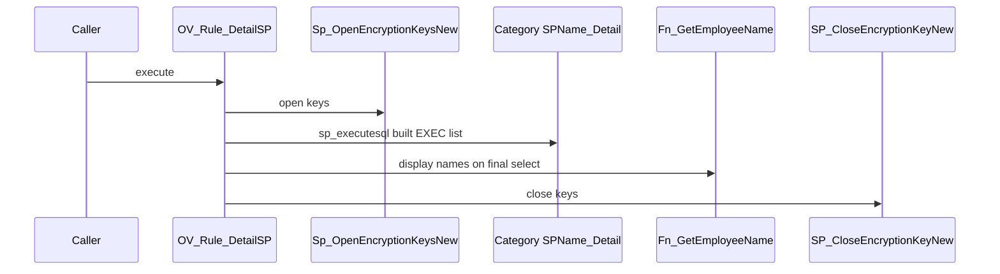
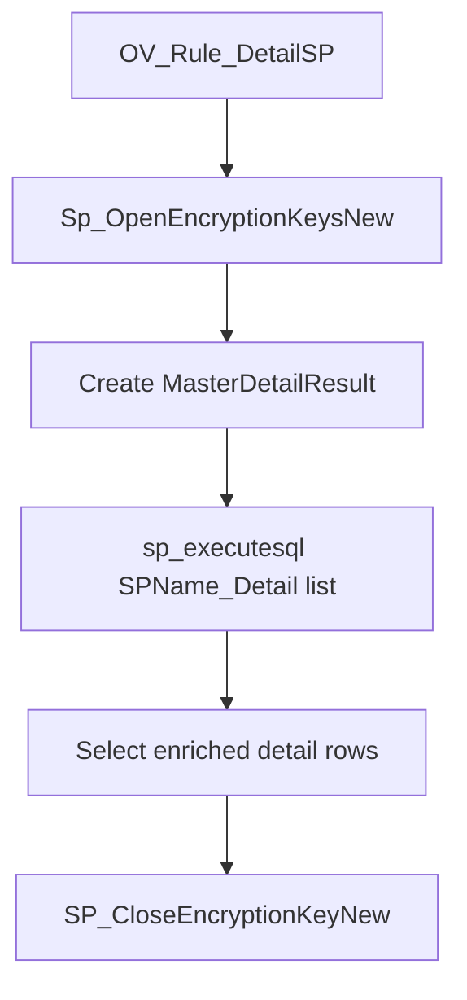

# OV_Rule_DetailSP

## What it does

Builds per-employee violation activity detail rows for one employer/employee pair. It opens encryption keys, creates `#MasterDetailResult`, dynamically executes each active category’s `SPName_Detail` procedure (from `OccuranceVialoationSPsCategoryMaster`), then returns enriched rows with business unit, employee display name, functional manager, and reporting manager.

## Parameters

| Name | Direction | What it is for |
|---|---|---|
| `@EmployerID` | in | Employer that owns the activities (default `1`) |
| `@EmployeeId` | in | Employee whose detail rows are scored (default `12`) |

## Call sequence

## Callers

No other procedure or function calls this object. `ViolationsOccurrenceDAL.GetEmploeeSpecificViolationData` in Core API executes it when Violations & Occurrence drills into an employee.

## Nested

| Object | Kind | When | Page |
|---|---|---|---|
| `Sp_OpenEncryptionKeysNew` | procedure | Start of run | [Sp_OpenEncryptionKeysNew](/docs/database/hrms/Sp_OpenEncryptionKeysNew) |
| `SP_CloseEncryptionKeyNew` | procedure | End of run | [SP_CloseEncryptionKeyNew](/docs/database/hrms/SP_CloseEncryptionKeyNew) |
| `Fn_GetEmployeeName` | function | Final select for employee / manager names | [Fn_GetEmployeeName](/docs/database/hrms/Fn_GetEmployeeName) |

## Steps

1. In `HRMS-DATABASE/HRMS/STOREPROCEDURE/OV_Rule_DetailSP.sql`, set `NOCOUNT` and `READ UNCOMMITTED`, then `EXEC dbo.Sp_OpenEncryptionKeysNew`.
2. Drop/create `#MasterDetailResult` with employee, activity, condition, card colour, and point columns.
3. Concatenate `@SQL` as `EXEC <CategoryMaster.SPName>_Detail` with module/category/activity/`@EmployeeId`/`@EmployerID` arguments for each active activity master of `@EmployerID`.
4. `EXECUTE sp_executesql @SQL` (Detail procedures are expected to populate `#MasterDetailResult`).
5. Select distinct detail rows joined to `TEmployeeInfo`, `TOrgHierarchyDetails`, functional manager `TEmployeeInfo`, and `TORGChart`, using `Fn_GetEmployeeName` for display names.
6. `EXEC dbo.SP_CloseEncryptionKeyNew`.

## Tables

| Table | Read or write |
|---|---|
| `dbo.OccuranceVialoationActivityMaster` | read |
| `dbo.THrmsModules` | read |
| `dbo.OccuranceVialoationSPCategory` | read |
| `dbo.OccuranceVialoationSPsCategoryMaster` | read |
| `dbo.TEmployeeInfo` | read |
| `dbo.TOrgHierarchyDetails` | read |
| `dbo.TORGChart` | read |
| `#MasterDetailResult` | write (create) / read |

## Unresolved calls

This script builds or executes dynamic SQL (`sp_executesql` of `CategoryMaster.SPName + '_Detail'`). The concrete Detail procedure names are not fixed in the script.

## Flow

