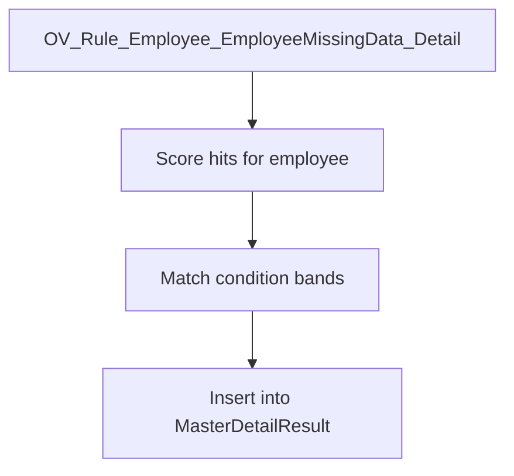

# OV_Rule_Employee_EmployeeMissingData_Detail

## What it does

Scores Employee Missing Data for one employee into the caller's `#MasterDetailResult` (empty profile fields vs joining-days condition bands), skipping active Employee excludes.

## Parameters

| Name | Direction | What it is for |
|---|---|---|
| `@ModuleName` | in | Module label echoed on the result |
| `@CategoryName` | in | Category label echoed on the result |
| `@ActivityName` | in | Activity label echoed on the result |
| `@ActivityDescription` | in | Activity description echoed on the result |
| `@EffectiveDtm` | in | Effective date passed from the activity master |
| `@OccuranceVialoationMasterID` | in | Activity master id whose detail bands apply |
| `@EmployeeId` | in | Employee being scored or shown on the card |
| `@Employerid` | in | Employer scope |

## Call sequence

Calls no other procedures or functions.

## Callers

No other procedure or function calls this object by name. `OV_Rule_DetailSP` builds dynamic `EXEC CategoryMaster.SPName + '_Detail'` for active categories.

## Nested

Calls no other procedures or functions.

## Steps

1. In `HRMS-DATABASE/HRMS/STOREPROCEDURE/OV_Rule_Employee_EmployeeMissingData_Detail.sql`, set `NOCOUNT` and `READ UNCOMMITTED`.
2. Score category-specific hits for `@EmployeeId` / `@Employerid` from `@EffectiveDtm`, applying exclude filters where present.
3. Match hits to activity-detail condition bands.
4. INSERT aggregated point rows into the caller-created `#MasterDetailResult`.
5. Uses `sp_executesql` for dynamic field-template probes (see Unresolved calls).

## Tables

| Table | Read or write |
|---|---|
| `dbo.OccuranceVialoationActivityDetail` | read |
| `dbo.OccuranceVialoationCategory` | read |
| `dbo.OccuranceVialoationCategoryFields` | read |
| `dbo.OccuranceVialoationExclude` | read |
| `dbo.OccuranceVialoationFieldTemplate` | read |
| `dbo.OccuranceVialoationFieldTemplateDetail` | read |
| `dbo.OccuranceVialoationSPCategory` | read |
| `dbo.OccuranceVialoationSPsCategoryMaster` | read |
| `dbo.TEmployee` | read |
| `dbo.TEmployeeInfo` | read |
| `#MasterDetailResult` | write (insert into caller temp) |

## Unresolved calls

This script builds or executes dynamic SQL (`sp_executesql`). Concrete table/column names come from the field template at runtime.

## Flow

