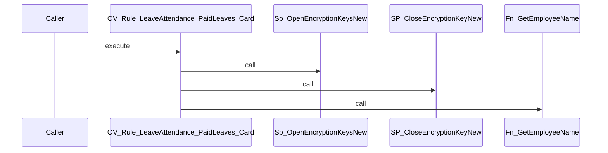
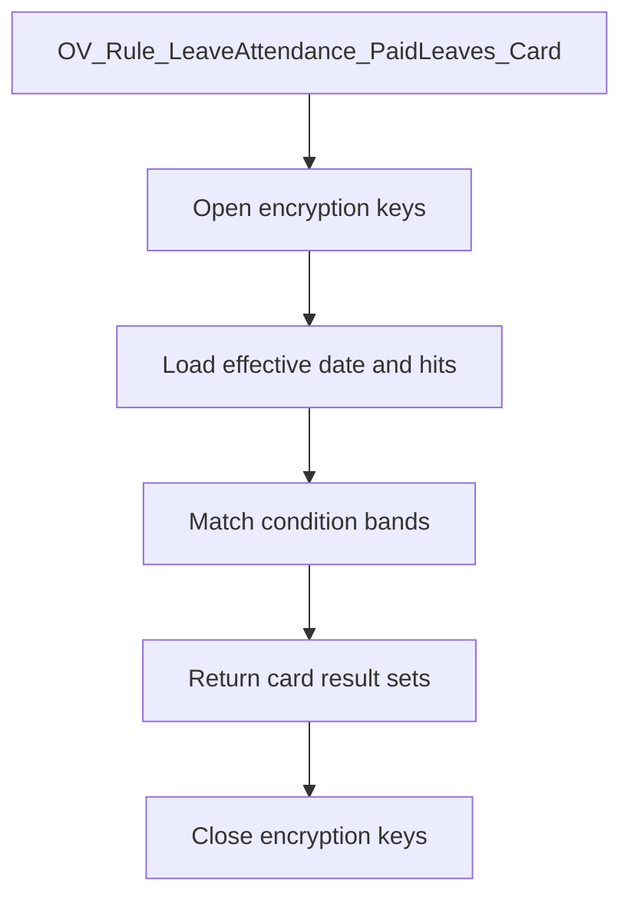

# OV_Rule_LeaveAttendance_PaidLeaves_Card

## What it does

Returns the Paid Leaves View/Edit card for one employee: paid leave requests from `TLeaveRequest` matched to condition bands, with points, managers, and exclude Param keys.

## Parameters

| Name | Direction | What it is for |
|---|---|---|
| `@ModuleName` | in | Module label echoed on the result |
| `@CategoryName` | in | Category label echoed on the result |
| `@ActivityName` | in | Activity label echoed on the result |
| `@ActivityDescription` | in | Activity description echoed on the result |
| `@OccuranceVialoationMasterID` | in | Activity master id whose detail bands apply |
| `@EmployeeId` | in | Employee being scored or shown on the card |
| `@Employerid` | in | Employer scope |

## Call sequence

## Callers

No other procedure or function calls this object. `ViolationsOccurrenceDAL` card handlers in Core API execute it for Violations & Occurrence View/Edit.

## Nested

| Object | Kind | When | Page |
|---|---|---|---|
| `Sp_OpenEncryptionKeysNew` | procedure | Start of run (open keys for name decryption) | [Sp_OpenEncryptionKeysNew](/docs/database/hrms/Sp_OpenEncryptionKeysNew) |
| `SP_CloseEncryptionKeyNew` | procedure | End of run | [SP_CloseEncryptionKeyNew](/docs/database/hrms/SP_CloseEncryptionKeyNew) |
| `Fn_GetEmployeeName` | function | Final select for employee / manager names | [Fn_GetEmployeeName](/docs/database/hrms/Fn_GetEmployeeName) |

## Steps

1. In `HRMS-DATABASE/HRMS/STOREPROCEDURE/OV_Rule_LeaveAttendance_PaidLeaves_Card.sql`, set `NOCOUNT` and `READ UNCOMMITTED`.
2. `EXEC` Sp_OpenEncryptionKeysNew.
3. Load `@EffectiveDtm` from `OccuranceVialoationActivityMaster` for `@OccuranceVialoationMasterID`.
4. Build category-specific hit rows for `@EmployeeId` / `@Employerid` after the effective date (and apply exclude filters where the script does).
5. Match hits to `OccuranceVialoationActivityDetail` condition operators (Below / Between / Above / Equal).
6. Select condition band metadata and the enriched card grid (BU, names via `Fn_GetEmployeeName`, points, Param1-3 / ParamType).
7. `EXEC` SP_CloseEncryptionKeyNew.

## Tables

| Table | Read or write |
|---|---|
| `dbo.OccuranceVialoationActivityDetail` | read |
| `dbo.OccuranceVialoationActivityMaster` | read |
| `dbo.OccuranceVialoationExclude` | read |
| `dbo.TEmployeeInfo` | read |
| `dbo.TLeaveRequest` | read |
| `dbo.TORGChart` | read |
| `dbo.TOrgHierarchyDetails` | read |

## Flow

