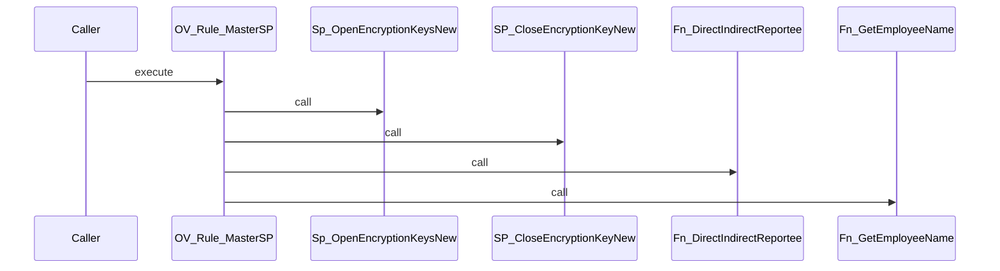
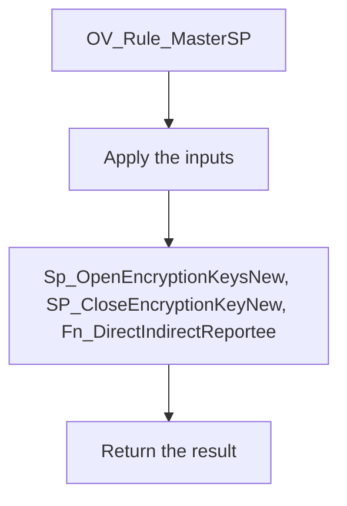

# OV_Rule_MasterSP

## What it does

Returns the violation and occurrence rules that apply to this employee for the requested run (the Home card asks for self).

## Parameters

| Name | Direction | What it is for |
|---|---|---|
| `@EmployerID` | in | Employer that owns the data (`INT`) |
| `@EmployeeId` | in | Employee the Home screen is loading or acting for (`INT`) |
| `@RunFor` | in | Who the violation rules are evaluated for. The Home card sends self (`VARCHAR(50)`) |

## Call sequence

## Callers

No other procedure or function under STOREPROCEDURE or FUNCTIONS executes this object.

## Nested

| Object | Kind | When | Page |
|---|---|---|---|
| `Sp_OpenEncryptionKeysNew` | procedure | Called while this object runs | [Sp_OpenEncryptionKeysNew](/docs/database/hrms/Sp_OpenEncryptionKeysNew) |
| `SP_CloseEncryptionKeyNew` | procedure | Called while this object runs | [SP_CloseEncryptionKeyNew](/docs/database/hrms/SP_CloseEncryptionKeyNew) |
| `Fn_DirectIndirectReportee` | function | Called while this object runs | [Fn_DirectIndirectReportee](/docs/database/hrms/Fn_DirectIndirectReportee) |
| `Fn_GetEmployeeName` | function | Called while this object runs | [Fn_GetEmployeeName](/docs/database/hrms/Fn_GetEmployeeName) |

## Steps

In `HRMS-DATABASE/HRMS/STOREPROCEDURE/OV_Rule_MasterSP.sql`:

1. Returns the violation and occurrence rules that apply to this employee for the requested run (the Home card asks for self).

## Tables

| Table | Read or write |
|---|---|
| `TEmployee` | read |
| `TUserEmployee` | read |
| `TUsers` | read |
| `TRoles` | read |
| `TEmployeeOrgBusinessHead` | read |
| `TEmployeeInfo` | read |
| `OccuranceVialoationActivityMaster` | read |
| `THrmsModules` | read |
| `OccuranceVialoationSPCategory` | read |
| `OccuranceVialoationSPsCategoryMaster` | read |
| `TOrgHierarchyDetails` | read |
| `TORGChart` | read |

## Unresolved calls

This script builds or executes dynamic SQL (`sp_executesql` or `EXEC(@variable)`). The procedure name is not fixed in the script.

## Flow

