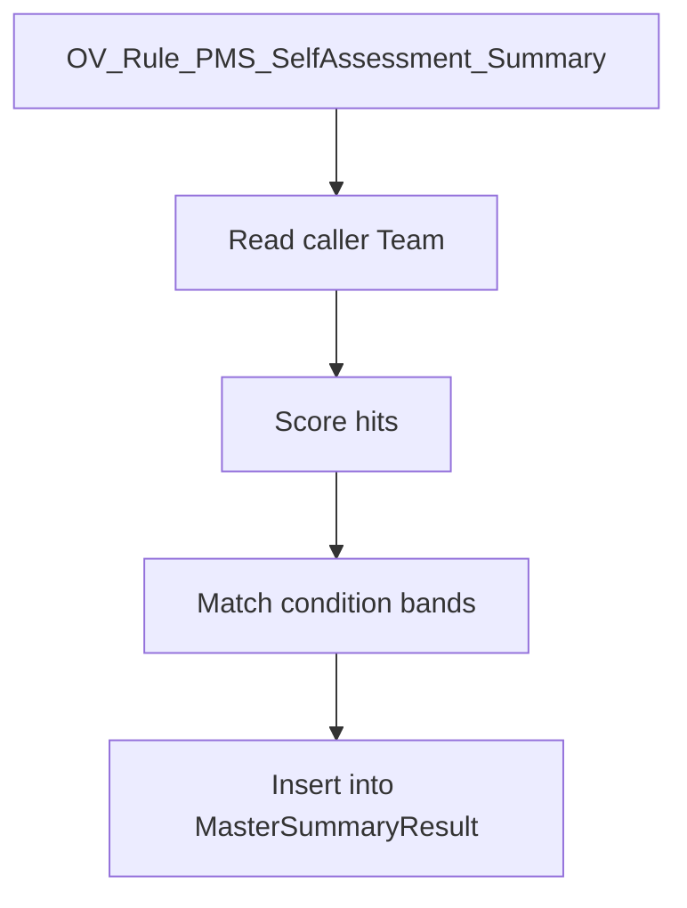

# OV_Rule_PMS_SelfAssessment_Summary

## What it does

Scores PMS SelfAssessment for employees in `#Team` into `#MasterSummaryResult` from overdue self-appraisal / cycle data, skipping active excludes.

## Parameters

| Name | Direction | What it is for |
|---|---|---|
| `@ModuleName` | in | Module label echoed on the result |
| `@CategoryName` | in | Category label echoed on the result |
| `@RunFor` | in | Self vs Team context from Master (team temp table already built by caller) |
| `@ActivityName` | in | Activity label echoed on the result |
| `@ActivityDescription` | in | Activity description echoed on the result |
| `@EffectiveDtm` | in | Effective date passed from the activity master |
| `@OccuranceVialoationMasterID` | in | Activity master id whose detail bands apply |
| `@EmployeeId` | in | Session employee used when Master builds the team |
| `@Employerid` | in | Employer scope |

## Call sequence

Calls no other procedures or functions.

## Callers

No other procedure or function calls this object by name. `OV_Rule_MasterSP` builds dynamic `EXEC CategoryMaster.SPName + '_Summary'` for active categories.

## Nested

Calls no other procedures or functions.

## Steps

1. In `HRMS-DATABASE/HRMS/STOREPROCEDURE/OV_Rule_PMS_SelfAssessment_Summary.sql`, set `NOCOUNT` and `READ UNCOMMITTED`.
2. Read employees from the caller-created `#Team` temp table (populated by `OV_Rule_MasterSP`).
3. Score category-specific hits after `@EffectiveDtm`, applying exclude filters where present.
4. Match hits to activity-detail condition bands.
5. INSERT aggregated point rows into the caller-created `#MasterSummaryResult`.

## Tables

| Table | Read or write |
|---|---|
| `dbo.OccuranceVialoationActivityDetail` | read |
| `dbo.OccuranceVialoationExclude` | read |
| `dbo.TEmployee` | read |
| `dbo.TPMSAppraisalCycles` | read |
| `dbo.TPMSEmployeeSelfAppraisal` | read |
| `#Team` | read (caller temp) |
| `#MasterSummaryResult` | write (insert into caller temp) |

## Flow

