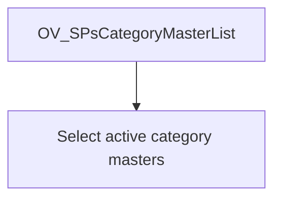

# OV_SPsCategoryMasterList

## What it does

Lists active category master rows that are global (EmployerID -1) or for the given employer, optionally filtered by module.

## Parameters

| Name | Direction | What it is for |
|---|---|---|
| `@EmployerID` | in | Employer scope for non-global masters |
| `@ModuleID` | in | Optional module filter; null returns all modules |

## Call sequence

Calls no other procedures or functions.

## Callers

No other procedure or function calls this object. `ViolationsOccurrenceDAL` in Core API executes it for Setup Violations & Occurrence (Setup Category dropdown).

## Nested

Calls no other procedures or functions.

## Steps

1. In `HRMS-DATABASE/HRMS/STOREPROCEDURE/OV_SPsCategoryMasterList.sql`, select distinct master id, name, SPName, and description from `OccuranceVialoationSPsCategoryMaster`.
2. Require `Active = 1` and (`EmployerID = -1` or `@EmployerID`).
3. When `@ModuleID` is supplied, also require matching `ModuleID`.

## Tables

| Table | Read or write |
|---|---|
| `dbo.OccuranceVialoationSPsCategoryMaster` | read |

## Flow

