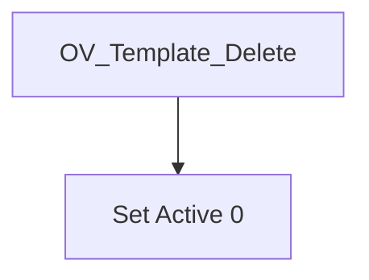

# OV_Template_Delete

## What it does

Soft-deletes a field template header by setting Active to 0 and recording ModifiedBy and ModifiedDate.

## Parameters

| Name | Direction | What it is for |
|---|---|---|
| `@OccuranceVialoationFieldTemplateID` | in | Template to deactivate |
| `@UpdatedBy` | in | Employee id writing the soft delete |

## Call sequence

Calls no other procedures or functions.

## Callers

No other procedure or function calls this object. `ViolationsOccurrenceDAL` in Core API executes it for Setup Violations & Occurrence (template modal delete).

## Nested

Calls no other procedures or functions.

## Steps

1. In `HRMS-DATABASE/HRMS/STOREPROCEDURE/OV_Template_Delete.sql`, update `OccuranceVialoationFieldTemplate` set Active = 0, ModifiedBy, ModifiedDate for the given id.

## Tables

| Table | Read or write |
|---|---|
| `dbo.OccuranceVialoationFieldTemplate` | write |

## Flow

