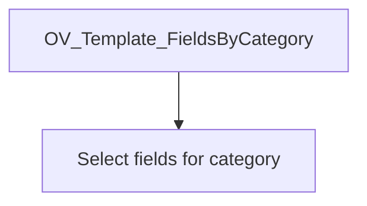

# OV_Template_FieldsByCategory

## What it does

Lists active fields for a template tab category, or all categories when @CategoryID is null.

## Parameters

| Name | Direction | What it is for |
|---|---|---|
| `@CategoryID` | in | Tab category id; null returns all active categories |

## Call sequence

Calls no other procedures or functions.

## Callers

No other procedure or function calls this object. `ViolationsOccurrenceDAL` in Core API executes it for Setup Violations & Occurrence (template modal field multi-select).

## Nested

Calls no other procedures or functions.

## Steps

1. In `HRMS-DATABASE/HRMS/STOREPROCEDURE/OV_Template_FieldsByCategory.sql`, join `OccuranceVialoationCategoryFields` to active `OccuranceVialoationCategory`.
2. Filter fields where CategoryID matches `@CategoryID` or `@CategoryID` is null, and field Active = 1.

## Tables

| Table | Read or write |
|---|---|
| `dbo.OccuranceVialoationCategoryFields` | read |
| `dbo.OccuranceVialoationCategory` | read |

## Flow

