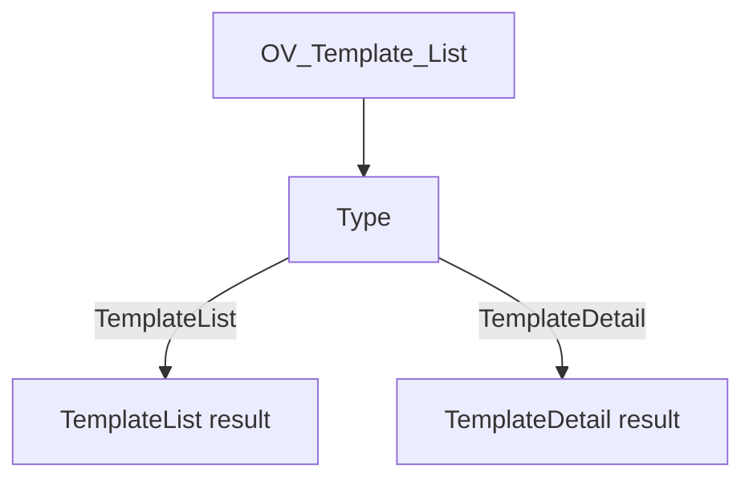

# OV_Template_List

## What it does

Dual-mode list. TemplateList returns employer field templates with IsSelected and Status. TemplateDetail returns one template tab and field breakdown.

## Parameters

| Name | Direction | What it is for |
|---|---|---|
| `@EmployerID` | in | Employer that owns the templates |
| `@OccuranceVialoationFieldTemplateID` | in | Template id for TemplateDetail mode |
| `@Type` | in | TemplateList or TemplateDetail |

## Call sequence

Calls no other procedures or functions.

## Callers

No other procedure or function calls this object. `ViolationsOccurrenceDAL` in Core API executes it for Setup Violations & Occurrence (template modal grid and view).

## Nested

Calls no other procedures or functions.

## Steps

1. In `HRMS-DATABASE/HRMS/STOREPROCEDURE/OV_Template_List.sql`, when `@Type` is TemplateList, join template header to detail for the employer and left join active SPCategory for IsSelected.
2. When `@Type` is TemplateDetail, return active detail rows for the given template with category and field display text.

## Tables

| Table | Read or write |
|---|---|
| `dbo.OccuranceVialoationFieldTemplate` | read |
| `dbo.OccuranceVialoationFieldTemplateDetail` | read |
| `dbo.OccuranceVialoationSPCategory` | read |
| `dbo.OccuranceVialoationCategory` | read |
| `dbo.OccuranceVialoationCategoryFields` | read |

## Flow

