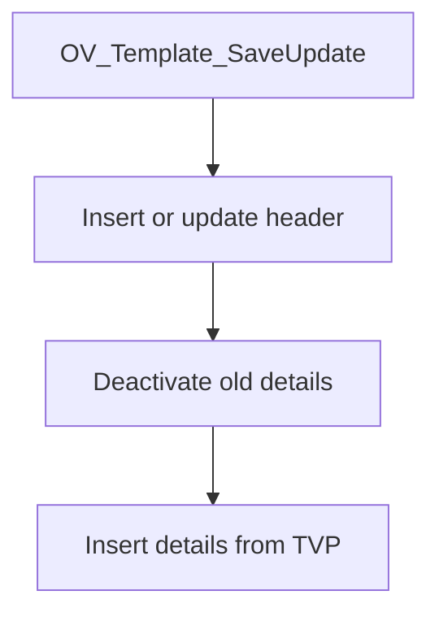

# OV_Template_SaveUpdate

## What it does

Inserts or updates a field template header, soft-deactivates prior detail rows, then re-inserts field ids from the UDT (CSV FieldID values split per category).

## Parameters

| Name | Direction | What it is for |
|---|---|---|
| `@OccuranceVialoationFieldTemplateID` | in | 0 to insert; existing id to update |
| `@OccuranceVialoationFieldTemplateDetail` | in | UDT_OccuranceVialoationFieldTemplateDetail readonly TVP |
| `@TemplateName` | in | Template display name |
| `@EmployerID` | in | Employer owning the template |
| `@IsActive` | in | Active flag on the header |
| `@CreatedBy` | in | Creator on insert |
| `@UpdatedBy` | in | Updater on update and detail soft-delete |

## Call sequence

Calls no other procedures or functions.

## Callers

No other procedure or function calls this object. `ViolationsOccurrenceDAL` in Core API executes it for Setup Violations & Occurrence (template modal save).

## Nested

Calls no other procedures or functions.

## Steps

1. In `HRMS-DATABASE/HRMS/STOREPROCEDURE/OV_Template_SaveUpdate.sql`, insert or update `OccuranceVialoationFieldTemplate`.
2. When the TVP has rows, set existing detail Active = 0 for the template.
3. Loop TVP rows, STRING_SPLIT FieldID CSV values, and insert new `OccuranceVialoationFieldTemplateDetail` rows.

## Tables

| Table | Read or write |
|---|---|
| `dbo.OccuranceVialoationFieldTemplate` | write |
| `dbo.OccuranceVialoationFieldTemplateDetail` | write |

## Flow

