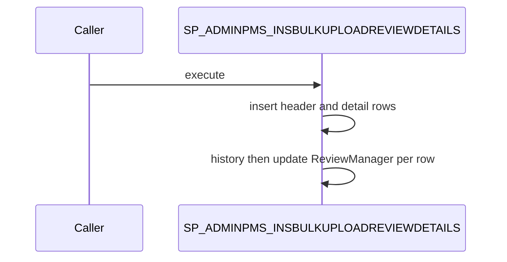
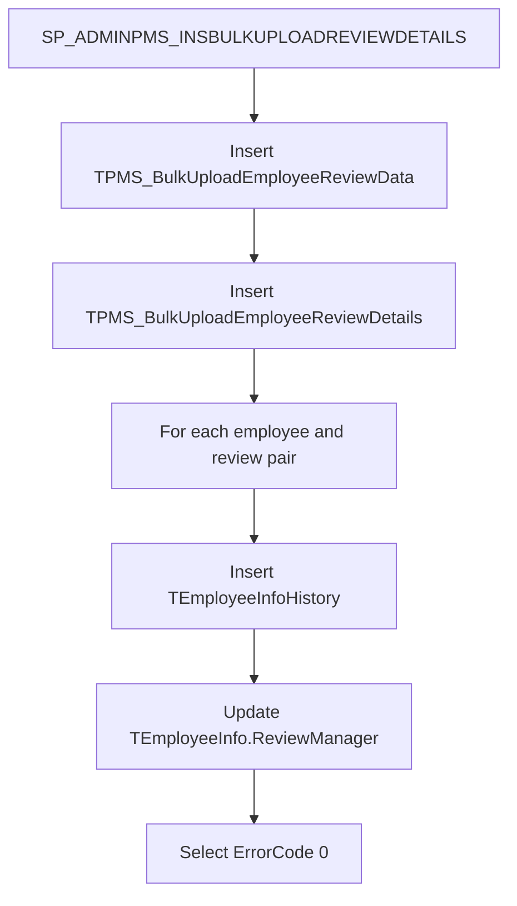

# SP_ADMINPMS_INSBULKUPLOADREVIEWDETAILS

## What it does

Persists a review-manager bulk Excel upload for one employer. It inserts a header row into `TPMS_BulkUploadEmployeeReviewData`, expands the table-valued `@BulkUploadReviewDetails` into `TPMS_BulkUploadEmployeeReviewDetails` (resolving employment numbers to employee ids under that employer), then for each mapped pair snapshots `TEmployeeInfo` into history and sets `TEmployeeInfo.ReviewManager` to the review employee id. Returns `ErrorCode` `0` with an empty `ErrorMsg`.

## Parameters

| Name | Direction | What it is for |
|---|---|---|
| `@EmployerID` | in | Employer for the upload and employment-number lookups |
| `@Comments` | in | Comments stored on the bulk-upload header |
| `@UploadedFileName` | in | Original uploaded file name |
| `@DirectoryPath` | in | Server path where the file was saved |
| `@UploadedBy` | in | Uploader employee id (`CreatedBy`) |
| `@BulkUploadReviewDetails` | in | TVP rows with `EmploymentNumber` and `ReviewEmploymentNumber` |

## Call sequence

Calls no other procedures or functions.

## Callers

No other procedure or function calls this object. `EmployeeDal.InsertEmployeeBulkUploadReviewDetails` executes it from Employee Bulk Update (`EmployeeBulkUpdate.aspx.cs`).

## Nested

Calls no other procedures or functions.

## Steps

From `HRMS-DATABASE/HRMS/STOREPROCEDURE/SP_ADMINPMS_INSBULKUPLOADREVIEWDETAILS.sql`:

1. Insert `TPMS_BulkUploadEmployeeReviewData` with file name, comments, uploader, employer, and directory path; capture `SCOPE_IDENTITY()` as `@lv_BulkId`.
2. Insert detail rows into `TPMS_BulkUploadEmployeeReviewDetails`, resolving each employment number to `TEmployeeInfo.EmployeeId` for `@EmployerID`.
3. Cursor over those detail rows. For each employee id, insert a full `TEmployeeInfoHistory` snapshot (with history `ReviewManager` set to the review employee id) and update live `TEmployeeInfo.ReviewManager`.
4. Select `0` as `ErrorCode` and an empty `ErrorMsg`.

## Tables

| Table | Read or write |
|---|---|
| `dbo.TPMS_BulkUploadEmployeeReviewData` | write |
| `dbo.TPMS_BulkUploadEmployeeReviewDetails` | write |
| `dbo.TEmployeeInfo` | read, write |
| `dbo.TEmployeeInfoHistory` | write |

## Flow

