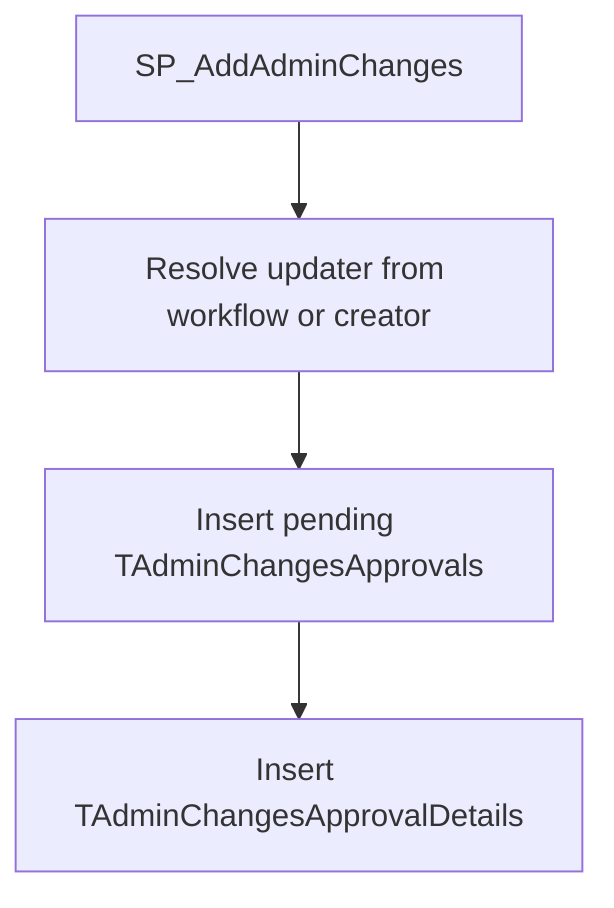

# SP_AddAdminChanges

## What it does

Files one pending admin-configuration change. Setup procedures call it when the page has an approval workflow. It resolves who may update the request, inserts a header in `TAdminChangesApprovals` with status `Pending`, and inserts one detail row per changed field in `TAdminChangesApprovalDetails`.

## Parameters

| Name | Direction | What it is for |
|---|---|---|
| `@ActionType` | in | `INSERT` or `UPDATE` |
| `@PageName` | in | Screen name stored on the request, such as `Set Shifts` |
| `@TableName` | in | Table or tables the change targets |
| `@TableId` | in | Existing row id when the action is an update |
| `@ApprovalDetails` | in | XML of field name, display name, old value, and new value |
| `@CreatedBy` | in | Administrator who submitted the change |
| `@Employerid` | in | Organisation |
| `@RequestType` | in | Module request type, such as `ShiftMaster` |
| `@WorkflowId` | in | Workflow used to pick the updater |
| `@ActionFor` | in | Short label shown beside the page name |

## Call sequence

Calls no other procedures or functions.

## Callers

Procedures that `EXEC` this object from `STOREPROCEDURE/`. Application pages are not listed.

| Object | Kind | Page |
|---|---|---|
| `SP_AdminAM_InsertShift` | procedure | [SP_AdminAM_InsertShift](/docs/database/hrms/SP_AdminAM_InsertShift) |
| `SP_AdminAM_UpdShift` | procedure | No page yet |
| `SP_AdminAM_InsAttendanceCategory` | procedure | [SP_AdminAM_InsAttendanceCategory](/docs/database/hrms/SP_AdminAM_InsAttendanceCategory) |
| `SP_AdminAM_UpdAttendanceCategory` | procedure | No page yet |
| `SP_AdminLM_AddNewLeaveType` | procedure | No page yet |
| `SP_AdminLM_InsLeaveTypeRules` | procedure | No page yet |
| `SP_AdminLM_UpdLeaveTypeRules` | procedure | No page yet |
| `USP_AdminLM_AddNewLeaveType` | procedure | No page yet |
| `USP_LA_LeaveType_Save` | procedure | No page yet |
| `USP_LA_LeaveEvent_Save` | procedure | No page yet |
| `USP_LA_LeaveEvent_Update` | procedure | No page yet |
| `SP_AdminMstr_AddCalendar` | procedure | [SP_AdminMstr_AddCalendar](/docs/database/hrms/SP_AdminMstr_AddCalendar) |
| `SP_AdminMstr_AddHoliday` | procedure | [SP_AdminMstr_AddHoliday](/docs/database/hrms/SP_AdminMstr_AddHoliday) |
| `SP_AdminMstr_UpdHoliday` | procedure | No page yet |
| `SP_AdminMstr_AddWeeklyOff` | procedure | [SP_AdminMstr_AddWeeklyOff](/docs/database/hrms/SP_AdminMstr_AddWeeklyOff) |
| `SP_AdminRoleM_InsRoles` | procedure | [SP_AdminRoleM_InsRoles](/docs/database/hrms/SP_AdminRoleM_InsRoles) |
| `SP_AdminRoleM_UpdRoles` | procedure | [SP_AdminRoleM_UpdRoles](/docs/database/hrms/SP_AdminRoleM_UpdRoles) |
| `SP_AdminMstr_AddResignation` | procedure | [SP_AdminMstr_AddResignation](/docs/database/hrms/SP_AdminMstr_AddResignation) |

## Nested

Calls no other procedures or functions.

## Steps

1. Read `RootEmployerId` from `TEmployerDetails` for `@Employerid`.
2. When a workflow id is passed, pick an active employee mapped to the workflow's first manager role inside that root employer. Otherwise the updater is `@CreatedBy`.
3. Insert `TAdminChangesApprovals` with `ActionStatus = 'Pending'`.
4. Insert `TAdminChangesApprovalDetails` from the `@ApprovalDetails` XML.

## Tables

| Table | Read or write |
|---|---|
| `TEmployerDetails` | read |
| `tRoleEmployeeMapping` | read |
| `TWorkflowDetails` | read |
| `TEmployee` | read |
| `TAdminChangesApprovals` | write |
| `TAdminChangesApprovalDetails` | write |

## Flow

