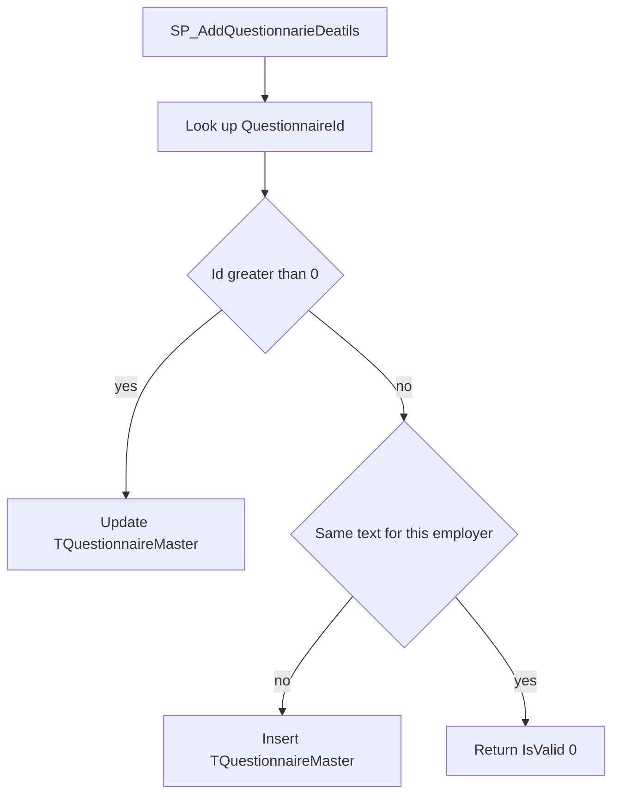

# SP_AddQuestionnarieDeatils

## What it does

Inserts one question or updates an existing one. Add Questionnaire posts both actions here. When the id is already on `TQuestionnaireMaster`, the procedure updates that row. When it is not, the procedure inserts a row only if that question text is not already stored for the employer. A duplicate text returns `IsValid` 0 and does not insert.

## Parameters

| Name | Direction | What it is for |
|---|---|---|
| `@QuestionnaireId` | in | Existing id to update. Default 0, which takes the insert path when that id is not on the table |
| `@QuestionnaireText` | in | Question text |
| `@ControlType` | in | Answer type, such as Option Button or Free Text |
| `@IsActive` | in | Active flag |
| `@IsMandatory` | in | Whether the question is mandatory |
| `@NoOfChoices` | in | How many choice values were sent |
| `@NoOfChoicesText` | in | Choice values joined for storage |
| `@Employerid` | in | Organisation, used on insert and on the duplicate-text check |
| `@AddCommentBox` | in | Whether an extra comment box is shown. Default 0 |
| `@IsCommentMandatory` | in | Whether that comment is mandatory. Default 0 |
| `@IsScoringEnabled` | in | Scoring flag. No default in the procedure |
| `@ScoringMethod` | in | Scoring method. No default in the procedure |
| `@MaxScore` | in | Maximum score. No default in the procedure |

## Call sequence

Calls no other procedures or functions.

## Callers

No other procedure or function calls this object. `recruitmentDAL.AddQuestionnaireDetails` executes it for Add Questionnaire.

## Nested

Calls no other procedures or functions.

## Steps

1. Replace `@QuestionnaireId` with the id found on `TQuestionnaireMaster`. A missing id becomes NULL.
2. When the id is greater than 0, update text, control type, active, mandatory, choices, comment flags, and scoring columns for that id. The update does not filter on `@Employerid`. Return `IsValid` 1 and an empty message.
3. Otherwise count rows with the same `QuestionnaireText` and `Employerid`.
4. When the count is 0, insert one `TQuestionnaireMaster` row and return `IsValid` 1.
5. When the count is not 0, return `IsValid` 0 and `Question Already exist for the given Employer`.

## Tables

| Table | Read or write |
|---|---|
| `TQuestionnaireMaster` | read and write |

## Flow

