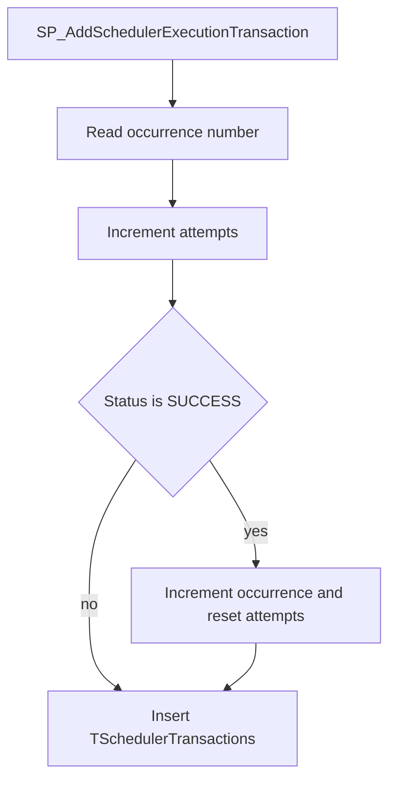

# SP_AddSchedulerExecutionTransaction

## What it does

Bumps the attempt count on a schedule and inserts one `TSchedulerTransactions` row. A `SUCCESS` status also increments `OccurrenceNumber` and resets `Attempts` to 0 before the insert. Skip and Run now call this after `SP_UpdateSchedulerExecutionDetails`.

## Parameters

| Name | Direction | What it is for |
|---|---|---|
| `@Id` | in | Schedule id, stored as `SchedulerId` on the transaction |
| `@ExecutionStartDate` | in | When the attempt started |
| `@ExecutionEndDate` | in | When the attempt ended |
| `@Status` | in | Status text, up to 10 characters |
| `@Details` | in | Detail text, stored in `Detail` |
| `@Errors` | in | Error text |
| `@ExecutionType` | in | `System` or `Manual` as sent by the caller |

## Call sequence

Calls no other procedures or functions.

## Callers

Procedures and functions that call this object.

No other procedure or function calls this object.

## Nested

Calls no other procedures or functions.

## Steps

1. In `HRMS-DATABASE/HRMS/STOREPROCEDURE/SP_AddSchedulerExecutionTransaction.sql`, read `OccurrenceNumber` from `TSchedulers` for `@Id`.

2. Add 1 to `Attempts`, treating null as 0.

3. When `@Status` is `SUCCESS`, add 1 to `OccurrenceNumber`, set `Attempts` back to 0, and add 1 to the local occurrence number used on the insert.

4. Insert `TSchedulerTransactions` with the schedule id, start and end, status, detail, errors, `GETDATE()` as `CreatedDate`, the occurrence number, and the execution type.

## Tables

| Table | Read or write |
|---|---|
| `TSchedulers` | read and write |
| `TSchedulerTransactions` | write |

## Flow

