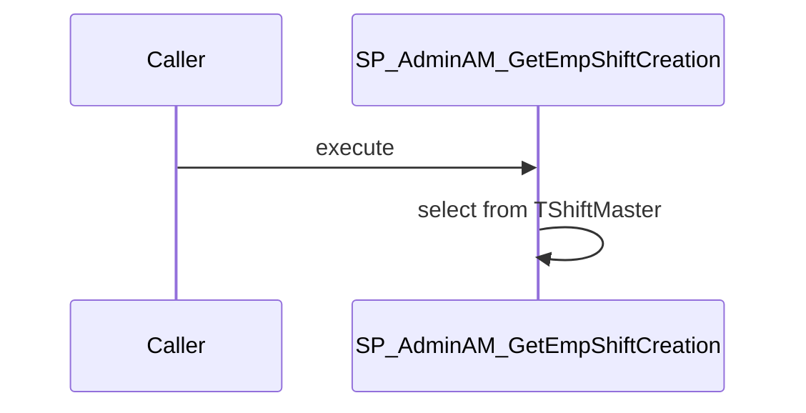
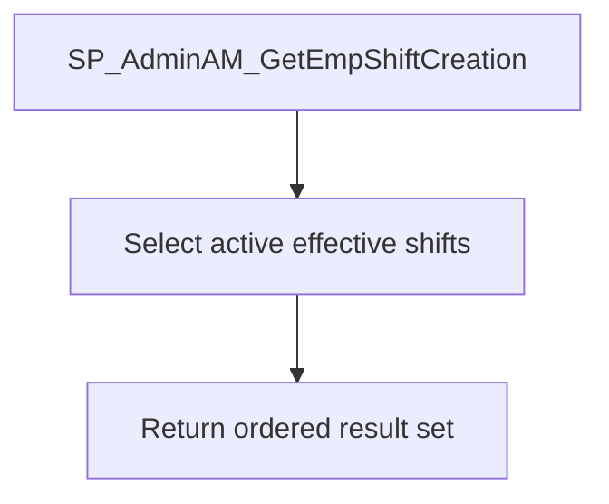

# SP_AdminAM_GetEmpShiftCreation

## What it does

Returns active shift master rows for one employer whose `ShiftEffectiveDate` is on or before today. Columns include shift id, name, effective date, start/end times, grace and absence thresholds, overtime and monitoring settings, and force-timeout. Results are ordered by `ShiftName`.

## Parameters

| Name | Direction | What it is for |
|---|---|---|
| `@Employerid` | in | Employer whose shifts to return |

## Call sequence

Calls no other procedures or functions.

## Callers

No other procedure or function calls this object. `AttendanceManagementDAL.GetEmployeeShiftCreation` executes it from Employee Bulk Update (`EmployeeBulkUpdate.aspx.cs`) and other screens.

## Nested

Calls no other procedures or functions.

## Steps

From `HRMS-DATABASE/HRMS/STOREPROCEDURE/SP_AdminAM_GetEmpShiftCreation.sql`:

1. Select shift columns from `TShiftMaster` where `ShiftEffectiveDate <= getdate()`, `isactive = 1`, and `Employerid = @Employerid`.
2. Order by `ShiftName`.

## Tables

| Table | Read or write |
|---|---|
| `dbo.TShiftMaster` | read |

## Flow

