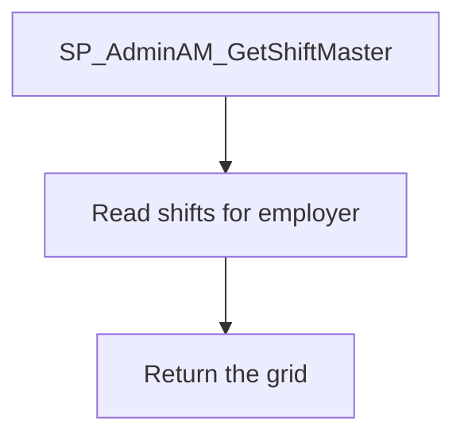

# SP_AdminAM_GetShiftMaster

## What it does

Returns the shift grid for one employer. Each row is the shift header plus its attendance configuration and grace-period rules.

## Parameters

| Name | Direction | What it is for |
|---|---|---|
| `@Employerid` | in | Organisation whose shifts are listed |

## Call sequence

Calls no other procedures or functions.

## Callers

No other procedure or function calls this object. `AttendanceManagementDAL.GetShiftDetailsList` calls it from Attendance Management.

## Nested

Calls no other procedures or functions.

## Steps

1. Select shift columns from `TShiftMaster` for `@Employerid` (`SP_AdminAM_GetShiftMaster.sql`).
2. Join `TShiftAttendanceConfig` and `TShiftGracePeriodRules` on the shift id.

## Tables

| Table | Read or write |
|---|---|
| `TShiftMaster` | read |
| `TShiftAttendanceConfig` | read |
| `TShiftGracePeriodRules` | read |

## Flow

