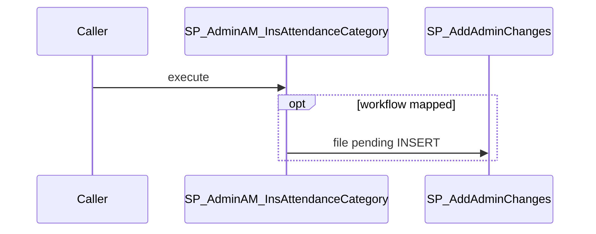
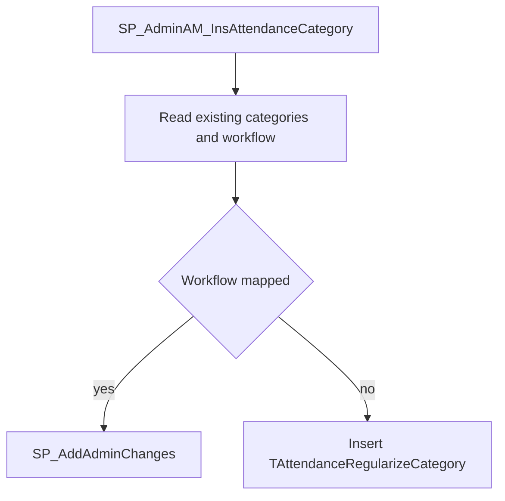

# SP_AdminAM_InsAttendanceCategory

## What it does

Inserts one attendance-regularization category for an employer. The category carries frequency, occurrence, duration, pullback, support-document, auto-approval, and applicability rules (location, business unit, grade, role, and the other audience lists). When a workflow is mapped, the procedure files the insert through `SP_AddAdminChanges` instead of writing the category row.

## Parameters

| Name | Direction | What it is for |
|---|---|---|
| `@RegularizationCategory` | in | Category name |
| `@createdby` | in | Administrator |
| `@Employerid` | in | Organisation |
| `@CategoryType` | in | Category type |
| `@IsActive` | in | Active flag |
| `@Frequency`, `@Occurrence`, `@MaxDuration` | in | How often and how long the category can be used |
| `@IsApplicableOnWeekOff`, `@IsAppplicableOnHoliday` | in | Whether the category applies on those days |
| `@PullbackApplicable` and the past/future pullback columns | in | Pullback window |
| `@IsARNeedSupportDoc`, `@IsARReasonMandatory` | in | Document and reason requirements |
| `@IsStandardRule` and the id-list columns | in | Who the category applies to |
| `@IsARApplyRestriction` and the dated-AR limit columns | in | Whether current, back, and future dates are allowed |

## Call sequence

## Callers

No other procedure or function calls this object. `AttendanceManagementDAL.AddAttendanceCategory` calls it from Attendance Management.

## Nested

| Object | Kind | When | Page |
|---|---|---|---|
| `SP_AddAdminChanges` | procedure | when a workflow is mapped for the category page | [SP_AddAdminChanges](/docs/database/hrms/SP_AddAdminChanges) |

## Steps

1. Read existing categories from `TAttendanceRegularizeCategory` for duplicate and rule checks.
2. Read `TWorkflowManagement` joined to `TModulePages` for a mapped workflow.
3. When that workflow applies, `EXEC SP_AddAdminChanges` with action `INSERT`.
4. Otherwise `INSERT` into `TAttendanceRegularizeCategory`.

## Tables

| Table | Read or write |
|---|---|
| `TAttendanceRegularizeCategory` | read and write |
| `TWorkflowManagement` | read |
| `TModulePages` | read |

## Flow

