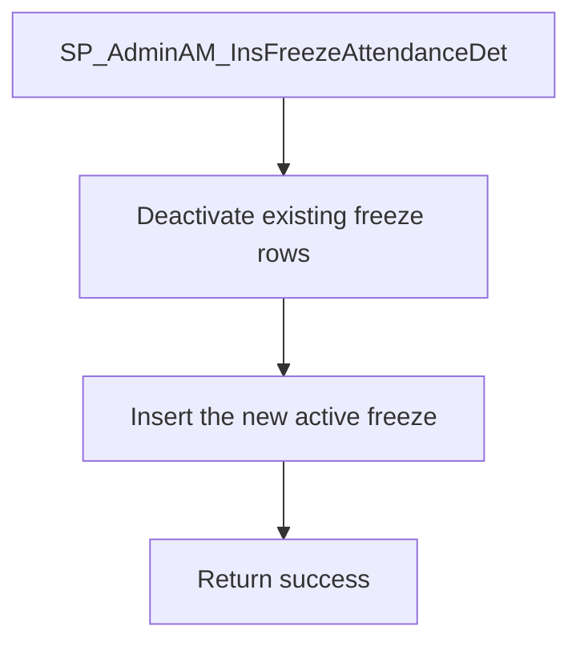

# SP_AdminAM_InsFreezeAttendanceDet

## What it does

Replaces the active attendance freeze for one employer. It marks every existing `TFreezeAttendance` row for that employer inactive, then inserts one active row with the new freeze date, comment, and who it applies to (apply, approval, or both).

## Parameters

| Name | Direction | What it is for |
|---|---|---|
| `@FreezeDate` | in | Last date that stays open |
| `@CreatedBy` | in | Administrator |
| `@CreatedDate` | in | Stamp stored on the row |
| `@Employerid` | in | Organisation |
| `@Comments` | in | Note stored with the freeze |
| `@ApplicableTo` | in | Apply, approval, or both |

## Call sequence

Calls no other procedures or functions.

## Callers

No other procedure or function calls this object. `AttendanceManagementDAL.SaveFreezeAttendanceDetails` calls it from Attendance Management.

## Nested

Calls no other procedures or functions.

## Steps

1. Set `isactive = 'N'` on `TFreezeAttendance` for `@Employerid`.
2. Insert one row with `IsActive = 'Y'`.
3. Return `Errcode` 0 and `Record Inserted Successfully`.

## Tables

| Table | Read or write |
|---|---|
| `TFreezeAttendance` | write |

## Flow

