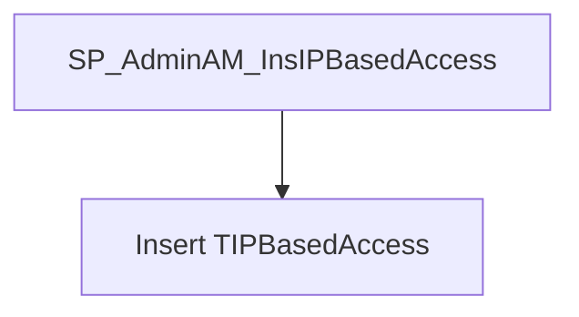

# SP_AdminAM_InsIPBasedAccess

## What it does

Inserts one office IP address. Attendance that is calculated from login and logout uses this list to decide whether the login came from the office.

## Parameters

| Name | Direction | What it is for |
|---|---|---|
| `@StaticIP` | in | IP address |
| `@Description` | in | Label for the address |
| `@createdby` | in | Administrator |
| `@Employerid` | in | Organisation |
| `@IsActive` | in | `Y` or `N` |

## Call sequence

Calls no other procedures or functions.

## Callers

No other procedure or function calls this object. `AttendanceManagementDAL.AddIPBasedAccess` calls it from Attendance Management.

## Nested

Calls no other procedures or functions.

## Steps

1. Insert `TIPBasedAccess` with `createdate = GETDATE()`.

## Tables

| Table | Read or write |
|---|---|
| `TIPBasedAccess` | write |

## Flow

