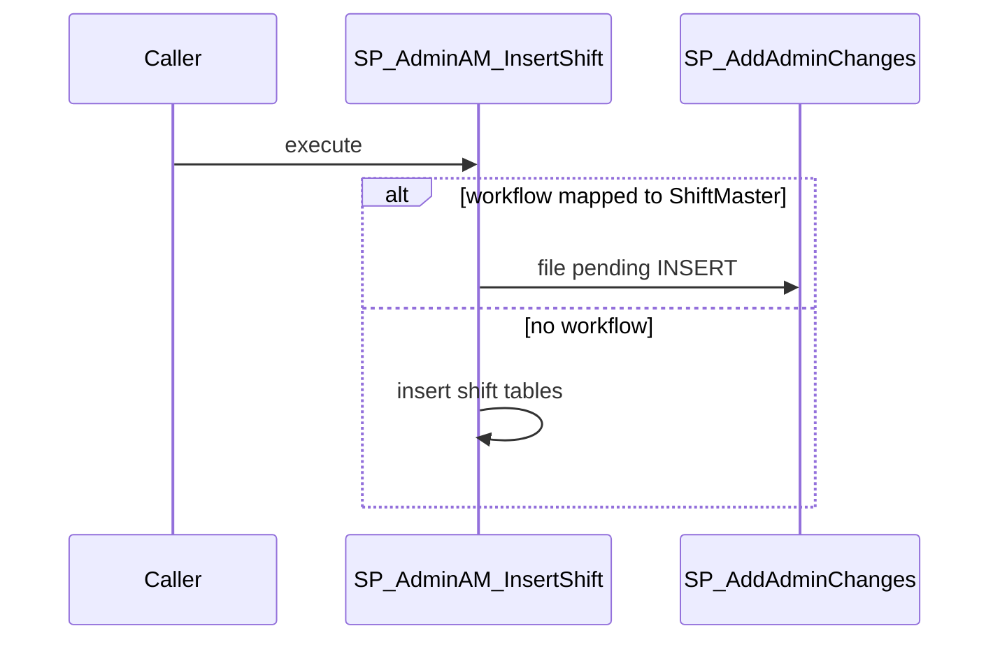
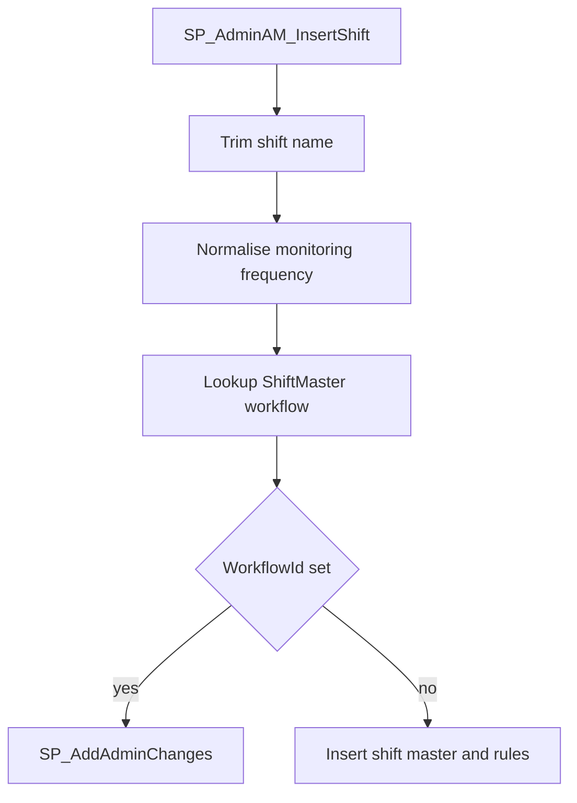

# SP_AdminAM_InsertShift

## What it does

Inserts one shift for an employer, or holds that insert for admin approval. It trims the shift name, normalises the monitoring frequency (daily, weekly, or monthly), and looks up a live workflow whose mapped page is `ShiftMaster`. When that workflow exists, the procedure builds an XML field list and files a pending admin change. When it does not, it inserts `TShiftMaster`, `TShiftAttendanceConfig`, and `TShiftGracePeriodRules`.

## Parameters

| Name | Direction | What it is for |
|---|---|---|
| `@ShiftName` | in | Shift name, trimmed before use |
| `@ShiftEffectiveDate` | in | Date the shift starts |
| `@StartTime`, `@EndTime` | in | Shift window |
| `@ShiftEndsNextDay` | in | End time falls on the next calendar day |
| `@AbsentTime`, `@HalfDayTime`, `@FullDayTime`, `@OverTime`, `@OfficeHourTime` | in | Duration thresholds |
| `@MonitoringFrequency` | in | `D`, `W`, or `M` |
| `@CreatedBy`, `@Employerid` | in | Actor and organisation |
| `@AttendanceBasedOn` | in | How attendance duration is measured |
| `@WeeklyAdjustment`, `@WeeklyTotalHrs`, `@MonthlyAdjustment`, `@MonthlyTotalHrs` | in | Weekly and monthly hour adjustment |
| `@IsGraceperiodApplicable` and the late-in / early-out occurrence columns | in | Two grace rules for late in and early out |
| `@SinglePunchInRule`, `@ConsiderShiftIN` | in | Single-punch rule and which day's shift-in to use |
| `@IsEnableLateMarkPenalty`, `@LateMarkPenaltyAction` | in | Optional late-mark penalty |

The signature continues through `@INTransactionType` and `@OUTTransactionType` in the script. All of them are inputs.

## Call sequence

## Callers

| Object | Kind | Page |
|---|---|---|
| `uspProcessTShiftMaster` | procedure | No page yet |

`AttendanceManagementDAL.AddShiftMaster` calls this procedure from the Attendance Management page. That caller is application code, not a procedure.

## Nested

| Object | Kind | When | Page |
|---|---|---|---|
| `SP_AddAdminChanges` | procedure | when a live `ShiftMaster` workflow exists for the employer | [SP_AddAdminChanges](/docs/database/hrms/SP_AddAdminChanges) |

## Steps

1. Trim `@ShiftName` (`SP_AdminAM_InsertShift.sql`).
2. Clear the day-of-week or day-of-month fields that do not match `@MonitoringFrequency`.
3. Read `WorkflowId` from `TWorkflowManagement` for module page name `ShiftMaster`, this employer, `IsDelete = 0`.
4. When that id is not null, build `@ApprovalDetails` XML and `EXEC SP_AddAdminChanges` with action `INSERT`, page `Set Shifts`, and request type `ShiftMaster`.
5. Otherwise insert `TShiftMaster`, then `TShiftAttendanceConfig`, then `TShiftGracePeriodRules`.

## Tables

| Table | Read or write |
|---|---|
| `TWorkflowManagement` | read |
| `TModulePages` | read |
| `TShiftMaster` | write, when no workflow |
| `TShiftAttendanceConfig` | write, when no workflow |
| `TShiftGracePeriodRules` | write, when no workflow |
| `TAdminChangesApprovals` | write, through `SP_AddAdminChanges` |

## Flow

